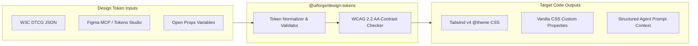

# Category 04 — Design Systems & Design Token Ecosystems

**Document ID:** `UIF-CAT-003`  
**Phase:** 02.1 — Open-Source Ecosystem Discovery & Intelligence  
**Category Focus:** Design Token Standards, Compilers, Color Scales & Theme Systems  
**Date:** November 2026  

---

## 1. Category Overview

Design tokens are the foundational contract linking visual design decisions (colors, typography, spacing, elevation, animation timings) to production code. Without structured design tokens, AI coding agents generate arbitrary, unmaintainable values (`margin: 17px`, `color: #4b6a9f`).

This category evaluates the specifications, transformation tools, and established design systems that inform `@uiforge/design-tokens`.

---

## 2. In-Depth Comparative Analysis

| Candidate ID | Project / Standard | Type | Output Formats | Strengths | UIForge Strategic Role |
| :--- | :--- | :--- | :--- | :--- | :--- |
| `OS-TOKN-01` | **W3C DTCG Specification** | Token Format Spec | JSON schema (`$value`, `$type`) | Official industry standard for cross-tool token exchange. | **`[REF]` Foundational Standard (P0)** |
| `OS-TOKN-02` | **Style Dictionary** (`style-dictionary/style-dictionary`) | Token Build System | CSS, SCSS, Tailwind, iOS Swift, Android XML | Mature, highly extensible token compiler with deep transform hooks. | **`[DEP]` / `[REF]` Core Build Tool (P1)** |
| `OS-TOKN-03` | **Open Props** (`argyleink/open-props`) | CSS Variable Library | Native CSS Custom Properties | Pre-computed scales for fluid typography, easing curves, and shadows. | **`[REG]` / `[REF]` Supported Token Base (P1)** |
| `OS-TOKN-04` | **Tailwind CSS v4** (`tailwindlabs/tailwindcss`) | Utility CSS Compiler | Native CSS `@theme` variables | Deprecates JS configs in favor of CSS variables; instant build times. | **`[DEP]` / `[REF]` Target Styling Layer (P0)** |
| `OS-TOKN-05` | **Radix Colors** (`radix-ui/colors`) | Palette System | CSS variables, JavaScript objects | 12-step accessible color scales with guaranteed contrast in dark/light modes. | **`[REG]` / `[DEP]` Primary Color Foundation (P1)** |
| `OS-TOKN-06` | **Tokens Studio SD Transforms** | Transform Library | Style Dictionary compatible tokens | Bridges Figma Tokens Studio exports directly to Style Dictionary builds. | **`[DEP]` / `[REF]` Figma Token Bridge (P1)** |
| `OS-TOKN-07` | **Primer Primitives** (`primer/primitives`) | Production Design System | JSON, CSS, TS, SCSS | GitHub's battle-tested semantic color and spacing token architecture. | `[REF]` Semantic Token Reference (P2) |
| `OS-TOKN-08` | **IBM Carbon** (`carbon-design-system/carbon`) | Production Design System | CSS, SCSS, Token JSON | High-density enterprise design tokens optimized for complex data UI. | `[REF]` Enterprise Reference (P2) |

---

## 3. The 12-Step Accessible Color System (Radix Colors)

A frequent failure mode in AI-generated frontend code is poor contrast between background, border, text, and hover states. **Radix Colors** solves this with a mathematically calibrated 12-step scale:

```
Step 1–2:  App backgrounds & subtle container fills
Step 3–5:  Interactive component backgrounds (normal, hover, active)
Step 6–8:  Subtle & strong component borders / focus outlines
Step 9–10: Solid high-contrast interactive backgrounds (buttons, badges)
Step 11:   Low-contrast secondary / muted text
Step 12:   High-contrast primary text & headlines (passes 4.5:1 WCAG AA)
```

UIForge incorporates this 12-step semantic mapping into `@uiforge/design-tokens`, preventing coding agents from generating unreadable button text or mismatched border contrasts.

---

## 4. The Token Normalization Pipeline in UIForge



This pipeline ensures that coding agents receive unambiguous, mathematically verified design constraints before writing a single line of markup.
