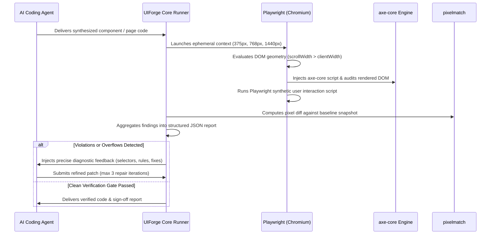

# UIForge Research — Testing, Verification & Frontend Quality Ecosystem

**Document ID:** `UIF-OS-007`  
**Phase:** 02.1 — Open-Source Ecosystem Discovery & Intelligence  
**Status:** Verification Infrastructure Architecture Reference  
**Date:** November 2026  

---

## 1. Overview of the Quality Ecosystem

Frontend engineering quality cannot be assessed solely through static textual reasoning or single-shot multimodal vision models. Complete quality verification requires an **independent, deterministic headless execution harness** capable of rendering pages in real browser engines and evaluating accessibility, responsive layout reflow, and interactive state machines.

This document synthesizes the open-source tools discovered across Categories 10 (Accessibility), 13 (Browser Testing), and 14 (Visual Regression).

---

## 2. Headless Browser Automation (Category 13)

### 2.1 Microsoft Playwright (`microsoft/playwright`) — Foundational (P0)
- **Role in UIForge:** The core execution engine for `@uiforge/browser-automation`.
- **Capabilities:**
  - Multi-Browser Coverage: Headless Chromium, Firefox, WebKit.
  - Viewport Emulation: High-precision viewport switching (Mobile 375px, Tablet 768px, Desktop 1440px).
  - Performance: Ephemeral browser context creation in sub-150ms.
  - Deep Observability: Console log capture, uncaught exception interception, network request mocking, and trace recordings.
- **Comparison vs. Puppeteer & Selenium:**
  - Puppeteer is Chromium-focused; Playwright provides cross-engine parity and superior multi-tab/iframe isolation.
  - Selenium has excessive WebDriver process overhead and slower startup latencies.

### 2.2 Sandboxed Execution Infrastructure (`testcontainers/testcontainers-node`)
- When evaluating existing or untrusted user codebases, running a local dev server directly on the host machine presents security risks (arbitrary script execution, environment variable leakage).
- **Testcontainers** enables programmatic lifecycle management of isolated Docker containers with loopback networking, isolating untrusted code during browser evaluation.

---

## 3. Programmatic Accessibility Verification (Category 10)

### 3.1 axe-core (`dequelabs/axe-core` & `@axe-core/playwright`) — Foundational (P0)
- **Role in UIForge:** Core programmatic engine for `@uiforge/a11y-engine`.
- **Methodology:** Injected directly into the live rendered DOM in headless Chromium via Playwright. Executes 90+ programmatic rules testing:
  - Color contrast ratios (4.5:1 normal text, 3:1 large text, 3:1 non-text objects).
  - Missing form labels and unlabelled inputs (`aria-label`, `<label>`).
  - Missing image `alt` attributes or empty non-decorative descriptions.
  - Invalid ARIA roles, states, and properties.
  - Duplicate DOM IDs that break assistive technology mapping.
- **Output:** Returns zero-hallucination JSON diagnostics with exact CSS selectors, severity classifications (Critical, Serious, Moderate, Minor), and WCAG rule identifiers.

### 3.2 Critical Boundary: Automated Scanning vs. True WCAG Conformance
In strict accordance with UIForge engineering invariants:
> **An axe-clean application is NOT automatically WCAG 2.2 AA compliant.**
- Industry research confirms that automated tools like `axe-core` detect approximately **30% to 57% of potential accessibility violations**.
- The remaining criteria require human and assistive-technology verification:
  1. *Logical Focus Order:* Does tabbing through the page follow a coherent visual sequence?
  2. *Focus Traps:* Do modal dialogs and slide-over drawers trap keyboard focus and dismiss on `Escape`?
  3. *Visible Focus Indicators:* Are focus rings visible (`:focus-visible`) across all interactive elements?
  4. *Semantic Appropriateness:* Does an `alt` description meaningfully describe image content?
  5. *Screen Reader Fidelity:* Does VoiceOver or NVDA announce dynamic state changes properly?
- **UIForge Strategy:** Combines automated `@axe-core/playwright` audits with synthetic Playwright keyboard navigation scripts and structured developer checklists.

---

## 4. Visual Regression & Diffing (Category 14)

### 4.1 Mapbox pixelmatch (`mapbox/pixelmatch`) — Foundational (P0)
- **Role in UIForge:** High-speed pixel comparison for Workflow B (Existing-Project Improvement).
- **Performance:** Processes full 1080p images in under 50ms in pure JavaScript without native C++ compilation dependencies.
- **Workflow:** Takes baseline screenshot $A$ and modified screenshot $B$, computes an exact difference mask highlighting additions, deletions, and layout shifts in high-contrast magenta.

### 4.2 Perceptual Color Diffing (`looks-same`)
- Implements the **CIEDE2000** color difference algorithm. Used when minor sub-pixel font anti-aliasing variations or GPU rendering differences trigger false-positive pixel differences in `pixelmatch`.

---

## 5. The Closed-Loop Autonomous Evaluation Harness

UIForge combines these open-source tools into an **automated multi-pass evaluation harness**:

This closed-loop system replaces unguided guesswork with deterministic, verifiable engineering feedback.
