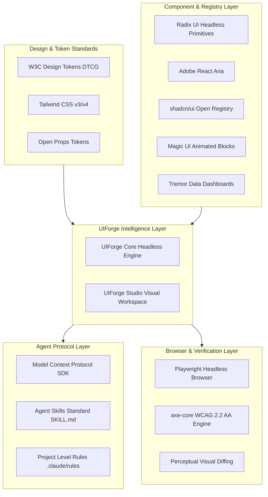

# UIForge Research — Open-Source & Industry Ecosystem Map

**Document ID:** `UIF-ECO-001`  
**Phase:** 01 — Product Research, Problem Validation, Competitive Intelligence & Product Differentiation  
**Status:** Architecture Reference  
**Date:** November 2026  

---

## 1. Architectural Landscape Overview

UIForge does not operate in isolation. It sits at the intersection of five rapidly converging ecosystems:
1. **Modern Headless Component & Registry Architectures** (shadcn/ui, Radix UI, React Aria).
2. **Design Token Standards & Utility Styling** (Tailwind CSS v4, W3C DTCG).
3. **AI Agent Protocols & Tooling Standards** (Model Context Protocol / MCP, Agent Skills).
4. **Automated Browser Verification & Quality Engines** (Playwright, axe-core).
5. **AST-Based Static Analysis & Code Transformation Tooling** (Babel, TypeScript Compiler API).

---

## 2. In-Depth Category Audits

### 8.1 Component Systems
- **shadcn/ui**:
  - *Philosophy:* Uncompiled code ownership. Components live in `components/ui/` within the user's project, configured via `components.json`.
  - *Accessibility:* Relies on Radix UI primitives; meets WAI-ARIA authoring practices.
  - *Framework Support:* React (Next.js, Vite, Remix). Unofficial ports exist for Vue (shadcn-vue) and Svelte (shadcn-svelte).
  - *Role in UIForge:* **Supported Reference Standard**. UIForge will support shadcn/ui component patterns and registry schemas natively, while ensuring the platform can also discover and support Radix UI primitives, React Aria, and custom repository component systems without forcing shadcn onto every codebase.
- **Radix UI Primitives**:
  - *Philosophy:* Completely unstyled, accessible UI building blocks (Dialog, DropdownMenu, Tooltip, Popover).
  - *Customization:* 100% style-agnostic; styled via Tailwind or custom CSS.
  - *Role in UIForge:* Underlying behavioral primitive layer for interactive state modeling.
- **React Aria (Adobe Spectrum)**:
  - *Philosophy:* Enterprise accessibility hooks and components with deep support for mobile touch gestures, screen reader quirks, and complex keyboard navigation.
  - *Role in UIForge:* High-accessibility reference benchmark and alternative primitive foundation for complex data-entry components.

---

### 8.2 Component Registries
- **shadcn Registry Specification**:
  - *Structure:* Exposes a standard JSON schema (`registry.json`) detailing component names, dependencies, devDependencies, registryDependencies, and file contents.
  - *Discovery & Installation:* Enabled via `npx shadcn add <component-name>` or custom registry URLs (`npx shadcn add https://example.com/r/my-component.json`).
  - *Role in UIForge:* UIForge's **Component Registry Engine (Phase 10)** will implement the official shadcn registry specification, allowing UIForge-curated components to be installed seamlessly using native shadcn tooling.

---

### 8.3 Visual Component Libraries
- **Magic UI (MIT Core)**:
  - *Visual Style:* High-polish modern SaaS aesthetics: bento grids, animated beam borders, retro grids, marquee text.
  - *Animation Stack:* Framer Motion, Tailwind CSS.
  - *Role in UIForge:* Ingestion target for curated, visual-direction-specific components (e.g., Marketing / SaaS Landing Page archetypes). Must be wrapped in `prefers-reduced-motion` safety adapters.
- **Aceternity UI (Proprietary)**:
  - *Licensing Hazard:* **Strictly forbidden from direct registry bundling** due to commercial redistribution terms.
  - *Role in UIForge:* Reference only for aesthetic trend analysis.
- **React Bits (MIT)**:
  - *Visual Style:* Creative web animations, text reveal effects, particle backgrounds.
  - *Role in UIForge:* Secondary reference for micro-interactions; requires manual TypeScript and a11y vetting before inclusion.

---

### 8.4 Design Systems & Styling
- **Tailwind CSS (v3 / v4)**:
  - *Architecture:* Utility-first CSS compiler. v4 introduces native CSS `@theme` directives and zero-config builds.
  - *Semantic Variables:* Configures colors as CSS variables (`hsl(var(--primary))`), enabling dynamic dark/light theme switching.
  - *Role in UIForge:* Target styling language for all synthesized code due to its predictable, machine-analyzable classname syntax.
- **Open Props & W3C DTCG Tokens**:
  - *Architecture:* CSS Custom Properties embodying typographic ramps, fluid spacing, and elevation shadows.
  - *Role in UIForge:* Schema inspiration for `@uiforge/design-tokens` (Phase 09).

---

### 8.5 Dashboard & Data-Heavy Components
- **Tremor (Apache-2.0)**:
  - *Focus:* Enterprise dashboards, KPI cards, area charts, bar lists, interactive data filters.
  - *Dependencies:* Tailwind CSS, Radix UI, Recharts.
  - *Role in UIForge:* Standard component set for Analytics, CRM, and B2B SaaS application archetypes.

---

### 8.6 Design-to-Code Platforms
- **Figma Dev Mode & Code Connect**:
  - *Mechanism:* Links Figma components directly to production code in GitHub.
  - *Role in UIForge:* **Integration Target**. UIForge can consume Figma Code Connect mappings to ensure coding agents reuse verified production components.
- **Figma MCP Server**:
  - *Mechanism:* Exposes design tokens and frame node hierarchies over MCP.
  - *Role in UIForge:* External context source for Phase 08 (Design Intelligence).

---

### 8.7 AI Coding Agents & Ecosystem
- **OpenCode**: Open-source, terminal-based AI coding agent. Integrates via CLI commands, custom tool configurations, and local git hooks.
- **Claude Code (Anthropic)**: Terminal coding agent. Integrates via `.claude/rules`, custom Agent Skills, and local MCP server configs.
- **OpenAI Codex / Operator**: OpenAI's agent ecosystem. Integrates via tool calling, function calling, and structured outputs.
- **Generic MCP Clients (Cursor, Windsurf, Zed)**: Multi-agent IDE clients capable of communicating with `@uiforge/mcp-server` over stdio.

---

### 8.8 Agent Skills Specification
- **Standard Format**: `SKILL.md` frontmatter with YAML metadata (`name`, `description`, `parameters`) accompanied by executable helper scripts in `scripts/` or `resources/`.
- **Role in UIForge**: UIForge will package its domain intelligence as standardized Agent Skills (e.g., `uiforge-design-system`, `uiforge-a11y-audit`) that any compatible agent can discover and invoke dynamically.

---

### 8.9 Model Context Protocol (MCP)
- **Protocol**: JSON-RPC 2.0 transport over `stdio` or Server-Sent Events (SSE).
- **Core Primitives**:
  1. *Tools:* Executable functions (e.g., `analyze_project`, `evaluate_page`, `discover_components`).
  2. *Resources:* Read-only contextual data (e.g., `uiforge://tokens/current`, `uiforge://audit/latest`).
  3. *Prompts:* Structured prompt templates guiding agent implementation steps.
- **Role in UIForge**: `@uiforge/mcp-server` will expose all Core engines directly to any MCP-compliant agent.

---

### 8.10 Browser Automation & Verification
- **Playwright**:
  - *Capabilities:* Headless execution across Chromium, Firefox, WebKit. Precise viewport emulation (e.g., 375x667 mobile, 768x1024 tablet, 1440x900 desktop).
  - *Performance:* Ephemeral browser context creation in <150ms.
  - *Role in UIForge:* The core runtime harness for Phase 14 (Evaluation Engine).

---

### 8.11 Accessibility Testing
- **axe-core (@axe-core/playwright)**:
  - *Capabilities:* Deterministic checking of ~90 WCAG 2.0/2.1/2.2 rules (color contrast, missing ARIA roles, unlabelled inputs, broken focus order).
  - *Zero Hallucination:* Returns programmatic JSON results containing exact DOM selectors and severity scores.
  - *Role in UIForge:* An automated accessibility testing layer in `@uiforge/a11y-engine`, supplemented by manual keyboard testing and semantic review.

---

### 8.12 Visual Regression
- **Pixelmatch / Looks-Same**:
  - *Capabilities:* Fast, lightweight pixel-level image comparison in pure Node.js.
  - *Masking:* Ability to ignore dynamic dates or animated regions.
  - *Role in UIForge:* Side-by-side visual difference computation for Workflow B (before-and-after improvement reports).
