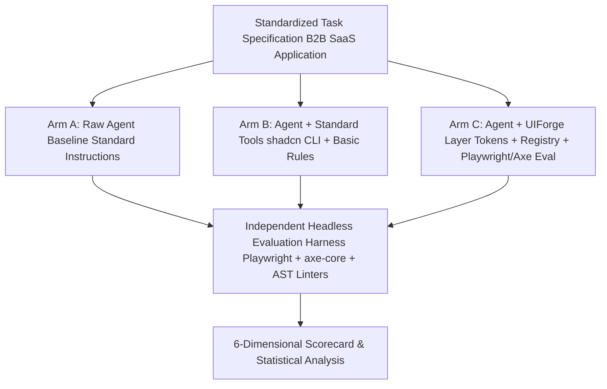

# UIForge Research Protocol — 3-Arm Baseline Measurement Plan

**Document ID:** `UIF-EXP-003`  
**Phase:** 01 — Product Research, Problem Validation, Competitive Intelligence & Product Differentiation  
**Status:** Ready for Execution (Benchmark Trial Protocol)  
**Date:** November 2026  

---

## 1. Study Objective & Hypothesis

The goal of this randomized, controlled experimental plan is to establish **empirical, reproducible baseline measurements** of AI frontend generation quality and evaluate the exact statistical delta delivered by UIForge.

### Formal Null Hypothesis ($H_0$)
> There is no statistically significant difference in frontend defect rates, accessibility compliance, responsive stability, or developer correction turns between an AI coding agent operating with standard prompt instructions versus an agent assisted by the UIForge intelligence and evaluation harness.

---

## 2. Experimental Design: 3-Arm Randomized Trial

To isolate the exact causal mechanism of quality improvements, tasks will be executed across three strictly controlled experimental arms:

### The Three Experimental Arms
1. **Arm A (Control / Raw Baseline):** Connected coding agent (Claude Code / OpenCode using Claude 3.5 Sonnet / GPT-4o) provided with standard, natural-language frontend prompts. No specialized design tokens, no automated browser testing, no external evaluation.
2. **Arm B (Conventional Tools / Component Registry):** Connected coding agent equipped with standard ecosystem tools: initialized with `shadcn-ui` CLI, standard Tailwind CSS, and a general prompt instructing adherence to accessibility and responsive design.
3. **Arm C (Experimental / UIForge Layer):** Connected coding agent orchestrated through the UIForge framework:
   - Upstream: `@uiforge/contracts` and `@uiforge/design-tokens` (DTCG format).
   - Component Layer: `@uiforge/component-registry` metadata and state machine schemas.
   - Downstream: Automated `@uiforge/browser-automation` (Playwright multi-viewport) + `@axe-core/playwright` evaluation loop with max 3 targeted refinement passes.

---

## 3. Strict Experimental Controls

To eliminate confounding variables, all three arms will adhere to identical environmental invariants:
- **Underlying Model Version:** Fixed to an identical model snapshot (e.g., `claude-3-5-sonnet-20241022` or `gpt-4o-2024-08-06`). Temperature set to $0.2$.
- **Runtime Environment:** Isolated Docker container (Ubuntu 24.04 LTS, Node.js 22 LTS, pnpm).
- **Network Boundaries:** Local loopback only during execution; mock data APIs to prevent external network latency variance.
- **Sample Size ($N$):** 10 randomized task runs per arm (total $N = 30$ greenfield runs, $N = 30$ brownfield runs) to establish statistical power and calculate 95% confidence intervals.

---

## 4. The 6-Dimensional Measurement Framework

Evaluation must not collapse into an arbitrary subjective score. Each of the six independent quality dimensions is measured using specific, reproducible criteria:

| Quality Dimension | Specific Measurable Indicators | Deterministic vs Model-Assisted | Measurement Tool / Method |
| :--- | :--- | :---: | :--- |
| **1. Accessibility (a11y)** | - Automated WCAG 2.2 AA violations - Contrast ratio verification (4.5:1 normal text, 3:1 large text, 3:1 non-text objects) - Keyboard focus-visible and focus-trap behavior | **Deterministic + Scripted** | `@axe-core/playwright` JSON output + computed contrast algorithms + Playwright keyboard navigation scripts |
| **2. Responsiveness** | - Horizontal scroll overflows at 375px (`scrollWidth > clientWidth`) - Element clipping, line wrapping, and overlapping bounds - Touch target sizes ($\ge 24\text{px} \times 24\text{px}$ per WCAG 2.5.8) - Visual layout reflow across 375px, 768px, and 1440px | **Deterministic + Visual Review** | Playwright headless DOM script measuring bounding rects + visual reflow review |
| **3. Functional Integrity** | - Requirement-based interaction test passes - Ratio of working stateful controls vs. inert facades - Form validation error states on invalid/empty submit - Presence of loading, empty, and error state transitions | **Deterministic** | Playwright synthetic interaction suite executing user journey scripts |
| **4. Visual & Typographic Quality** | - Adherence to modular type scale ratio ($R^2$ fit) - Line length measure check (evaluating 45–85 character readability heuristic) - Visual hierarchy contrast and layout density balance | **Hybrid** | AST computed CSS styles + blinded pairwise human design review |
| **5. UX & Information Architecture** | - Navigation hierarchy clarity & breadcrumb presence - Content grouping and logical visual scanning flow - User journey step count to complete core action | **Model-Assisted / Human** | Standardized UX heuristic checklist (Nielsen Norman 10 heuristics) |
| **6. Engineering Quality** | - Lines of code churn and duplicate UI primitive count - Cyclomatic complexity and file length signals - Regression rate in brownfield tasks (passing existing unit/E2E tests) - TypeScript compilation pass (`tsc --noEmit`) | **Deterministic** | `git diff --stat`, ESLint AST linter, `tsc`, and `vitest` regression runner |

---

## 5. Economic & Resource Efficiency Metrics

In addition to output quality, the experiment tracks the exact resource expenditure of each approach:
1. **Total Elapsed Execution Time:** Wall-clock seconds from initial prompt submission to verified production-ready code.
2. **Correction Turn Count:** Number of conversational repair turns required to resolve build or layout failures.
3. **Total Token Expenditure:** Cumulative input and output token consumption across all turns.
4. **Financial API Cost:** Total dollar cost based on model provider per-token pricing.

---

## 6. Statistical Analysis Plan

- **Descriptive Statistics:** Mean, median, standard deviation, and interquartile range (IQR) for all quantitative metrics across the 10 runs per arm.
- **Inferential Testing:** 
  - For continuous parametric metrics (time, token count): One-way ANOVA followed by Tukey's Honest Significant Difference (HSD) post-hoc test.
  - For discrete count data (a11y violations, overflow elements, regression count): Non-parametric Kruskal-Wallis test followed by Mann-Whitney U pairwise tests.
- **Significance Threshold:** $\alpha = 0.05$ with Bonferroni correction for multiple hypothesis comparisons.

---

## 7. Compliance Statement: Zero Pre-Emptive Claims

In strict accordance with Phase 01 guidelines:
- **No benchmark improvements are claimed in this research document.**
- All comparative cells in future reporting will remain blank or marked `PENDING EXECUTION` until the full test battery is physically run and verified in Phase 19.
