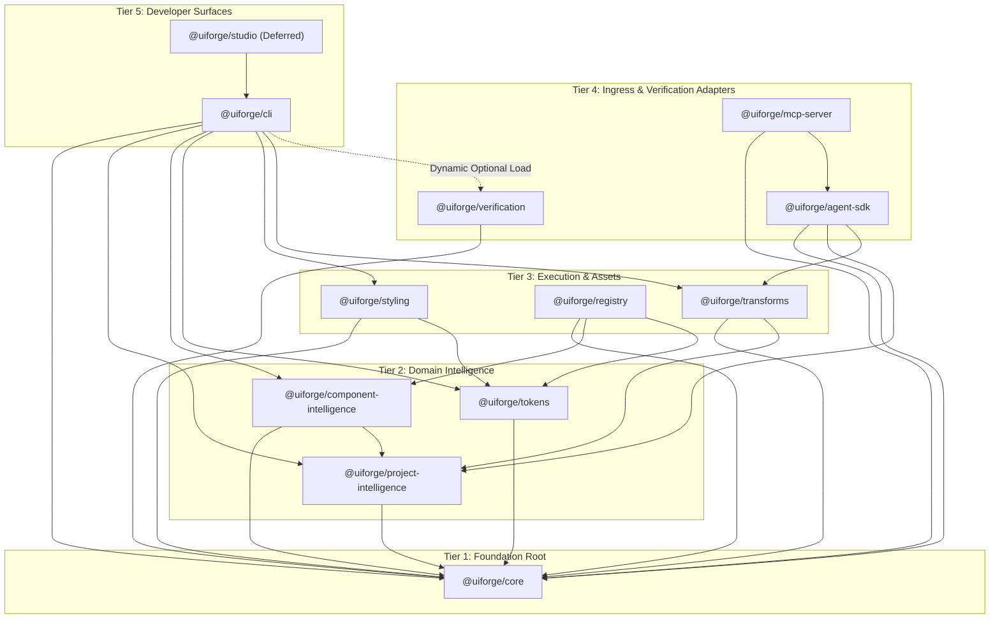

# UIForge Phase 02.2 — Dependency Boundaries & Package Architecture

**Document Identifier:** `UIF-PH02.2-DEPENDENCY-ARCHITECTURE`  
**Classification:** Monorepo Topology, Module Boundaries & Dependency Governance Specification  
**Parent Phase:** Phase 02.2 — Deep Technical Audit, Architecture Decisions & Cross-Workstream Consolidation  
**Target Standard:** Principal Software Architect + Principal Frontend Infrastructure Engineer + Application Security Architect  
**Status:** COMPLETE & CONSOLIDATED  
**Date:** November 21, 2026  

---

## 1. Monorepo Architectural Philosophy & Invariants

UIForge organizes its codebase into a **Cohesive Multi-Package Monorepo** managed with `pnpm workspaces` and `turborepo`. Rather than creating an unmanageable web of micro-packages or a fragile monolithic bundle, UIForge enforces clear architectural tiering:

### 1.1 Strict Dependency Direction Invariants
1. **Core Independence (Rule 1 & 2):** `@uiforge/core` is the foundational domain root. It must **never depend on MCP, coding agents, browser binaries, or LLM providers**. Core can be compiled, tested, and executed in any pure Node.js runtime.
2. **Decoupled Agent SDK (Rule 3):** `@uiforge/agent-sdk` is an integration SDK that formats context, validates tool contracts, and provides typed Node.js hooks for agents. It is **strictly decoupled from LLM Provider SDKs** (such as `@google/genai`, `@anthropic-ai/sdk`, or `openai`). It does not make API calls to AI model providers.
3. **Optional Browser Automation (Rule 4):** Browser verification (`@uiforge/verification`) is an optional downstream adapter. Basic project analysis, AST scanning, component discovery, and token transformations **must never require browser binaries or Playwright installation**.
4. **Zero Circular Dependencies (Rule 11):** The dependency graph forms a strict **Directed Acyclic Graph (DAG)**. Lower-tier domain modules must never import from higher-tier adapters or developer interfaces.
5. **No Premature Micro-Services (Rule 12):** UIForge operates as an in-process, modular monolith in local development and automation environments. Inter-package communication occurs via standard TypeScript function calls and typed contracts, not IPC or HTTP micro-services.

---

## 2. Monorepo Package Topology & Candidate Classification

We evaluate and assign boundaries for all 12 candidate modules:

```
┌────────────────────────────────────────────────────────────────────────────────────────┐
│                              MONOREPO PACKAGE TOPOLOGY                                 │
├──────────────────────────────────┬─────────────────┬───────────┬───────────────────────┤
│ Package Name                     │ Classification  │ Tier      │ Implementation Role   │
├──────────────────────────────────┼─────────────────┼───────────┼───────────────────────┤
│ `@uiforge/core`                  │ Required Core   │ Tier 1    │ Contracts, Errors, FS │
│ `@uiforge/project-intelligence`  │ Required Core   │ Tier 2    │ AST, Discovery, Route │
│ `@uiforge/component-intelligence`│ Required Core   │ Tier 2    │ RSC Taxonomy, Catalog │
│ `@uiforge/tokens`                │ Required Core   │ Tier 2    │ DTCG 2025.10 Normaliz.│
│ `@uiforge/styling`               │ Required Core   │ Tier 3    │ Style Adapters, CSS   │
│ `@uiforge/registry`              │ Required Core   │ Tier 3    │ shadcn Ingestion, SPDX│
│ `@uiforge/transforms`            │ Required Core   │ Tier 3    │ AST Rewrite, Journal  │
│ `@uiforge/verification`          │ Optional Adapter│ Tier 4    │ Playwright, A11y, Diff│
│ `@uiforge/agent-sdk`             │ Optional Library│ Tier 4    │ Agent Client API, Ctx │
│ `@uiforge/mcp-server`            │ Optional Adapter│ Tier 4    │ MCP Ingress Protocol  │
│ `@uiforge/cli`                   │ Required CLI    │ Tier 5    │ Terminal CLI Tool     │
│ `@uiforge/studio`                │ Deferred Module │ Tier 5    │ Desktop/Web Visual GUI│
└──────────────────────────────────┴─────────────────┴───────────┴───────────────────────┘
```

### 2.1 Package Responsibility Specifications

#### 1. `@uiforge/core` (Tier 1: Foundation Root)
- **Role:** Pure domain abstractions, shared contract schemas, error definitions, file system abstractions, permission ladder policies, and cryptographic digest helpers.
- **Runtime Dependencies:** `zod` (contract validation), pure Node.js `node:crypto`, `node:path`, `node:fs`. Zero external binary dependencies.

#### 2. `@uiforge/project-intelligence` (Tier 2: WS-1 Domain)
- **Role:** Filesystem traversal, Next.js / Remix / Vite route discovery, dependency parsing, AST/CST syntactic analysis, and `ProjectSnapshot` generation.
- **Runtime Dependencies:** `@uiforge/core`, `oxc-parser` (`v0.159.0`), `@ast-grep/napi` (`v0.51.3`), `ts-morph` (`v28.0.0`), `@typescript/typescript6` (`v6.0.2` pinned).

#### 3. `@uiforge/component-intelligence` (Tier 2: WS-2 Domain)
- **Role:** Component discovery, prop API extraction, 4-tier RSC classification, 4-tier accessibility profiling, and the 2-stage weighted component selection engine.
- **Runtime Dependencies:** `@uiforge/core`, `@uiforge/project-intelligence`.

#### 4. `@uiforge/tokens` (Tier 2: WS-3 Domain)
- **Role:** W3C DTCG 2025.10 token parsing, color space mathematics (`components: [r, g, b]`), token group inheritance, `$deprecated` propagation, and multi-dimensional alias resolution.
- **Runtime Dependencies:** `@uiforge/core`, `colord` (color space conversions). Zero styling framework dependencies.

#### 5. `@uiforge/styling` (Tier 3: WS-3 Domain)
- **Role:** Cross-paradigm styling conversion (Tailwind v3/v4 `@theme`, CSS Modules, Sass), specificity conflict evaluation, conversion loss calculation, and Style Dictionary v5.8.0 integration.
- **Runtime Dependencies:** `@uiforge/core`, `@uiforge/tokens`, `postcss`, `style-dictionary` (`v5.8.0`).

#### 6. `@uiforge/registry` (Tier 3: WS-3 Domain)
- **Role:** Ingesting external shadcn v1 registries (all 12 item types), SSRF-protected HTTP fetching, payload SHA-256 verification, and SPDX license manifest extraction.
- **Runtime Dependencies:** `@uiforge/core`, `@uiforge/component-intelligence`, `@uiforge/tokens`.

#### 7. `@uiforge/transforms` (Tier 3: WS-1 Domain)
- **Role:** Non-destructive CST code transformations, AST code generation, unified diff production, write-ahead transaction journaling (`.uiforge/journal.db`), and automated rollback.
- **Runtime Dependencies:** `@uiforge/core`, `@uiforge/project-intelligence`, `@babel/parser`, `recast`, `better-sqlite3` (or SQLite Wasm fallback).

#### 8. `@uiforge/verification` (Tier 4: WS-4 Adapter)
- **Role:** Independent headless browser runner, Playwright v1.65.1 lifecycle management, Pixelmatch v8 perceptual visual regression (OKLab/HyAB), WCAG 2.2 accessibility scanning (axe-core v4.14.1 + `page.ariaSnapshot()`), and layout geometry overflow evaluation.
- **Runtime Dependencies:** `@uiforge/core`, `playwright-core` (`v1.65.1`), `pixelmatch` (`v8.0.0`), `axe-core` (`v4.14.1`). Optional browser binaries (`chromium`, `firefox`, `webkit`).

#### 9. `@uiforge/agent-sdk` (Tier 4: WS-5 Client Library)
- **Role:** Context packing and compression (>90% reduction), tool schema generation, permission challenge negotiation, and typed Node.js programmatic API for external agent frameworks.
- **Runtime Dependencies:** `@uiforge/core`, `@uiforge/project-intelligence`, `@uiforge/transforms`. Decoupled from LLMs.

#### 10. `@uiforge/mcp-server` (Tier 4: WS-5 Protocol Adapter)
- **Role:** Model Context Protocol (MCP) server implementation adhering to specification `2026-07-28`. Exposes stdio and Streamable HTTP POST transports; maps MCP `tools/call` to UIForge core operations.
- **Runtime Dependencies:** `@uiforge/core`, `@uiforge/agent-sdk`, `@modelcontextprotocol/server` (`v2.x`), `@modelcontextprotocol/core`.

#### 11. `@uiforge/cli` (Tier 5: Developer Interface)
- **Role:** Developer command-line interface (`uiforge analyze`, `uiforge tokens`, `uiforge verify`, `uiforge transform`, `uiforge rollback`). Handles interactive terminal approval prompts.
- **Runtime Dependencies:** `@uiforge/core`, `@uiforge/project-intelligence`, `@uiforge/component-intelligence`, `@uiforge/tokens`, `@uiforge/styling`, `@uiforge/transforms`, `commander`, `@clack/prompts`. Dynamically loads `@uiforge/verification` on demand.

#### 12. `@uiforge/studio` (Tier 5: Future Visual Workspace)
- **Role:** Local web/desktop GUI for visual design token editing, side-by-side AST diff review, component catalog browsing, and interactive browser verification viewing.
- **Classification:** **Deferred Capability (Phase 04+)**. Core and CLI operate 100% autonomously without Studio.

---

## 3. Dependency Graph & Circular Dependency Proof

The following Mermaid diagram demonstrates that the package architecture is a **Strict Directed Acyclic Graph (DAG)**:



### 3.1 Circular Dependency Analysis & Topological Sort
To formally verify the absence of circular imports, we perform a topological sort across all monorepo packages:

1. **`Level 0 (Root):`** `@uiforge/core` (Incoming edges: 11; Outgoing edges: 0).
2. **`Level 1:`** `@uiforge/tokens`, `@uiforge/project-intelligence`.
3. **`Level 2:`** `@uiforge/component-intelligence`, `@uiforge/transforms`.
4. **`Level 3:`** `@uiforge/styling`, `@uiforge/registry`.
5. **`Level 4:`** `@uiforge/verification`, `@uiforge/agent-sdk`.
6. **`Level 5:`** `@uiforge/mcp-server`.
7. **`Level 6 (Surfaces):`** `@uiforge/cli`, `@uiforge/studio`.

**Formal Proof:** Every package at Level $K$ imports strictly from packages at Level $J$ where $J < K$. No edge exists where $J \ge K$. Therefore, the dependency graph is guaranteed to be **100% acyclic and free of circular imports**.

---

## 4. Package Responsibility & Dependency Matrix

| Package Name | Internal UIForge Dependencies | Key External Runtime Dependencies | External Binaries Required |
| :--- | :--- | :--- | :--- |
| **`@uiforge/core`** | *None* | `zod` | *None* (Pure Node.js) |
| **`@uiforge/project-intelligence`** | `@uiforge/core` | `oxc-parser`, `@ast-grep/napi`, `ts-morph` | *None* (NAPI Rust binaries bundled) |
| **`@uiforge/component-intelligence`**| `@uiforge/core`, `@uiforge/project-intelligence` | *None* | *None* |
| **`@uiforge/tokens`** | `@uiforge/core` | `colord` | *None* |
| **`@uiforge/styling`** | `@uiforge/core`, `@uiforge/tokens` | `style-dictionary`, `postcss` | *None* |
| **`@uiforge/registry`** | `@uiforge/core`, `@uiforge/component-intelligence`, `@uiforge/tokens` | *None* (Node `fetch`) | *None* |
| **`@uiforge/transforms`** | `@uiforge/core`, `@uiforge/project-intelligence` | `@babel/parser`, `recast`, `better-sqlite3` | *None* |
| **`@uiforge/verification`** | `@uiforge/core` | `playwright-core`, `pixelmatch`, `axe-core` | Playwright Browser Binaries (Chromium) |
| **`@uiforge/agent-sdk`** | `@uiforge/core`, `@uiforge/project-intelligence`, `@uiforge/transforms` | *None* | *None* |
| **`@uiforge/mcp-server`** | `@uiforge/core`, `@uiforge/agent-sdk` | `@modelcontextprotocol/server` (v2), `@modelcontextprotocol/core` | *None* |
| **`@uiforge/cli`** | `@uiforge/core`, `@uiforge/project-intelligence`, `@uiforge/component-intelligence`, `@uiforge/tokens`, `@uiforge/styling`, `@uiforge/transforms` | `commander`, `@clack/prompts` | *None* |
| **`@uiforge/studio`** | `@uiforge/cli` | React / Electron / Webview | *None* |

---

## 5. Optional Adapter Loading & External Binary Strategy

### 5.1 Dynamic Adapter Loading Strategy
Certain heavyweight capabilities (specifically browser verification with Playwright) must not degrade startup latency or inflate package footprints for CLI commands that only require AST inspection or token analysis.

UIForge implements a **Safe Dynamic Adapter Loader** pattern:
```typescript
export async function loadVerificationAdapter(): Promise<IBrowserVerifier> {
  try {
    const { PlaywrightVerificationAdapter } = await import('@uiforge/verification');
    return new PlaywrightVerificationAdapter();
  } catch (error) {
    throw new UIForgeError(
      'OPTIONAL_PACKAGE_MISSING',
      'Browser verification requires @uiforge/verification. Install via: npm install -D @uiforge/verification playwright',
      { originalError: error }
    );
  }
}
```

### 5.2 External Browser Binary Requirements
1. **Core Zero-Binary Guarantee:** Installing `uiforge` via npm will **never trigger automatic downloads of multi-hundred-megabyte browser binaries** during `npm install`.
2. **On-Demand Browser Installation:** When a user or agent invokes a verification command (`uiforge verify` or `uiforge_verify_browser`), the adapter checks for installed Chromium binaries. If absent, it provides an actionable error prompting `npx playwright install chromium`.
3. **Rust NAPI Prebuilds:** Native Rust performance engines (`@ast-grep/napi` and `oxc-parser`) ship with precompiled NAPI binaries for Linux x64/arm64, macOS x64/arm64, and Windows x64. They do not require a local Rust toolchain or C++ build environment.
