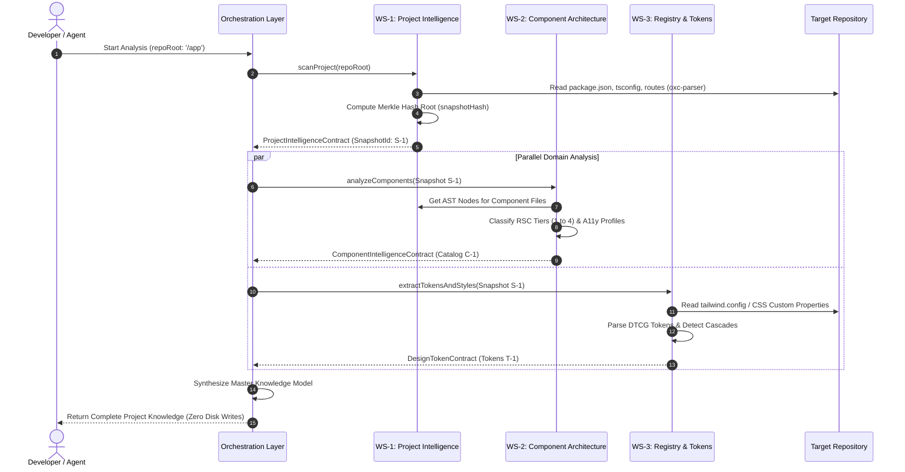
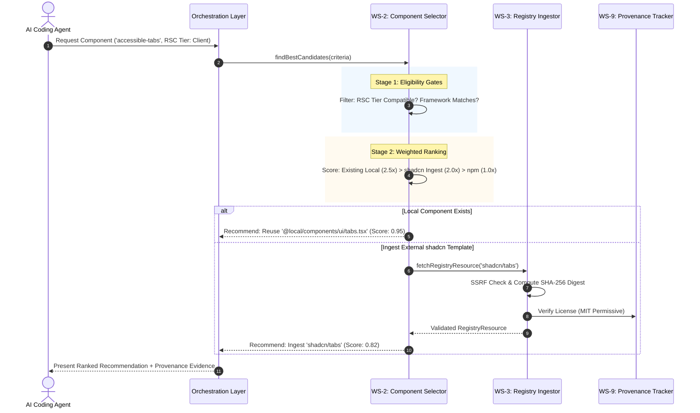
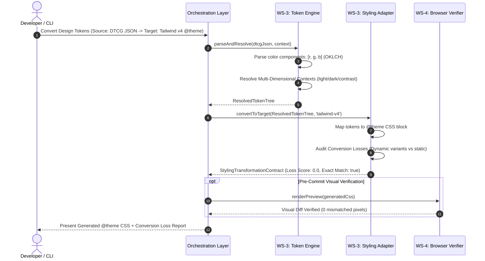
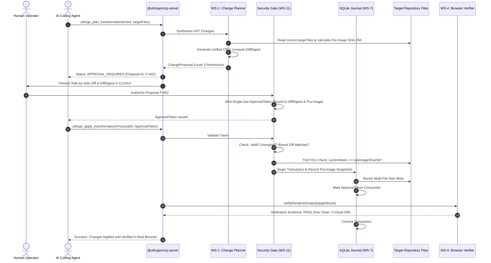
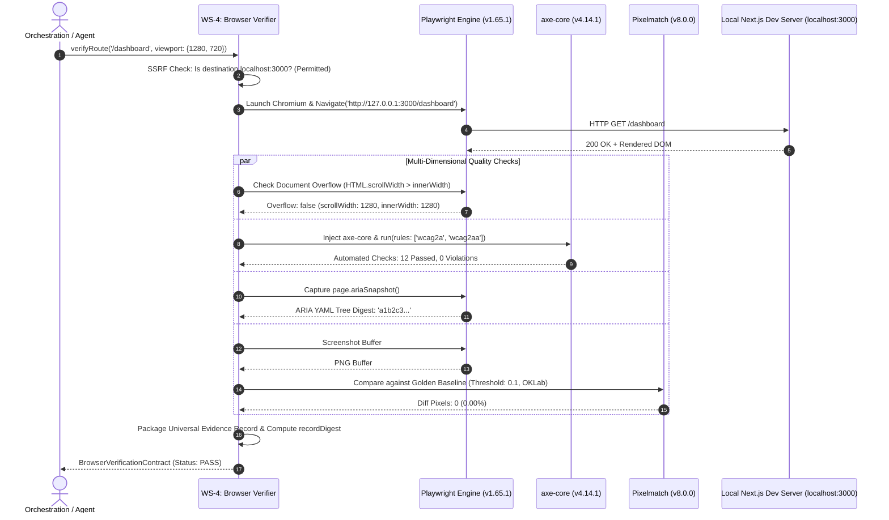
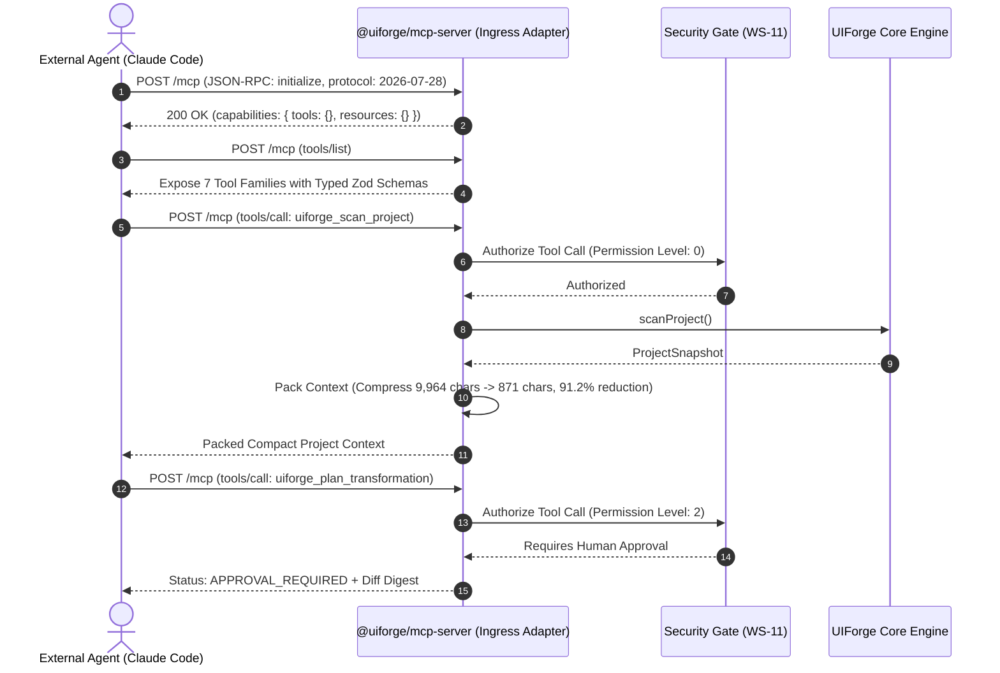
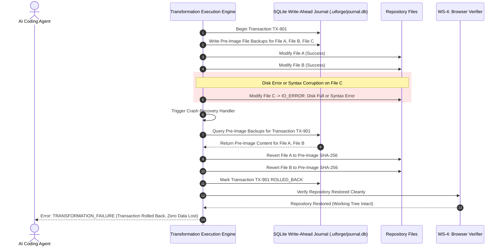

# UIForge Phase 02.2 — End-to-End Operational Workflows Specification

**Document Identifier:** `UIF-PH02.2-WORKFLOWS`  
**Classification:** Canonical System-Wide Operational Execution Flows & State Transitions  
**Parent Phase:** Phase 02.2 — Deep Technical Audit, Architecture Decisions & Cross-Workstream Consolidation  
**Target Standard:** Principal Software Architect + Principal Frontend Infrastructure Engineer + AI Systems Architect  
**Status:** COMPLETE & CONSOLIDATED  
**Date:** November 21, 2026  

---

## 1. Executive Summary & Workflow Principles

To validate that UIForge's 11 layers, 10 shared contracts, and 5 workstream domains cooperate seamlessly, this document defines **Seven Canonical End-to-End Operational Flows**.

### 1.1 Non-Negotiable Operational Principles
1. **Read-Only Ingress Gate:** Every workflow begins in a strictly non-mutating state. Scanning, analysis, token normalization, and candidate ranking never touch disk or stage Git modifications.
2. **Deterministic Pre-Image Hashing:** Workflows that propose mutations capture pre-image SHA-256 hashes of all target files to prevent TOCTOU concurrency corruption.
3. **Diff-Bound Authorization:** Human approvals are cryptographically bound to specific unified diffs and target file hashes.
4. **Independent Post-Mutation Verification:** Code changes are verified in headless browsers before an operation is declared successful.
5. **Fail-Closed Crash Recovery:** Any mid-operation crash or verification failure triggers write-ahead journal rollback.

---

## 2. Seven Canonical End-to-End Workflows

```
┌────────────────────────────────────────────────────────────────────────────────────────┐
│                        CANONICAL OPERATIONAL WORKFLOWS                                 │
├──────┬───────────────────────────────────────────────┬─────────────────────────────────┤
│ Ref  │ Workflow Title                                │ Primary Execution Focus         │
├──────┼───────────────────────────────────────────────┼─────────────────────────────────┤
│ **A**│ Brownfield Project Analysis                   │ Read-only discovery & context   │
│ **B**│ Component Discovery & Reuse                   │ Two-stage candidate selection   │
│ **C**│ Design-System & Token Generation              │ DTCG parsing & loss reporting   │
│ **D**│ Controlled Frontend Transformation            │ Diff planning, approval & write │
│ **E**│ Independent Browser Quality Verification      │ Playwright, A11y & visual diff  │
│ **F**│ External Agent Ingress via MCP                │ Protocol handshake & tool call  │
│ **G**│ Failed Transformation & Crash Recovery        │ Mid-transaction journal rollback│
└──────┴───────────────────────────────────────────────┴─────────────────────────────────┘
```

---

### Flow A: Brownfield Project Analysis (Read-Only Discovery)

**Description:** An engineer or AI agent points UIForge to an existing repository. UIForge performs deep syntactic and semantic indexing without modifying a single byte on disk.



- **Data Flow:** `repoRoot` ➔ `ProjectSnapshot` ➔ `ComponentCatalog` + `TokenTree` ➔ Unified Project Intelligence.
- **Security Check:** Verifies `repoRoot` exists, is canonical (`fs.realpathSync`), and excludes `.git`, `node_modules`, `.env*`.
- **Evidence Produced:** `ws1-scan-record` (`STATIC-ANALYSIS`).

---

### Flow B: Component Discovery, Evaluation & Reuse

**Description:** The user or agent requests a new UI capability (e.g., "Add an accessible tabs component"). UIForge evaluates existing components before considering external templates or package dependencies.



- **Key Decision Gate:** If an existing local component satisfies the requirement, external ingestion is bypassed entirely.
- **Evidence Produced:** `component-selection-evaluation` (`REPORTED-SIMULATION`).

---

### Flow C: Design-System & Token Generation

**Description:** Extracting legacy design values and generating target styling representations across Tailwind v3, Tailwind v4, CSS Modules, or Sass with formal loss reporting.



- **Critical Invariant:** If `exactMatch === false`, the conversion report details every lost construct and marks `humanReviewRequired: true`.
- **Evidence Produced:** `token-resolution-record` (`LOCAL-HARNESS-TESTED`).

---

### Flow D: Controlled Frontend Transformation (Diff, Approval & Write)

**Description:** The primary mutating workflow. An external AI agent requests a codebase modification. UIForge plans the change, requires human authorization, checks TOCTOU hashes, writes atomically via SQLite journal, and verifies the result.



- **Failure Boundary:** If TOCTOU check fails (disk was modified concurrently), operation aborts with `SOURCE_CHANGED`.
- **Evidence Produced:** `change-proposal-record` + `verification-evidence-record`.

---

### Flow E: Independent Headless Browser Quality Verification

**Description:** Autonomous verification of rendered web pages in real Playwright browsers, evaluating accessibility, layout geometry overflow, and perceptual visual regressions.



- **Security Isolation:** Route interception strictly blocks requests outside localhost:3000.
- **Evidence Produced:** `VerificationEvidenceRecord` (`LIVE-INTEGRATION-TESTED`).

---

### Flow F: External AI Coding Agent Ingress via Model Context Protocol (MCP)

**Description:** An external coding agent (Anthropic Claude Code, Cursor, Antigravity) connects to UIForge via MCP over Streamable HTTP POST or stdio.



- **Decoupled Mandate:** Agent pays for its own LLM inference; UIForge provides deterministic environment tools.
- **Evidence Produced:** `mcp-session-audit-record`.

---

### Flow G: Failed Transformation & Crash Recovery (Rollback)

**Description:** A multi-file transformation encounters a disk write error, unhandled exception, or post-mutation verification failure. The write-ahead journal restores pre-image files atomically.



- **Guarantee:** Repository is never left in a partially modified or uncompilable state.
- **Evidence Produced:** `journal-rollback-event` (`LOCAL-HARNESS-TESTED`).
