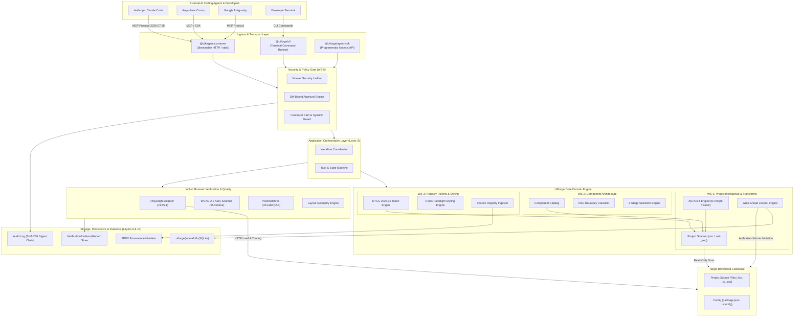

# UIForge Phase 02.2 — Master System Architecture Specification

**Document Identifier:** `UIF-PH02.2-MASTER-ARCHITECTURE`  
**Classification:** Canonical System Architecture Specification  
**Parent Phase:** Phase 02.2 — Deep Technical Audit, Architecture Decisions & Cross-Workstream Consolidation  
**Target Standard:** Principal Software Architect + Principal Frontend Infrastructure Engineer + AI Systems Architect + Application Security Architect  
**Status:** COMPLETE & CONSOLIDATED  
**Date:** November 21, 2026  

---

## 1. Executive Mission, Scope & System Invariants

This document establishes the **Authoritative Unified System Architecture** for **UIForge**. It consolidates the technical findings, architectural decisions, and empirical benchmarks of all five Phase 02.2 workstreams (WS-1 through WS-5) into an internally consistent, modular, implementation-ready blueprint for Phase 03 engineering.

### 1.1 UIForge System Mission
UIForge is an open-core **Frontend Engineering Intelligence & Orchestration Platform**. It bridges the gap between autonomous AI coding agents and production enterprise frontend codebases by providing:
1. **Sensory Intelligence:** Deep syntactic and semantic project comprehension (AST/CST parsing, route discovery, component dependency graphs, design token extraction).
2. **Deterministic Adaptation:** Safe, cross-paradigm component selection, DTCG-compliant design token manipulation, and style system translation (Tailwind v3/v4, CSS Modules, Sass).
3. **Verified Action Space:** Controlled, human-authorized AST code transformations, journaled rollback safety, and independent, multi-viewport headless browser verification with automated accessibility and visual regression checks.
4. **Standardized Agent Tooling:** Model Context Protocol (MCP) ingress adapters and decoupled Agent Integration SDKs that expose typed, capability-bounded tools to any external LLM-driven coding agent.

### 1.2 Non-Negotiable Architectural Invariants
1. **Read-Only by Default (Brownfield Invariant):** All repository inspection, AST analysis, component scanning, token discovery, and browser verification are strictly non-mutating. No file modifications, formatting adjustments, dependency installations, or configuration writes may occur without explicit, human-authorized, diff-bound approvals. An AI agent's instruction is never equivalent to user approval.
2. **Headless Core Independence:** Core domain logic (`@uiforge/core`, `@uiforge/project-intelligence`, `@uiforge/tokens`, etc.) is fully headless, local-first, and operational via CLI or programmatic Node.js API without requiring an active browser, a hosted cloud backend, an MCP daemon, or an LLM provider.
3. **Agent & Model Decoupling:** UIForge does not wrap, resell, prompt-engineer, or bill for LLM inference. External coding agents (Claude Code, Cursor, Codex, Antigravity) own their reasoning, context windows, and model billing. UIForge operates as the deterministic, authoritative environment oracle and execution gatekeeper.
4. **Evidence Over Assertion:** No subsystem may claim success, compliance, or safety without producing an immutable `VerificationEvidenceRecord`. Automated tools cannot declare WCAG 2.2 AA conformance; they report discrete test criteria results. Pixelmatch visual tests require human golden baselines.
5. **Fail-Closed Security & Provenance:** External component registries, third-party packages, and user code comments are classified as untrusted input. Ingested code maintains cryptographic provenance manifests (source URL, git commit, license, SHA-256 file digests). All filesystem mutations enforce canonical path validation, symlink guards, and pre-image write-ahead journaling.

---

## 2. Eleven Canonical Architecture Layers

The UIForge system is structured into **11 Canonical Architecture Layers**. Each layer has strictly bounded responsibilities, owned data models, defined interfaces, and security constraints.

```
┌────────────────────────────────────────────────────────────────────────────────────────┐
│ Layer 1: Developer Interface Layer (CLI, IDE Plugins, Future Studio GUI)              │
├────────────────────────────────────────────────────────────────────────────────────────┤
│ Layer 2: Agent Ingress Layer (MCP Server [2026-07-28], Agent Integration SDK)          │
├────────────────────────────────────────────────────────────────────────────────────────┤
│ Layer 3: Application Orchestration Layer (Workflow Coordinator, Task State Machine)   │
├────────────────────────────────────────────────────────────────────────────────────────┤
│ Layer 4: Project Intelligence Layer (WS-1: Scanner, Route & Dependency AST Engine)     │
├────────────────────────────────────────────────────────────────────────────────────────┤
│ Layer 5: Design & Component Intelligence Layer (WS-2: Catalog, RSC Taxonomy, A11y Tiers)│
├────────────────────────────────────────────────────────────────────────────────────────┤
│ Layer 6: Registry & Token Intelligence Layer (WS-3: DTCG 2025.10, shadcn Registry, Css)│
├────────────────────────────────────────────────────────────────────────────────────────┤
│ Layer 7: Transformation & Execution Layer (WS-1/WS-3: Change Planner, Journal Writer)  │
├────────────────────────────────────────────────────────────────────────────────────────┤
│ Layer 8: Browser Verification & Quality Layer (WS-4: Playwright v1.65, Pixelmatch v8)  │
├────────────────────────────────────────────────────────────────────────────────────────┤
│ Layer 9: Evidence & Provenance Layer (Cross-Cutting: Tamper-Evident Envelopes, SPDX)   │
├────────────────────────────────────────────────────────────────────────────────────────┤
│ Layer 10: Storage & Persistence Layer (Local .uiforge/, SQLite State, Snapshot Cache)  │
├────────────────────────────────────────────────────────────────────────────────────────┤
│ Layer 11: Security & Policy Enforcement Layer (WS-5: 5-Level Ladder, Diff-Bound Token) │
└────────────────────────────────────────────────────────────────────────────────────────┘
```

---

### Layer 1: Developer Interface Layer
- **Purpose:** Provide direct, human-facing command-line and graphical interfaces for developers to analyze projects, inspect tokens, authorize changes, and view verification reports.
- **Responsibilities:** Parse CLI flags; format human-readable terminal output; generate JSON streams for CI/CD; render interactive diffs; manage local user configuration.
- **Owned Data:** User CLI preferences (`~/.uiforge/config.json`), terminal session state, interactive confirmation inputs.
- **Public Interfaces:** CLI executable (`uiforge [command]`), future Studio Web/Desktop UI entry points.
- **Internal Interfaces:** Invokes Layer 3 (Orchestration) and Layer 10 (Storage).
- **Dependencies:** `@uiforge/core`, `@uiforge/cli`, commander/clack for terminal formatting. Zero dependency on MCP.
- **Security Boundary:** Runs under the host user's OS permissions. Enforces terminal confirmation prompts for Level 2+ operations.
- **Failure Modes:** Malformed CLI arguments, terminal disconnects, unhandled process interrupts (SIGINT/SIGTERM).
- **Ownership:** Cross-Workstream (Primary: CLI Developer Tools Architecture). Status: **Core Product Surface**.

---

### Layer 2: Agent Ingress Layer
- **Purpose:** Expose UIForge capabilities to external AI coding agents via standardized, capability-bounded protocols without embedding LLM inference into Core.
- **Responsibilities:** Model Context Protocol (MCP) server implementation adhering to specification `2026-07-28` (supporting `2025-11-25` legacy); Streamable HTTP POST transport and stdio pipes; context token budgeting and compression; tool schema generation from Zod contracts.
- **Owned Data:** Active MCP connection sessions, tool invocation context budgets, client capability manifests.
- **Public Interfaces:** MCP stdio endpoint, MCP Streamable HTTP endpoint (`POST /mcp`), programmatic Agent SDK (`@uiforge/agent-sdk`).
- **Internal Interfaces:** Calls Layer 3 (Orchestration) via `uiforge.contract.agent-tool.v1`.
- **Dependencies:** `@uiforge/core`, `@modelcontextprotocol/server`, `@modelcontextprotocol/core`. Zero dependency on specific LLMs.
- **Security Boundary:** Strict untrusted boundary. All agent payloads (prompts, arguments, tool calls) are sanitized. Tools requiring Level 2+ permissions halt and issue structured approval requests.
- **Failure Modes:** MCP transport disconnection, JSON-RPC schema validation failures, client timeout, context buffer overflow.
- **Ownership:** WS-5 (Agent Architecture & Tooling). Status: **Optional Transport Adapter**.

---

### Layer 3: Application Orchestration Layer
- **Purpose:** Coordinate end-to-end multi-step frontend engineering workflows, enforce task execution lifecycles, and maintain consistent workflow state.
- **Responsibilities:** Orchestrate Workflow A (New Frontend Creation) and Workflow B (Existing Frontend Improvement); dispatch domain tasks to Layers 4–8; handle task cancellation and rollback coordination.
- **Owned Data:** Active task state machine, workflow execution graph, run context, active cancellation tokens.
- **Public Interfaces:** `IWorkflowCoordinator.execute(workflowId, inputContext)`, `ITaskRunner.run(taskDescriptor)`.
- **Internal Interfaces:** Orchestrates Layers 4, 5, 6, 7, 8, and passes verification artifacts to Layer 9.
- **Dependencies:** `@uiforge/core`.
- **Security Boundary:** Internal trusted orchestration engine. Validates that every state transition obeys permission boundaries.
- **Failure Modes:** Task step failure, timeout, workflow cancellation, unrecoverable domain error.
- **Ownership:** Core Architecture (Synthesized from WS-1, WS-4, WS-5). Status: **Required Core Module**.

---

### Layer 4: Project Intelligence Layer
- **Purpose:** Build and maintain an authoritative, semantic knowledge model of the target repository without altering source code.
- **Responsibilities:** Fast filesystem scanning; framework and dependency detection; routing hierarchy discovery (Next.js App/Pages router, React Router, Remix); AST/CST parsing; import graph resolution; component export analysis; component hierarchy mapping.
- **Owned Data:** Authoritative `ProjectSnapshot`, file hash trees, AST caches, symbol reference tables.
- **Public Interfaces:** `IProjectIntelligence.scan(repoRoot): Promise<ProjectSnapshot>`, `IProjectIntelligence.getComponentAST(path)`.
- **Internal Interfaces:** Consumed by Layers 5 (Components), 6 (Tokens), 7 (Transforms), 8 (Browser Verification).
- **Dependencies:** `@uiforge/project-intelligence`, `ts-morph` (`v28.0.0`), `@ast-grep/napi` (`v0.51.3`), `oxc-parser` (`v0.159.0`), fallback `@typescript/typescript6` (`v6.0.2`).
- **Security Boundary:** Read-only repository access. Enforces path traversal barriers; ignores `.git`, `node_modules`, `.env*`.
- **Failure Modes:** Syntax errors in user files, unsupported experimental syntax, circular import deadlocks, massive repository memory limits.
- **Ownership:** WS-1 (Project Intelligence & Safe Transformation). Status: **Required Core Module**.

---

### Layer 5: Design & Component Intelligence Layer
- **Purpose:** Analyze, classify, evaluate, and select components within target codebases and external registries based on architectural compatibility, React Server Component (RSC) boundaries, and accessibility characteristics.
- **Responsibilities:** Component discovery; prop API extraction; 4-tier RSC taxonomy classification; 4-tier accessibility categorization; two-stage component selection engine (Eligibility Gates ➔ Weighted Ranking); reuse vs. adapt vs. ingest recommendations.
- **Owned Data:** Component Catalog, Component Intelligence Models (`uiforge.contract.component-intelligence.v1`), Selection Evaluation Matrices.
- **Public Interfaces:** `IComponentIntelligence.analyze(snapshot): ComponentCatalog`, `IComponentSelector.select(criteria): ComponentRecommendation[]`.
- **Internal Interfaces:** Consumes Layer 4 (Project Intelligence); consults Layer 6 (Tokens/Registry).
- **Dependencies:** `@uiforge/component-intelligence`, `@uiforge/core`.
- **Security Boundary:** Evaluates component safety manifests; flags components with unverified dependencies or non-permissive licenses.
- **Failure Modes:** Ambiguous RSC boundaries (missing `'use client'`), complex generic TypeScript prop types, conflicting library versions.
- **Ownership:** WS-2 (Component & Design-System Architecture). Status: **Required Core Module**.

---

### Layer 6: Registry & Token Intelligence Layer
- **Purpose:** Manage structured design tokens, ingest component registry resources, and execute cross-paradigm styling transformations.
- **Responsibilities:** W3C DTCG 2025.10 token parsing and normalization (`components` property); token alias resolution across multi-dimensional contexts (light/dark, contrast, density); shadcn v1 registry ingestion (all 12 item types); cross-paradigm styling translation (Tailwind v3/v4 `@theme`, CSS Modules, Sass, CSS variables); conversion loss reporting.
- **Owned Data:** Token Dependency Graphs, Resolved Token Trees, Ingested Registry Manifests, Conversion Loss Records.
- **Public Interfaces:** `ITokenEngine.parseAndResolve(tokenSource, context): ResolvedTokenTree`, `IStylingAdapter.convert(sourceStyle, targetParadigm): StyleConversionResult`, `IRegistryIngestor.ingest(url, hash): RegistryResource`.
- **Internal Interfaces:** Serves Layers 5 (Components) and 7 (Transforms); provides test baselines to Layer 8 (Verification).
- **Dependencies:** `@uiforge/tokens`, `@uiforge/styling`, `@uiforge/registry`, `style-dictionary@5.8.0`, PostCSS parsers.
- **Security Boundary:** Strict registry URL verification; HTTPS enforcement; registry payload SHA-256 integrity checks; prototype pollution guards; `--ignore-scripts` enforcement for registry dependencies.
- **Failure Modes:** Circular token references, lossy style conversions, invalid DTCG schemas, untrusted registry payloads.
- **Ownership:** WS-3 (Registry, Tokens & Styling Architecture). Status: **Required Core Module**.

---

### Layer 7: Transformation & Execution Layer
- **Purpose:** Plan and execute controlled, surgical, non-destructive source code transformations under strict transaction journaling and rollback guarantees.
- **Responsibilities:** Synthesize AST/CST code changes; generate unified diffs; calculate pre- and post-image SHA-256 hashes; write-ahead transactional journaling (`.uiforge/journal.db`); atomic multi-file execution; automatic crash recovery and rollback.
- **Owned Data:** Write-Ahead Transformation Journal, Change Plans (`uiforge.contract.change-approval.v1`), File Pre-image Backups.
- **Public Interfaces:** `ITransformationPlanner.plan(intent): ChangePlan`, `ITransformationExecutor.apply(approvedPlan): ExecutionResult`, `ITransformationExecutor.rollback(transactionId): RollbackResult`.
- **Internal Interfaces:** Validates approval with Layer 11 (Security); updates Layer 4 (Project Intelligence); triggers Layer 8 (Browser Verification).
- **Dependencies:** `@uiforge/transforms`, `ts-morph`, `@babel/parser` + `recast` (formatting preservation fallback).
- **Security Boundary:** Absolute mutation gatekeeper. Rejects execution without valid, unexpired, diff-bound human approval token; enforces OS path boundary checks; prevents symlink escapes; detects TOCTOU file modifications.
- **Failure Modes:** File changed on disk since analysis (hash mismatch), syntax corruption during AST emit, disk full during write, process crash mid-transaction.
- **Ownership:** WS-1 (Transforms & Recovery) + WS-5 (Approval Coupling). Status: **Required Core Module**.

---

### Layer 8: Browser Verification & Quality Layer
- **Purpose:** Independently verify rendered frontend behavior, responsive layouts, accessibility compliance, and visual regression in real browser engines.
- **Responsibilities:** Playwright lifecycle management (`v1.65.1`); multi-viewport rendering (320px to 1920px); Pixelmatch v8 perceptual visual regression (OKLab/HyAB); 55-criteria WCAG 2.2 accessibility assessment (automated axe-core checks + ARIA snapshot inspection); layout geometry overflow detection (`HTML.scrollWidth > innerWidth`) and occlusion testing; candidate touch-target evaluation (SC 2.5.8); diagnostic envelope generation.
- **Owned Data:** Screenshots, ARIA Tree Snapshots (`page.ariaSnapshot()`), Playwright traces, Visual Diff Buffers, Accessibility Findings.
- **Public Interfaces:** `IBrowserVerifier.verify(targetUrl, scenarios): Promise<VerificationEvidenceRecord>`.
- **Internal Interfaces:** Technology-neutral `IBrowserAdapter`. Feeds evidence into Layer 9 (Evidence) and diagnostics to Layer 2 (Agent Ingress).
- **Dependencies:** `@uiforge/verification`, `playwright-core` (`v1.65.1`), `pixelmatch` (`v8.0.0`), `axe-core` (`v4.14.1`). Optional browser binaries.
- **Security Boundary:** Browser network isolation. Prohibits RFC 1918 internal IPs, link-local, cloud metadata (`169.254.169.254`), and IPv6 loopbacks; enforces strict destination host whitelist; disables WebSockets/WebRTC to unapproved origins.
- **Failure Modes:** Local dev server offline, browser process crash, timeout during page navigation, flaky animation visual false-positives.
- **Ownership:** WS-4 (Browser Verification & Quality). Status: **Optional / On-Demand Verification Adapter**.

---

### Layer 9: Evidence & Provenance Layer
- **Purpose:** Capture, normalize, cryptographically correlate, and persist tamper-evident records of every action, analysis, verification, and component ingestion.
- **Responsibilities:** Generate standardized `VerificationEvidenceRecord` envelopes; compute SHA-256 digests (`recordDigest`); maintain SPDX 2.3 license manifests; record dependency provenance chains; link agent requests to executed diffs and verification outputs.
- **Owned Data:** Immutable Evidence Logs, Provenance Manifests (`provenance.json`), Verification Test Baselines.
- **Public Interfaces:** `IEvidenceStore.record(evidenceEnvelope): EvidenceRecordId`, `IProvenanceTracker.register(resource): ProvenanceManifest`.
- **Internal Interfaces:** Consumed by Layers 1 (CLI), 2 (Agent), 3 (Orchestration), 11 (Security Audit).
- **Dependencies:** `@uiforge/core`, standard Node.js `crypto`.
- **Security Boundary:** Tamper-evident digest chaining. Separates cryptographic digests from claims of digital signatures or independent trust anchors.
- **Failure Modes:** Disk persistence write error, corrupted evidence record digest.
- **Ownership:** Cross-Workstream (Synthesized from WS-1, WS-2, WS-3, WS-4, WS-5). Status: **Required Core Module**.

---

### Layer 10: Storage & Persistence Layer
- **Purpose:** Manage local filesystem state, project metadata caches, configuration, write-ahead journals, and offline databases.
- **Responsibilities:** Maintain project-local `.uiforge/` directory; store SQLite transaction journal (`.uiforge/journal.db`); manage user global config (`~/.uiforge/`); cache AST parsed trees with mtime/SHA-256 validation; purge stale caches.
- **Owned Data:** `.uiforge/` project state, SQLite schema, cached AST hashes.
- **Public Interfaces:** `IPersistenceStore.get(key)`, `IPersistenceStore.set(key, value)`, `IJournalStore.append(entry)`.
- **Internal Interfaces:** Backs Layers 4, 7, 9, 11.
- **Dependencies:** `better-sqlite3` (or pure Node.js fallback), filesystem APIs.
- **Security Boundary:** Restricts file access strictly to `.uiforge/` within the project root and `~/.uiforge/` in user home. Enforces OS file permissions (0600 for sensitive state).
- **Failure Modes:** SQLite lock contention, disk write permission denied, filesystem full.
- **Ownership:** Core Infrastructure Architecture. Status: **Required Core Module**.

---

### Layer 11: Security & Policy Enforcement Layer
- **Purpose:** Enforce the 5-level security permission ladder, validate human approval tokens, verify path boundaries, redact secrets, and maintain tamper-evident audit logs.
- **Responsibilities:** Evaluate operation permission level (Level 0 Read-Only to Level 4 Destructive); mint and verify single-use, diff-bound, time-bounded approval tokens; canonicalize filesystem paths (`fs.realpathSync`); detect symlink escapes; scan for and redact secrets in logs/diffs; maintain hash-chained audit trails.
- **Owned Data:** Active Approval Tokens, Permission Policy Rules, Redaction Regex Tables, Audit Log Chain.
- **Public Interfaces:** `ISecurityPolicy.authorize(operation, context): ApprovalStatus`, `IPathGuard.validate(path, repoRoot): CanonicalPath`.
- **Internal Interfaces:** Intercepts all mutating requests between Layer 2/3 and Layer 7.
- **Dependencies:** `@uiforge/core`, Node.js `crypto`.
- **Security Boundary:** Root security arbiter. Operates fail-closed: if policy evaluation fails or approval is ambiguous, the operation is rejected.
- **Failure Modes:** Token expiration, hash mismatch, path traversal attempt, approval replay attempt.
- **Ownership:** WS-5 (Agent Integration & Permissions) + WS-1 (Path Guards). Status: **Required Core Module**.

---

## 3. Subsystem Responsibility Ownership Matrix

To eliminate ambiguity across the five workstreams, every critical system capability is assigned a single **Primary Owner**, defined **Secondary Consumers**, an **Authoritative Data Owner**, an **Enforcement Owner**, and explicit **Evidence Handlers**.

| Capability | Primary Owner | Secondary Consumers | Authoritative Data Owner | Interface Contract | Security Enforcement Owner | Evidence Producer | Evidence Consumer |
| :--- | :--- | :--- | :--- | :--- | :--- | :--- | :--- |
| **Project & Route Discovery** | WS-1 (Project Intel) | WS-2, WS-4, WS-5 | WS-1 (`ProjectSnapshot`) | `uiforge.contract.project-intelligence.v1` | WS-1 (Path Traversal Guard) | WS-1 (AST/File Scan) | WS-5 (Agent Context) |
| **AST Parsing & CST Rewriting** | WS-1 (Transforms) | WS-3, WS-1 (Execution) | WS-1 (AST Graph) | Internal AST Engine | WS-1 (Syntax Validator) | WS-1 (CST Checksum) | WS-1 (Execution) |
| **Component Discovery & RSC** | WS-2 (Components) | WS-1, WS-5 | WS-2 (`ComponentCatalog`) | `uiforge.contract.component-intelligence.v1` | WS-2 (RSC Boundary Gate) | WS-2 (RSC Audit) | WS-5 (Agent Context) |
| **Component Selection Engine** | WS-2 (Components) | WS-3, WS-5 | WS-2 (Ranked Candidates) | `uiforge.contract.component-intelligence.v1` | WS-2 (Eligibility Gates) | WS-2 (Ranking Matrix) | WS-1 (Change Plan) |
| **DTCG Token Normalization** | WS-3 (Tokens) | WS-1, WS-2, WS-4 | WS-3 (`ResolvedTokenTree`) | `uiforge.contract.design-token.v1` | WS-3 (Schema Validator) | WS-3 (Graph Cycle Check) | WS-4 (Visual Baseline) |
| **Cross-Paradigm Styling** | WS-3 (Styling) | WS-1, WS-4 | WS-3 (Conversion Manifest) | `uiforge.contract.styling-transformation.v1` | WS-3 (Loss Threshold Gate) | WS-3 (Loss Report) | WS-1 (Change Plan) |
| **Registry Resource Ingestion** | WS-3 (Registry) | WS-2, WS-1 | WS-3 (`RegistryResource`) | `uiforge.contract.registry-resource.v1` | WS-3 (SSRF & SHA-256 Gate) | WS-3 (Integrity Record) | WS-2 (Catalog) |
| **Change Planning & Diffing** | WS-1 (Planner) | WS-5, CLI, Studio | WS-1 (`ChangePlan`) | `uiforge.contract.change-approval.v1` | WS-5 (Security Gate) | WS-1 (Diff Digest) | WS-5 (Approval UI) |
| **Transactional Execution** | WS-1 (Execution) | WS-3, WS-5 | WS-1 (Write Journal) | `uiforge.contract.change-approval.v1` | WS-5 (Precondition & Path Guard) | WS-1 (Journal Entry) | Core (Audit Subsystem) |
| **Rollback & Crash Recovery** | WS-1 (Recovery) | CLI, Studio | WS-1 (Pre-image Cache) | `uiforge.contract.change-approval.v1` | WS-1 (Atomic Reversion) | WS-1 (Rollback Digest) | Core (Audit Subsystem) |
| **Browser Runner & Lifecycle** | WS-4 (Browser) | WS-5, Studio | WS-4 (`BrowserSession`) | `uiforge.contract.browser-verification.v1` | WS-4 (Network Isolation) | WS-4 (Session Trace) | WS-4 (Quality Engine) |
| **Visual Regression Testing** | WS-4 (Quality) | WS-5, CLI | WS-4 (Diff Buffer) | `uiforge.contract.browser-verification.v1` | WS-4 (Golden Human Baseline) | WS-4 (Per-Pixel Map) | WS-5 (Agent Diagnostic) |
| **Accessibility Assessment** | WS-4 (Quality) | WS-2, WS-5 | WS-4 (WCAG Findings) | `uiforge.contract.browser-verification.v1` | WS-4 (Rule Evaluator) | WS-4 (55-Criteria Record) | WS-5 (Agent Diagnostic) |
| **Responsive Geometry Engine**| WS-4 (Quality) | WS-5, CLI | WS-4 (Layout Violations) | `uiforge.contract.browser-verification.v1` | WS-4 (Overflow Gate) | WS-4 (Geometry Map) | WS-5 (Agent Diagnostic) |
| **MCP Ingress & Protocol** | WS-5 (Agent Protocol) | External Agents | WS-5 (Session Map) | `uiforge.contract.agent-tool.v1` | WS-5 (JSON-RPC Sanitizer) | WS-5 (Transport Log) | Core (Audit Subsystem) |
| **Context Compression & Budget**| WS-5 (Context) | External Agents | WS-5 (Packed Context) | `uiforge.contract.session-context.v1` | WS-5 (Budget Enforcer) | WS-5 (Token Reduction Metric)| External Agent |
| **5-Level Security Ladder** | WS-5 (Security) | All Subsystems | WS-5 (Policy Rules) | `uiforge.contract.change-approval.v1` | WS-5 (Token Gatekeeper) | WS-5 (Auth Digest) | Core (Audit Subsystem) |
| **Provenance Tracking & SPDX**| Core (Provenance) | WS-2, WS-3, Legal | Core (`provenance.json`) | `uiforge.contract.evidence-provenance.v1` | Core (License Whitelist Gate)| Core (SPDX Manifest) | User / Release Manager |
| **Unified Evidence Envelope** | Core (Evidence) | All Subsystems | Core (Evidence Store) | `uiforge.contract.evidence-provenance.v1` | Core (Digest Chain Guard) | All Subsystems | WS-5, CLI, CI/CD |

---

## 4. Product Boundaries: Core, CLI, MCP Server, SDK & Studio

UIForge is distributed as an open-core platform with clear separation of responsibilities across its entry points:

```
┌────────────────────────────────────────────────────────────────────────────────────────┐
│                                  UIFORGE STUDIO                                        │
│  (Optional Desktop / Web GUI: Visual Token Editor, Interactive Diff Review, Reports)   │
└──────────────────────────────────────────┬─────────────────────────────────────────────┘
                                           │
┌──────────────────────────────────────────▼─────────────────────────────────────────────┐
│       UIFORGE CLI       │    @uiforge/mcp-server    │       @uiforge/agent-sdk         │
│ (Developer Terminal CLI)│  (External Agent Ingress) │   (Programmatic Node.js Binding) │
└─────────────────────────┴───────────────┬───────────┴──────────────────────────────────┘
                                          │
┌─────────────────────────────────────────▼──────────────────────────────────────────────┐
│                                  @uiforge/core                                         │
│ (Headless Domain Logic, AST, DTCG Tokens, RSC Catalog, Journal, Security & Evidence)   │
└────────────────────────────────────────────────────────────────────────────────────────┘
```

### 4.1 Feature Ownership Across Distribution Surfaces

| Feature / Subsystem Capability | `@uiforge/core` | `@uiforge/cli` | `@uiforge/mcp-server` | `@uiforge/agent-sdk` | UIForge Studio |
| :--- | :---: | :---: | :---: | :---: | :---: |
| **Project Intelligence & AST Scanning** | Implements | Commands | Tool | Method | Visual Explorer |
| **Component Discovery & RSC Taxonomy** | Implements | Commands | Tool | Method | Component Catalog |
| **DTCG Token Normalization & Styling** | Implements | Commands | Tool | Method | Token Editor |
| **shadcn Registry Ingestion** | Implements | Commands | Tool | Method | Registry Browser |
| **Change Planning & AST Diffing** | Implements | Commands | Tool | Method | Side-by-Side Diff |
| **Interactive Terminal Approval** | Abstract | Enforces | Requests | Callback | Approval UI |
| **Write-Ahead Journal & Rollback** | Implements | Commands | No (Auto) | Method | History & Restore |
| **Playwright Browser Runner** | Adapter | Commands | Tool | Method | Embedded Preview |
| **Pixelmatch Visual Regression** | Implements | Commands | Tool | Method | Visual Diff Overlay |
| **WCAG 2.2 Accessibility Scanner** | Implements | Commands | Tool | Method | A11y Tree Inspector |
| **MCP stdio & Streamable HTTP POST** | None | None | Implements | None | None |
| **Context Token Budgeting & Packing**| Models | None | Implements | Implements | None |
| **Tamper-Evident Audit Logging** | Implements | Formats | Records | Records | Visual Audit Trail |
| **SPDX Provenance Tracking** | Implements | Generates | Exposes | Method | License Inspector |

---

## 5. System Architecture Topology Diagram

The following Mermaid diagram illustrates the complete, consolidated UIForge system architecture, highlighting data flows, protocol boundaries, and security enforcement gates:



---

## 6. Architecture Quality & Conformance Guarantees

1. **No Monolithic AST Overhead:** Fast structural pattern queries run in sub-millisecond Rust AST grep; full type checking is invoked only as a fallback for complex cross-file symbol resolution.
2. **Deterministic Token Fidelity:** Tokens strictly conform to the stable **W3C Design Tokens Community Group (DTCG) 2025.10 specification** (W3C Community Group process) utilizing the Color Module's `components` property with exact color-space semantics (`[L, C, H]` for OKLCH, `[r, g, b]` for sRGB), permitting numeric values or `'none'` for missing components. Listed color spaces represent supported baseline implementations rather than an exhaustive closed set. Unsupported styling constructs generate explicit conversion loss reports rather than silent corruption.
3. **Reproducible Verification:** Browser verification produces structured, hash-digested evidence records. ARIA role snapshots (`page.ariaSnapshot()`) provide stable accessibility regression assertions across browser versions. Automated axe-core passes evaluate candidate DOM attributes and are never equated with universal WCAG 2.2 AA conformance.
4. **Resilient Failure Recovery:** Multi-file mutations implement a **recoverable multi-file mutation protocol**, acknowledging that POSIX and Windows filesystems do not natively support multi-file transactional atomicity, and SQLite ACID guarantees apply strictly to the `.uiforge/journal.db` SQLite database file. Pre-images and execution intent are recorded to the write-ahead journal prior to disk writes. If process termination, disk write failure, or verification errors occur, the recovery engine uses recorded pre-image snapshots to restore tracked repository files to their pre-mutation state.
5. **Multi-Layer Filesystem Defenses:** Pre-image SHA-256 checks serve as a point-in-time precondition validation check, not an atomic elimination of filesystem concurrency. Mitigation of TOCTOU and concurrency risks incorporates closest-existing-ancestor path canonicalization (`fs.realpathSync`), private staging (`.uiforge/staging/<txId>/`), atomic replacement where supported, OS-level file locking, and journaled recovery, subject to prototype validation against 7 failure scenarios in Phase 02.4 Gate 2.
