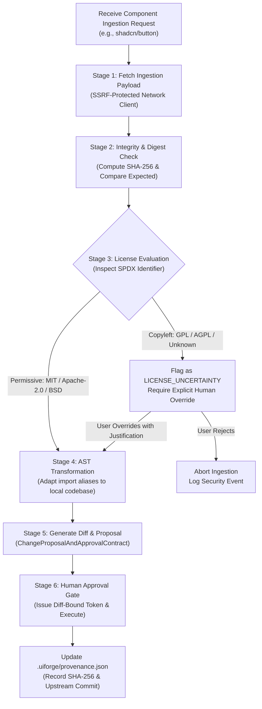

# UIForge Phase 02.2 — Component Provenance & Registry Governance Specification

**Document Identifier:** `UIF-PH02.2-PROVENANCE-GOVERNANCE`  
**Classification:** Software Supply-Chain, Provenance Tracking & License Governance Specification  
**Parent Phase:** Phase 02.2 — Deep Technical Audit, Architecture Decisions & Cross-Workstream Consolidation  
**Target Standard:** Principal Software Architect + Application Security Architect + Software Supply-Chain Auditor  
**Status:** COMPLETE & CONSOLIDATED  
**Date:** November 21, 2026  

---

## 1. Executive Mission & Supply-Chain Governance Principles

Modern frontend engineering relies heavily on external component registries (such as shadcn/ui), open-source component primitives (Base UI, Radix UI, React Aria), icon libraries, and design token sets. In traditional AI coding workflows, agents copy code recklessly without tracking licensing, authors, original URLs, or transitive dependencies.

UIForge establishes a **Deterministic Supply-Chain & Provenance Architecture**. Every component, hook, token, or asset brought into a project is cryptographically tracked from its upstream source to its destination file in the project.

### 1.1 Non-Negotiable Governance Invariants
1. **Never Assume Whole-Repo License Equivalence:** The top-level license of a repository (e.g., MIT in a root `LICENSE` file) does not automatically apply to every font, bundled icon, SVG illustration, or sub-package in that repository. UIForge performs file-level and asset-level license inspection.
2. **Six-Tier Consumption Classification:** Every external resource is classified into one of six distinct consumption tiers, each carrying explicit attribution and legal requirements.
3. **Immutable Provenance Manifest (`provenance.json`):** Ingested or adapted files maintain an immutable record linking destination paths to upstream Git commits, package versions, SPDX identifiers, and SHA-256 content digests.
4. **Mandatory Review on License Uncertainty:** Ambiguous, missing, or copyleft licenses (e.g., GPL-3.0, AGPL-3.0, CC-BY-NC) automatically halt automated ingestion and require explicit human review.
5. **Phase 02.3 Handoff Boundary:** Technical mechanisms enforce policy and record metadata; formal corporate legal interpretations are explicitly deferred to the **Phase 02.3 Software Supply-Chain, Licensing & Commercial Risk Audit**.

---

## 2. Six-Tier Resource Consumption Taxonomy

To prevent license contamination and copyright infringement, UIForge categorizes external resource usage into six distinct tiers:

```
┌────────────────────────────────────────────────────────────────────────────────────────┐
│                        SIX-TIER RESOURCE CONSUMPTION TAXONOMY                          │
├──────┬───────────────────────────────┬────────────────────────────────────────────────┤
│ Tier │ Consumption Model             │ Provenance & Licensing Requirements            │
├──────┼───────────────────────────────┼────────────────────────────────────────────────┤
│ **1**│ **Reference-Only Use**        │ Ephemeral inspection; no code copied; no note. │
│ **2**│ **Independent Reimplementation│ Clean-room pattern reuse; no copyright burden. │
│ **3**│ **Source Copying / Template** │ Full attribution header; SPDX record; SHA-256. │
│ **4**│ **Package Dependency**        │ Add to package.json; track npm license in audit│
│ **5**│ **Asset Redistribution**      │ Track SVG/Font licenses; check commercial use. │
│ **6**│ **Registry Redistribution**   │ Upstream registry mirror; export full manifest.│
└──────┴───────────────────────────────┴────────────────────────────────────────────────┘
```

### Tier Descriptions & Governance Constraints

#### Tier 1: Reference-Only Use
- **Definition:** The agent or engineer inspects an external component (e.g., an accessible Radix UI pattern) to understand state machine transitions or ARIA role combinations, but copies zero lines of code.
- **Requirement:** Logged in the agent's internal reasoning trace. No permanent repository provenance record required.

#### Tier 2: Independent Reimplementation (Clean-Room)
- **Definition:** Writing an original implementation based on generic functional requirements or public specifications (e.g., implementing an accessible tabs component from W3C APG patterns).
- **Requirement:** No copyright attribution required; record APG specification URL in the component docstring for architectural provenance.

#### Tier 3: Source Copying / Template Ingestion (shadcn Model)
- **Definition:** Ingesting component templates directly into the project's source tree (e.g., copying `button.tsx` from `ui.shadcn.com`).
- **Requirement:** 
  1. Record original upstream repository URL, Git commit hash, and file SHA-256.
  2. Embed a non-intrusive provenance comment or store in `.uiforge/provenance.json`.
  3. Validate permissive license (MIT, Apache-2.0, BSD-3-Clause).
  4. Require human confirmation before writing to disk.

#### Tier 4: Managed Package Dependency
- **Definition:** Adding an external npm package (e.g., `@base_ui/react`, `clsx`, `lucide-react`) to `package.json`.
- **Requirement:**
  1. Inspect package license via npm manifest (`license` field).
  2. Flag non-permissive or copyleft licenses.
  3. Enforce `--ignore-scripts` during installation to eliminate lifecycle script attacks (TH-05).
  4. Record pinned semver in project dependencies.

#### Tier 5: Asset Redistribution (Fonts, Icons, SVGs)
- **Definition:** Downloading font binaries (`.woff2`), brand logos, or SVG icon sets into public assets.
- **Requirement:**
  1. Check asset-specific license (e.g., SIL Open Font License 1.1 for fonts).
  2. Verify that commercial redistribution is permitted.
  3. Flag any asset lacking an explicit license.

#### Tier 6: Registry Redistribution / Mirroring
- **Definition:** UIForge caching or re-serving external registry items across multiple projects or internal enterprise teams.
- **Requirement:** Complete SPDX 2.3 software bill of materials (SBOM) generation; full author attribution preservation.

---

## 3. The Canonical Provenance Manifest Schema

Every project managed by UIForge maintains an authoritative provenance manifest at `.uiforge/provenance.json`:

```typescript
export interface ProvenanceManifestV1 {
  readonly manifestVersion: '1.0.0';
  readonly projectSnapshotId: string;
  readonly lastUpdatedAt: string; // ISO 8601 UTC

  readonly resources: Record<string, {
    readonly resourceId: string; // e.g., 'shadcn/button' or 'pkg:npm/@radix-ui/react-slot'
    readonly consumptionTier: 1 | 2 | 3 | 4 | 5 | 6;
    readonly destinationPath: string; // Relative path in project (e.g., 'components/ui/button.tsx')
    readonly destinationDigest: string; // SHA-256 of local file

    readonly upstream: {
      readonly registryUrl?: string; // e.g., 'https://ui.shadcn.com/r'
      readonly repositoryUrl: string; // e.g., 'https://github.com/shadcn-ui/ui'
      readonly commitHash: string; // Pinned 40-character Git SHA
      readonly originalFilePath: string; // Path in upstream repo
      readonly upstreamDigest: string; // SHA-256 of original file at ingestion
    };

    readonly licensing: {
      readonly declaredSpdxExpression: string; // e.g., 'MIT'
      readonly licenseSource: 'package.json' | 'file-header' | 'repo-license-file' | 'registry-metadata';
      readonly licenseAuditStatus: 'approved-permissive' | 'flagged-uncertain' | 'human-authorized';
      readonly requiredAttributionText?: string;
    };

    readonly modificationsApplied: ReadonlyArray<{
      readonly transformationId: string;
      readonly description: string; // e.g., 'Replaced @/lib/utils import with local utils path'
      readonly appliedAt: string;
    }>;

    readonly authorization: {
      readonly approvalTokenId: string;
      readonly approvedBy: string;
      readonly approvedAt: string;
    };
  }>;
}
```

---

## 4. Ingestion Lifecycle & License Governance Pipeline

The ingestion of any external component resource follows a deterministic, 6-stage verification pipeline:



---

## 5. License Uncertainty Handling & Phase 02.3 Handoff

### 5.1 Automated Handling of License Uncertainty
When an external registry item or dependency encounters any of the following conditions:
1. Missing `license` field or ambiguous string (e.g., `Custom`, `Commercial`, `SEE LICENSE IN ...`).
2. Dual-licensing expressions requiring commercial selection (e.g., `(GPL-2.0 OR Commercial)`).
3. Non-permissive copyleft licenses (GPL-2.0, GPL-3.0, AGPL-3.0, SSPL).
4. Asset files (fonts, icons) bundled inside an MIT repository without clear licensing metadata.

**The engine immediately:**
- Halts autonomous planning for that candidate component.
- Emits a structured diagnostic: `LICENSE_AUDIT_REQUIRED`.
- Displays the full upstream license text and attribution terms to the developer in the CLI/GUI.
- Prohibits automated commit or unreviewed injection into the target repository.

### 5.2 Phase 02.3 Legal & Commercial Risk Audit Handoff
While this technical specification defines the **data models, SHA-256 verification, and blocking gates**, formal legal risk classification is deferred to **Phase 02.3 (Software Supply-Chain, Licensing & Commercial Risk Audit)**. Specifically, Phase 02.3 will deliver:
- Legal risk matrix for enterprise redistribution of shadcn-derived components.
- GPL/LGPL contamination analysis for sub-process dependencies (e.g., Pa11y LGPL-3.0 subprocess obligations).
- Commercial font licensing compliance checklists.
- Formal SPDX expression validation rules for enterprise procurement.
