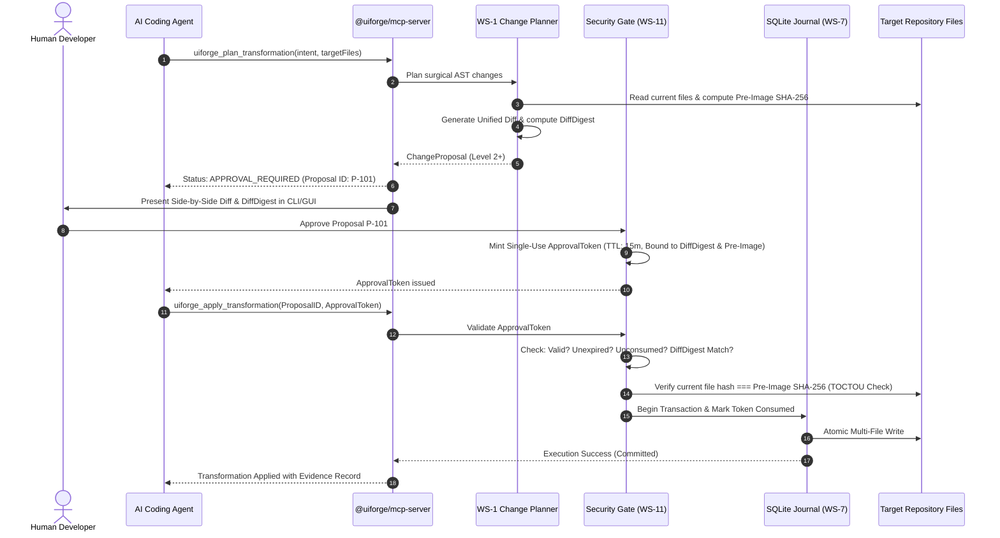

# UIForge Phase 02.2 — Security & Trust Architecture Specification

**Document Identifier:** `UIF-PH02.2-SECURITY-ARCHITECTURE`  
**Classification:** Canonical Application Security & Trust Boundary Specification  
**Parent Phase:** Phase 02.2 — Deep Technical Audit, Architecture Decisions & Cross-Workstream Consolidation  
**Target Standard:** Principal Application Security Architect + Principal Software Architect + AI Systems Architect  
**Status:** COMPLETE & CONSOLIDATED  
**Date:** November 21, 2026  

---

## 1. Security Philosophy & The Zero-Trust Model

AI coding agents are powerful but fundamentally non-deterministic and susceptible to prompt injection, hallucinated paths, and indirect jailbreaks. In UIForge:

> **Prompt instructions are not security boundaries.** Security is enforced strictly through hardened operating system boundaries, deterministic policy gates, path canonicalization, pre-image hash verification, and human authorization tokens.

### 1.1 Non-Negotiable Security Invariants
1. **Repository As Untrusted Input:** Source code, Markdown documentation, README files, and code comments residing inside target repositories are treated as **untrusted data**. They are never evaluated as executable code or trusted as instructions.
2. **Agent As Untrusted Actor:** An AI agent connecting via MCP or CLI is an untrusted client. An agent's assertion that "the user authorized this modification" is given zero trust. Mutating actions require cryptographically valid, single-use, diff-bound approval tokens generated by UIForge and confirmed by the human operator.
3. **Fail-Closed Execution:** If a path cannot be canonicalized, if a file hash has shifted by a single byte, if an approval token has expired, or if an SSRF check is ambiguous, the system halts execution immediately and logs an audit failure.

---

## 2. Trust Classification Taxonomy

Every data source and actor interacting with UIForge is assigned an explicit trust tier:

```
┌────────────────────────────────────────────────────────────────────────────────────────┐
│                              TRUST CLASSIFICATION TIERS                                │
├───────┬───────────────────────────────┬────────────────────────────────────────────────┤
│ Tier  │ Entity / Artifact             │ Trust Level & Operational Treatment            │
├───────┼───────────────────────────────┼────────────────────────────────────────────────┤
│ T-0   │ Human User Terminal / GUI     │ Fully Trusted (Ultimate Authorization Root)    │
│ T-1   │ UIForge Engine & Policy Logic │ Trusted Internal System Boundary               │
│ T-2   │ Human-Approved Mutation Diff  │ Trusted for Single Authorized Execution        │
│ T-3   │ Verified Official Registries  │ Semi-Trusted (Inspected, Validated & Sandboxed)│
│ T-4   │ External AI Coding Agents     │ Untrusted (Capability-Bounded via MCP / SDK)   │
│ T-5   │ Target Project Source Files   │ Untrusted (Potential Indirect Prompt Injection)│
│ T-6   │ Unofficial Registries / Pkgs  │ Hostile / Untrusted (SSRF & Integrity Barred)  │
│ T-7   │ Headless Browser Rendered DOM │ Hostile Sandbox (Isolated Network & Memory)    │
└───────┴───────────────────────────────┴────────────────────────────────────────────────┘
```

---

## 3. The 21-Vector Threat Model & Mitigation Matrix

We conduct an exhaustive threat modeling analysis covering 21 critical threat vectors spanning AI agents, filesystem mutations, external registries, and browser automation:

| Vector ID | Threat Description | Attack Vector / Entry Point | Affected Subsystem | Prevention Owner | Enforcement Mechanism | Residual Risk & Phase 03 Validation |
| :--- | :--- | :--- | :--- | :--- | :--- | :--- |
| **TH-01** | **Indirect Prompt Injection** | Malicious text in repository README, component comments, or issues. | WS-1 / WS-5 | WS-5 (Agent SDK) | Strict prompt/context boundary delimiters; context packing strips instructional tags. | Low; agents must not treat comments as system instructions. |
| **TH-02** | **Malicious Registry Content** | Registry item containing obfuscated malicious code or crypto miners. | WS-3 (Registry) | WS-3 (Registry) | Ingestion inspects all 12 shadcn types; enforces AST linting and static analysis before staging. | Medium; Phase 02.3 legal & supply-chain audit handoff. |
| **TH-03** | **Compromised Dependency** | Ingested component declares malicious transitive npm packages. | WS-3 / WS-2 | WS-3 (Registry) | Package name whitelisting; explicit audit flags; disallow dynamic dependencies. | Low; requires user confirmation for npm package installs. |
| **TH-04** | **Dependency Confusion** | Registry references internal company package on public npm. | WS-3 (Registry) | WS-3 (Registry) | Scoped package namespace validation against local package.json configuration. | Low. |
| **TH-05** | **Malicious Lifecycle Scripts**| `npm install` executing malicious `postinstall` shell scripts. | WS-1 / WS-3 | WS-1 (Transforms) | UIForge strictly enforces `--ignore-scripts` on any automated package operation. | Eliminated by `--ignore-scripts`. |
| **TH-06** | **Registry SSRF** | Attacker specifies registry URL pointing to AWS metadata or internal IP. | WS-3 (Registry) | WS-3 (Registry) | Deny RFC 1918 (10.0.0.0/8, 172.16.0.0/12, 192.168.0.0/16), 169.254.169.254, IPv6 loopback (`::1`). | Low; enforced at HTTP request client level. |
| **TH-07** | **Redirect Abuse** | Registry URL redirects from public HTTPS to internal HTTP intranet. | WS-3 (Registry) | WS-3 (Registry) | Disallow automatic HTTP 3xx cross-origin or downgrade redirects. | Low. |
| **TH-08** | **Path Traversal Escape** | Malicious file paths (e.g., `../../etc/passwd` or `C:\Windows`). | WS-1 / WS-7 | WS-1 (Transforms) | Path canonicalization via `fs.realpathSync`; assert `path.startsWith(canonicalRepoRoot)`. | Low; verified in WS-5 Experiment E5. |
| **TH-09** | **Symlink Hijacking** | Target repo contains symlink pointing to sensitive system file outside repo. | WS-1 / WS-7 | WS-1 (Transforms) | Rejects modifications to symlinks or paths traversing symlinked directories. | Low; requires live runtime OS test in Phase 03. |
| **TH-10** | **TOCTOU Race Condition** | File modified on disk between human approval and physical write. | WS-1 / WS-7 | WS-1 (Transforms) | Physical write checks pre-image SHA-256 against exact disk state in same atomic tick. | Low; verified in WS-5 Experiment E5. |
| **TH-11** | **Unauthorized File Writes** | AI agent calls tool attempting direct file write without approval. | WS-5 / WS-11 | WS-5 (Security) | 5-level security ladder blocks Level 2+ execution without valid approval token. | Zero; fail-closed gate. |
| **TH-12** | **Approval Token Replay** | Replaying an intercepted approval token to execute a second modification. | WS-5 / WS-11 | WS-5 (Security) | Tokens are strictly single-use; marked consumed in SQLite journal immediately upon entry. | Zero; atomic consumption. |
| **TH-13** | **Expired Approval Execution**| Executing a change using a stale approval token issued hours earlier. | WS-5 / WS-11 | WS-5 (Security) | Hard TTL limit: maximum 15 minutes validity; rejects expired tokens. | Zero. |
| **TH-14** | **Secret & API Key Exposure** | Hardcoded `.env` secrets or API keys leaked in agent context or logs. | WS-5 / WS-9 | WS-5 (Agent SDK) | Blacklist `.env*`, `.pem`, `id_rsa`; regex redactor masks Bearer tokens, AWS keys, GitHub tokens. | Low; verified in WS-5 Experiment E9. |
| **TH-15** | **MCP Tool Parameter Poisoning**| Malformed JSON-RPC payloads designed to exploit prototype pollution. | WS-5 (MCP) | WS-5 (MCP Server) | Zod schema validation; `Object.freeze` on parsed inputs; disallow `__proto__`, `constructor`. | Zero; verified in WS-3 Experiment E4. |
| **TH-16** | **Session Hijacking** | Malicious local process hijacking another agent's MCP session. | WS-5 (MCP) | WS-5 (MCP Server) | Stdio transport restricted to OS parent-child pipes; HTTP requires localhost bearer token. | Low. |
| **TH-17** | **Audit Log Tampering** | Attacker modifies `.uiforge/journal.db` or audit logs to conceal changes. | WS-9 / WS-10 | WS-9 (Evidence) | Chained SHA-256 digests (`recordDigest[n] = H(record[n] + recordDigest[n-1])`). | Low; detectability guaranteed (external anchor required). |
| **TH-18** | **Browser Intranet SSRF** | Playwright navigating to internal cloud metadata or local microservices. | WS-4 (Browser) | WS-4 (Browser) | Network route interception blocks non-whitelisted destinations; restricts to target app port. | Low; verified in WS-4 Experiment E8. |
| **TH-19** | **Malicious Webpage Exploits**| Rendered page executes malicious WebSockets or WebRTC to bypass sandbox. | WS-4 (Browser) | WS-4 (Browser) | Disable WebSockets/WebRTC in Playwright context; disable cross-origin iframes. | Low. |
| **TH-20** | **Visual Trace / Screen Leak** | Screenshot of UI containing PII or production user data stored insecurely. | WS-4 / WS-9 | WS-4 (Browser) | Verification screenshots stored locally in `.uiforge/artifacts/` with 0600 file permissions. | Low. |
| **TH-21** | **Cross-Project Pollution** | Agent operating in Repo A reads or writes files in Repo B. | WS-1 / WS-5 | WS-1 (Project) | Every session strictly pinned to a single canonical repository root. Cross-repo paths rejected. | Zero; path bounds enforced. |

---

## 4. Five-Level Security Permission Ladder

UIForge implements a formal **Five-Level Security Permission Ladder**. Every capability, CLI command, and MCP tool is mapped to an immutable permission tier:

```
┌────────────────────────────────────────────────────────────────────────────────────────┐
│                        FIVE-LEVEL SECURITY PERMISSION LADDER                           │
├───────┬──────────────────────────────┬──────────────────┬──────────────────────────────┤
│ Level │ Tier Name                    │ Approval Gate    │ Permitted Capabilities       │
├───────┼──────────────────────────────┼──────────────────┼──────────────────────────────┤
│ **0** │ **Read-Only Inspection**     │ None (Autonomous)| AST scan, route map, tokens  │
│ **1** │ **Ephemeral Verification**   │ None (Autonomous)| Headless browser test, axe   │
│ **2** │ **Scoped Change Proposal**   │ Human Review     │ Single-file edit, CSS token  │
│ **3** │ **Multi-File Transformation**│ Human Approval   │ Multi-file AST rewrite, shadcn│
│ **4** │ **System & Destructive**     │ Explicit Confirm │ Config mutation, dependency  │
└───────┴──────────────────────────────┴──────────────────┴──────────────────────────────┘
```

### 4.1 Permission Enforcement Rules
1. **Level 0 (Autonomous Read-Only):** Tools that inspect the filesystem without modifying state (`uiforge_scan_project`, `uiforge_get_component_ast`, `uiforge_resolve_tokens`). Safe for continuous agent reasoning.
2. **Level 1 (Autonomous Verification):** Ephemeral execution tools that do not touch application source code (`uiforge_verify_browser`, `uiforge_run_a11y_scan`). Playwright launches in an isolated sandbox.
3. **Level 2 (Scoped Change Proposal):** Operations proposing a mutation to 1–2 localized component files. UIForge generates a unified diff and halts. Execution requires human confirmation.
4. **Level 3 (Multi-File Transformation):** Structural refactorings affecting 3+ files, component registry installations, or cross-paradigm styling migrations. Requires explicit, interactive diff-by-diff human approval.
5. **Level 4 (System & Destructive Mutation):** Modifications to `package.json`, `tsconfig.json`, Tailwind build configurations, file deletions, or dependency additions. Requires two-step human confirmation with terminal warning flags.

---

## 5. Single-Use, Diff-Bound Human Approval Architecture

To guarantee that an approved change cannot be subverted, UIForge cryptographically binds authorization to the exact proposed change:



### 5.1 Defense Against TOCTOU Races
A critical vulnerability in automated agent workflows is the **Time-of-Check to Time-of-Use (TOCTOU)** race condition:
1. Agent inspects file `A.tsx` (Pre-image SHA-256: `abcd...`).
2. Human approves the diff.
3. Developer concurrently edits `A.tsx` outside UIForge.
4. Agent executes mutation, potentially overwriting unapproved developer work.

**UIForge Resolution:** In step 11 above, before modifying a single byte on disk, the execution engine reads the physical file and computes its current SHA-256 hash. If `currentHash !== preImageSha256`, the operation **aborts immediately**, marks the approval token invalid, and issues a `TOCTOU_DISK_MODIFICATION_DETECTED` failure without touching disk.

---

## 6. Browser & Registry Isolation Architecture

### 6.1 Headless Browser Network Isolation (WS-4)
Headless browser verification operates inside a locked-down Playwright context:
1. **Destination Whitelisting:** Navigations are restricted strictly to `127.0.0.1`, `localhost`, or the explicitly designated local development server port (e.g., `http://localhost:3000`).
2. **SSRF Egress Blocking:** Route interception actively cancels any network request targeting:
   - Private IPv4 ranges (RFC 1918): `10.0.0.0/8`, `172.16.0.0/12`, `192.168.0.0/16`.
   - Cloud instance metadata services: `169.254.169.254`.
   - IPv6 loopback (`::1`) or link-local (`fe80::/10`).
3. **Protocol Restriction:** WebSockets, WebRTC, and file:// protocol navigations are blocked by default.

### 6.2 Component Registry Ingestion Isolation (WS-3)
1. **Canonical Registry Whitelist:** Only approved HTTPS registries (e.g., official `ui.shadcn.com/r` or enterprise-configured mirrors) may be fetched.
2. **HTTPS Only:** Plaintext HTTP registry endpoints are rejected.
3. **Payload Digest Verification:** Ingested JSON envelopes must match an expected SHA-256 hash or be reviewed by the developer prior to extraction.

---

## 7. Audit Logging & Secret Redaction

### 7.1 Secret Redaction Engine
Before writing any log entry, terminal output, or agent context excerpt, strings pass through the UIForge **Secret Redaction Pipeline**:
- Masked patterns include:
  - AWS Access Keys (`AKIA[0-9A-Z]{16}`)
  - GitHub Personal Access Tokens (`ghp_[0-9a-zA-Z]{36}`)
  - OpenAI / Anthropic API Keys (`sk-[0-9a-zA-Z]{20,}`)
  - Private Keys (`-----BEGIN (RSA|EC|OPENSSH) PRIVATE KEY-----`)
  - Generic Bearer Tokens (`Bearer [A-Za-z0-9\-\._~\+\/]+=*`)
- Redacted tokens are replaced with `[REDACTED_SECRET:hash_prefix]`.

### 7.2 SHA-256 Digest-Chained Audit Trail
Audit events are appended to `.uiforge/audit.jsonl` using cryptographic hash chaining:
$$\text{recordDigest}_n = \text{SHA-256}(\text{recordContent}_n \parallel \text{recordDigest}_{n-1})$$
Any deletion, reordering, or tampering with previous audit log entries causes immediate hash chain verification failure. *(Disclaimer: Hash chaining detects local modifications; external trust anchoring or timestamping authorities are documented as Phase 03/04 enterprise extensions).*
