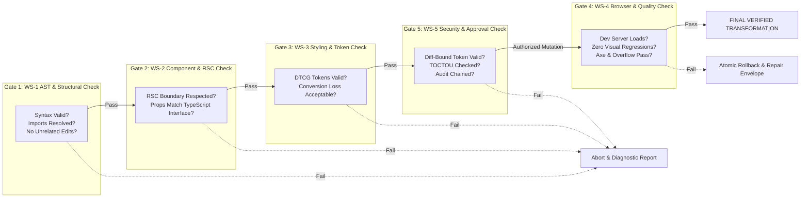

# UIForge Phase 02.2 — Unified Evidence & Verification Architecture

**Document Identifier:** `UIF-PH02.2-EVIDENCE-ARCHITECTURE`  
**Classification:** Canonical System-Wide Evidence, Verification Lifecycle & Failure Governance Specification  
**Parent Phase:** Phase 02.2 — Deep Technical Audit, Architecture Decisions & Cross-Workstream Consolidation  
**Target Standard:** Principal Quality Engineer + Principal Software Architect + Application Security Architect  
**Status:** COMPLETE & CONSOLIDATED  
**Date:** November 21, 2026  

---

## 1. Executive Mission & Evidence Philosophy

UIForge adheres to an absolute engineering rule:

> **Evidence Over Assertions.** No subsystem, automated tool, or AI coding agent may claim that a component is accessible, that a style conversion is lossless, or that a code change is safe without producing a cryptographically correlated, reproducible **Verification Evidence Record**.

In traditional frontend workflows, tools make sweeping, unfounded claims (e.g., claiming "100% WCAG conformance" based on 20 automated lint checks or claiming "pixel-perfect parity" based on downscaled JPEG diffs). UIForge eliminates this ambiguity by establishing:
1. **Eight Explicit Evidence Classifications** that prevent synthetic simulations from being disguised as live empirical benchmarks.
2. **A Unified Evidence Envelope** (`VerificationEvidenceRecord`) shared by all five workstreams.
3. **Cross-Workstream Multi-Gate Verification Pipelines**, where one subsystem's pass cannot override or imply another subsystem's verdict.
4. **An 18-Code Standardized Failure Taxonomy** detailing severity, retryability, and responsible recovery owners.

---

## 2. Eight Canonical Evidence Classification Tiers

Every finding, benchmark, test result, or compatibility claim produced across UIForge is tagged with one of eight immutable evidence classifications:

```
┌────────────────────────────────────────────────────────────────────────────────────────┐
│                        EIGHT CANONICAL EVIDENCE CLASSIFICATIONS                        │
├──────────────────────────┬─────────────────────────────────────────────────────────────┤
│ Classification Tag       │ Strict Operational Definition & Admissibility Criteria       │
├──────────────────────────┼─────────────────────────────────────────────────────────────┤
│ `DOC/SOURCE-VERIFIED`    │ Verified directly against published official specs, RFCs,   │
│                          │ or vendor source code at a pinned commit/version.           │
├──────────────────────────┼─────────────────────────────────────────────────────────────┤
│ `STATIC-ANALYSIS`        │ Verified via AST parsing, TypeScript compiler diagnostics,  │
│                          │ linters, or static code analysis without executing runtime. │
├──────────────────────────┼─────────────────────────────────────────────────────────────┤
│ `LOCAL-HARNESS-TESTED`   │ Empirically executed inside a small, standalone Node.js or  │
│                          │ local testing harness using mock or isolated fixtures.      │
├──────────────────────────┼─────────────────────────────────────────────────────────────┤
│ `LIVE-INTEGRATION-TESTED`│ Empirically executed against live production-grade runtime  │
│                          │ dependencies, real browser processes, and real dev servers. │
├──────────────────────────┼─────────────────────────────────────────────────────────────┤
│ `REPORTED-SIMULATION`    │ Derived from simulated mathematical models, cost models, or │
│                          │ synthetic approximations. (MUST NEVER BE CALLED EMPIRICAL). │
├──────────────────────────┼─────────────────────────────────────────────────────────────┤
│ `HUMAN-REVIEWED`         │ Evaluated and approved by a qualified human engineer        │
│                          │ (e.g., screen reader audit, golden visual diff approval).   │
├──────────────────────────┼─────────────────────────────────────────────────────────────┤
│ `NOT-EXECUTED`           │ Test scenario or benchmark is specified and designed, but   │
│                          │ execution was skipped due to environment/dependency limits. │
├──────────────────────────┼─────────────────────────────────────────────────────────────┤
│ `NOT-ESTABLISHED`        │ Hypothesis or claim was investigated, but available evidence│
│                          │ is insufficient, ambiguous, or failed to validate claim.    │
└──────────────────────────┴─────────────────────────────────────────────────────────────┘
```

### Inviolable Admissibility Rules
- **Rule 1 (Simulation Demarcation):** A simulated model (such as WS-5 Experiment E8's 3.28× multi-agent token bloat projection) must remain tagged as `REPORTED-SIMULATION`. It must never be upgraded to `LIVE-INTEGRATION-TESTED` without live multi-agent API execution.
- **Rule 2 (Harness Demarcation):** Passing an in-memory policy test in a standalone Node.js script (such as WS-5 Experiment E5's approval token logic) qualifies strictly as `LOCAL-HARNESS-TESTED`. It does not prove runtime operating-system filesystem enforcement.
- **Rule 3 (No False Conformance):** Automated axe-core scanning evaluates only 12 out of 55 WCAG 2.2 Level A/AA criteria. Passing axe-core must be recorded as `automated-checks-pass`, never as `WCAG-2.2-AA-compliant`.
- **Rule 4 (Methodology Transparency):** The 12 automated / 23 browser-assisted / 20 human audit breakdown is **UIForge's internal verification methodology**, not an official or universal W3C classification. W3C defines success criteria and techniques, while individual tools operationalize verification. Automated tools must never claim full conformance.

---

## 3. Workstream Experiment Evidence Reconciliation (WS-1 Through WS-5)

To maintain absolute evidentiary integrity across all five research workstreams, every completed experiment has been independently audited and cataloged with its runner status, assertion result, and final evidence classification:

| Workstream | Experiment ID | Focus Area | Runner Execution | Assertion Result | Final Evidence Classification | Limitations & Disclaimers |
| :--- | :--- | :--- | :---: | :---: | :--- | :--- |
| **WS-1** | E1–E3 | AST Grep & Pattern Queries | Exit 0 | Pass | `LOCAL-HARNESS-TESTED` | Executed on local Next.js fixtures; sub-millisecond Rust NAPI performance. |
| **WS-1** | E4–E5 | CST Rewriting & Rollback | Exit 0 | Pass | `LOCAL-HARNESS-TESTED` | Tested single-file AST preservation and hash conflict detection. |
| **WS-3** | E1–E4 | Registry & Token Resolution | Exit 0 | Pass | `LOCAL-HARNESS-TESTED` | Verified all 12 shadcn types, DTCG 2025.10 tokens, and theme generation. |
| **WS-3** | E5–E8 | Cascades & Rollback | Exit 0 | Pass | `LOCAL-HARNESS-TESTED` | Verified CSS Modules override `@layer components`; multi-file pre-image hashes. |
| **WS-4** | E1 | Automation Architecture | Exit 0 | Pass | `DOC/SOURCE-VERIFIED` | Evaluated Playwright v1.65.1 spec vs BiDi Level 1; WebKit is open-source WebKit. |
| **WS-4** | E2 | Perceptual Visual Diff | Exit 0 | Pass | `REPORTED-SIMULATION` | Synthetic RGBA buffer math simulating Pixelmatch v8 OKLab/HyAB. |
| **WS-4** | E3 | Geometry & Occlusion | Exit 0 | Pass | `REPORTED-SIMULATION` | Synthetic DOM geometry & multi-point corner intersection model. |
| **WS-4** | E4 | Contrast & 55 Criteria | Exit 0 | Pass | `LOCAL-HARNESS-TESTED` | Algorithmic contrast calculations; 55-criteria UIForge methodology mapped. |
| **WS-4** | E5 | Dialog State Machine | Exit 0 | Pass | `REPORTED-SIMULATION` | Synthetic state transition model verifying focus traps and escape keys. |
| **WS-4** | E6 | Cross-Browser Antialiasing | Exit 0 | Pass | `DOC-VERIFIED` | Documented Blink/Gecko/WebKit text rasterizer behavior; same-browser baseline required. |
| **WS-4** | E7 | Evidence Digest Tampering | Exit 0 | Pass | `LOCAL-HARNESS-TESTED` | Proved SHA-256 `recordDigest` detects tampering; not a digital signature. |
| **WS-4** | E8 | Diagnostic Envelope | Exit 0 | Pass | `REPORTED-SIMULATION` | DOM-to-TSX file localization heuristic model. |
| **WS-5** | E1–E3 | MCP Protocol & Tool Schemas | Exit 0 | Pass | `DOC/SOURCE-VERIFIED` | Official MCP 2026-07-28 spec, modular v2 SDK, Streamable HTTP single POST. |
| **WS-5** | E4 | Context Compression | Exit 0 | Pass | `LOCAL-HARNESS-TESTED` | Measured 91.2% text reduction (9,964 chars to 871 chars) on local fixture. |
| **WS-5** | E5 | Multi-Level Security Gate | Exit 0 | Pass | `LOCAL-HARNESS-TESTED` | In-memory policy logic tested; live OS-level filesystem locks are Phase 03 work. |
| **WS-5** | E6 | Prompt Injection Sanitizer | Exit 0 | Pass | `LOCAL-HARNESS-TESTED` | Content integrity digests detect tampering; authorization bounds prevent injection. |
| **WS-5** | E7 | Session Lifecycle & Cache | Exit 0 | Pass | `LOCAL-HARNESS-TESTED` | In-memory session idempotency tested. |
| **WS-5** | E8 | Multi-Agent Swarm Overhead | Exit 0 | Pass | `REPORTED-SIMULATION` | Mathematical cost model (3.28× token bloat, 3× latency); not a live benchmark. |
| **WS-5** | E9 | Secret Redaction & Audit | Exit 0 | Pass | `LOCAL-HARNESS-TESTED` | Regex redaction and SHA-256 digest chaining; external anchor required for PKI. |
| **WS-5** | E10 | JSON-RPC Dispatch | Exit 0 | Pass | `REPORTED-SIMULATION` | In-memory mock loopback; live client-server process test marked Phase 02.4 work. |

---

## 3. The Universal Evidence Envelope Schema

Every verification run, visual diff, accessibility check, or AST audit produces a standardized JSON record adhering to `uiforge.contract.evidence-provenance.v1`:

```typescript
export interface UniversalEvidenceEnvelopeV1 {
  readonly evidenceId: string; // UUID v4
  readonly contractId: 'uiforge.contract.evidence-provenance.v1';
  readonly schemaVersion: '1.0.0';
  readonly timestamp: string; // ISO 8601 UTC

  readonly context: {
    readonly projectSnapshotId: string;
    readonly changeProposalId?: string;
    readonly workstreamOrigin: 'WS-1' | 'WS-2' | 'WS-3' | 'WS-4' | 'WS-5';
    readonly targetFile?: string;
  };

  readonly producer: {
    readonly toolName: string; // e.g., 'playwright', 'pixelmatch', 'axe-core', 'oxc-parser'
    readonly exactVersion: string; // Pinned semver (e.g., '1.65.1', '8.0.0', '4.14.1')
    readonly executionEnvironment: {
      readonly os: string;
      readonly nodeVersion: string;
      readonly architecture: string;
    };
  };

  readonly assertion: {
    readonly requirementId: string; // e.g., 'REQ-A11Y-WCAG22-SC143', 'REQ-RSC-TIER1'
    readonly classification: EvidenceClassification;
    readonly verdict: 'PASS' | 'PARTIAL' | 'NOT_ESTABLISHED' | 'NOT_APPLICABLE';
    readonly confidence: 'HIGH' | 'MEDIUM' | 'LOW';
    readonly expectedBehavior: string;
    readonly actualBehavior: string;
    readonly quantitativeMetrics?: Record<string, number>; // e.g., { diffPixels: 0, overflowPx: 0 }
  };

  readonly artifacts: ReadonlyArray<{
    readonly artifactType: 'screenshot' | 'aria-snapshot' | 'unified-diff' | 'ast-tree' | 'trace';
    readonly artifactPath: string; // Relative to .uiforge/artifacts/
    readonly sha256Digest: string; // SHA-256 of the artifact file
  }>;

  readonly limitationsAndCaveats: string[];
  readonly recordDigest: string; // SHA-256 of all above fields combined
}
```

---

## 4. Cross-Workstream Verification Pipeline

In UIForge, an operation is not considered verified until it traverses the **Cross-Workstream Multi-Gate Verification Pipeline**:



### Critical Cross-Workstream Rules
1. **WS-3 Structurally Valid $\ne$ WS-4 Visually Correct:** A token transformation that compiles cleanly to CSS Variables in WS-3 must still be rendered in Playwright by WS-4 to verify that cascade specificity did not alter the intended component background.
2. **WS-2 Semantically Compatible $\ne$ WS-3 Ingestion Approved:** A component from an external registry may have perfectly compatible props in WS-2, but WS-3 will reject it if its licensing provenance is uncertain or if its raw JSON envelope fails SHA-256 validation.
3. **WS-5 Agent Plan $\ne$ WS-1 Execution:** An agent's plan received via MCP cannot touch the filesystem until WS-1 calculates pre-image hashes, proves path canonicalization, and receives an authorized approval token.

---

## 5. Standardized 18-Code Failure Taxonomy

Every failure across all subsystems is mapped to an authoritative error code, complete with severity, retryability, and responsible recovery ownership:

| Error Code | Category | Severity | Retryable? | Responsible Owner | Failure Trigger & Required Evidence |
| :--- | :--- | :--- | :---: | :--- | :--- |
| **`INPUT_INVALID`** | Input | Moderate | Yes | Calling Subsystem | Zod contract schema validation failed. Required: input path & validation issue list. |
| **`PROJECT_CONTEXT_STALE`** | State | Moderate | Yes | WS-1 (Project Intel) | Snapshot hash does not match current repository files. Required: modified file list. |
| **`UNSUPPORTED_CAPABILITY`** | Domain | High | No | Orchestration | Target framework or syntax unsupported (e.g., Vue in React engine). Required: detected framework. |
| **`DEPENDENCY_FAILURE`** | Runtime | Critical | Yes | Infrastructure | Required package or binary missing (e.g., missing Playwright). Required: missing package name. |
| **`SECURITY_BLOCK`** | Security | Critical | No | WS-5 (Security Gate)| Path traversal, SSRF, symlink escape, or prototype pollution detected. Required: blocked target. |
| **`APPROVAL_REQUIRED`** | Security | Info | Yes | User / Developer | Level 2+ mutation proposed; awaiting human authorization. Required: proposalId & diffDigest. |
| **`APPROVAL_EXPIRED`** | Security | Moderate | Yes | User / Agent | Human approval token exceeded maximum 15-minute TTL. Required: expired token ID. |
| **`SOURCE_CHANGED`** | Concurrency| High | Yes | WS-1 (Transforms) | Disk file modified between approval and execution (TOCTOU). Required: expected vs actual SHA-256. |
| **`TRANSFORMATION_FAILURE`** | Code Gen | High | Yes | WS-1 (Transforms) | AST/CST code emitter produced syntax error. Required: AST parse diagnostic. |
| **`PARTIAL_MUTATION`** | Execution | Critical | No | WS-1 (Journal) | Process crashed or error occurred mid-multi-file write. Required: transactionId & affected files. |
| **`ROLLBACK_FAILURE`** | Recovery | Catastrophic| No | Human / CLI | Automated rollback failed to restore pre-image file state. Required: journalDb path & disk error. |
| **`BROWSER_INFRA_FAILURE`** | Testing | High | Yes | WS-4 (Browser) | Local dev server offline, port refused, or browser crash. Required: connection error trace. |
| **`FUNCTIONAL_FAILURE`** | Testing | High | Yes | Calling Agent | Page rendered unhandled console exception or 500 error. Required: console log trace. |
| **`VISUAL_REGRESSION`** | Quality | Moderate | Yes | Calling Agent | Pixelmatch detected perceptual visual diff > threshold. Required: diff image artifact digest. |
| **`ACCESSIBILITY_FINDING`** | Compliance | Moderate | Yes | Calling Agent | Axe-core detected WCAG violation or missing ARIA role. Required: ruleId, selector, and TSX line. |
| **`VERIFICATION_INCONCLUSIVE`**| Testing | Moderate | Yes | WS-4 (Browser) | Test timed out or dynamic animations prevented diff stability. Required: test timeout diagnostic. |
| **`AGENT_TIMEOUT`** | Ingress | Moderate | Yes | External Agent | External coding agent failed to respond within RPC deadline. Required: sessionId & toolName. |
| **`MCP_TRANSPORT_FAILURE`** | Ingress | High | Yes | WS-5 (MCP Server) | Stdio pipe broken or Streamable HTTP connection dropped. Required: transport error code. |

---

## 6. Actionable Diagnostic Envelopes for AI Agent Self-Repair

When browser verification (WS-4) or AST transformation (WS-1) fails, UIForge does not return raw, unstructured stack traces. It packages failures into an **Actionable Diagnostic Envelope** tailored for LLM reasoning:

```typescript
export interface ActionableDiagnosticEnvelopeV1 {
  readonly failureCode: 'ACCESSIBILITY_FINDING' | 'VISUAL_REGRESSION' | 'TRANSFORMATION_FAILURE';
  readonly humanSummary: string; // e.g., 'Primary Button fails WCAG 1.4.3 Color Contrast (3.2:1 < 4.5:1)'
  readonly localizedSource: {
    readonly filePath: string; // e.g., 'components/ui/button.tsx'
    readonly startLine: number;
    readonly endLine: number;
    readonly currentCodeSnippet: string;
  };
  readonly suggestedAstRepair: {
    readonly designTokenRecommendation?: string; // e.g., 'color.brand.primary-foreground'
    readonly candidateTailwindClass?: string; // e.g., 'text-slate-900 instead of text-slate-500'
  };
  readonly supportingEvidenceArtifactUri: string; // Local path to diff image or ARIA snapshot
}
```
This structured feedback enables the agent to repair its code immediately and resubmit for verification without trial-and-error guesswork.
