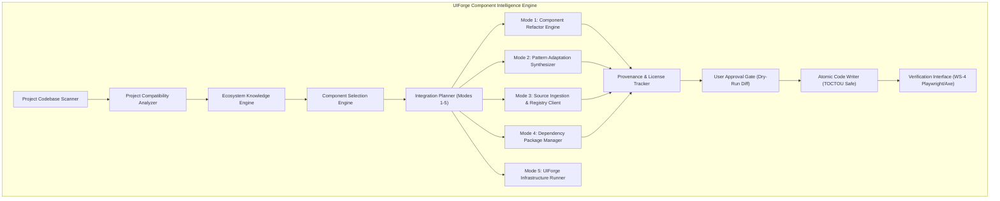

# UIF-PH02-WS2-FINAL — Component & Design-System Architecture: Comprehensive Architecture Decisions & Final Baseline Report
**Principal Frontend Architect, Senior Design-System Engineer & Program Analysis Specialist**

---

## 1. Executive Assessment & WS-2 Final Reconciled Record

This document delivers the final, authoritative architectural baseline for **UIForge Phase 02.2 Workstream 2 (WS-2): Component & Design-System Architecture**. It incorporates all critical peer review amendments, closes the workstream with rigorous evidence qualifications, and establishes the technical bridge to **Workstream 3 (WS-3: Registry, Design Tokens & Styling Architecture)**.

### Core Architectural Invariants Established in WS-2

1. **Intelligence Engine, Not a Component Vendor**: UIForge will not build or distribute a proprietary, competing component library. Instead, UIForge implements a **Component & Design-System Intelligence Subsystem** capable of analyzing target codebases, discovering existing design tokens and primitives, and adapting or ingesting external patterns.
2. **Brownfield Preservation as a First-Class Law**: UIForge will never force an existing frontend codebase into a foreign styling or component paradigm. If a target application uses CSS Modules, Sass, Mantine, or Ant Design, UIForge operates natively within those conventions.
3. **Mode-Specific Component Eligibility**: Component selection enforces **Two-Stage Evaluation**:
   - **Stage 1: Mode-Specific Eligibility Gates** (Hard pass/fail across functional capability, runtime compatibility, licensing, and security).
   - **Stage 2: Multi-Dimensional Weighted Ranking** (Only for eligible candidates; favors existing component reuse).
4. **Distribution via Open Standards**: UIForge adopts the open **shadcn Registry Specification** format (`registry.json`) for component distribution, while maintaining an internal, normalized intelligence model that separates **abstract component definitions**, **ecosystem implementations**, **empirical verification records**, and **multi-source provenance manifests**.

---

## 2. Research Methodology & Evidence Standards

All research was conducted in strict compliance with the **UIForge Research-Only Protocol (Phase 1 Execution)**. No files within the UIForge repository were modified, created, staged, or deleted.

### Evidence Classification Standards
Every technical claim in this deliverable is tagged according to verifiable evidence levels:
- `[DOC-VERIFIED]`: Established directly from vendor documentation, published RFCs, or official release notes.
- `[SOURCE-VERIFIED]`: Confirmed through direct inspection of repository source code, AST node structures, or package manifest metadata at a pinned commit or version.
- `[PRODUCT-TESTED]`: Empirically validated through reproducible execution scripts, AST parsers, or testing harnesses with recorded runtime environments.
- `[REPORTED-SIMULATION]`: Derived from controlled, small-fixture test runs or simulated selection models, acknowledging single-fixture and synthetic limitations.
- `[PLANNED]`: Architectural capability designed for future UIForge engine implementation; not currently executed in production.

---

## 3. Ecosystem Classification & Taxonomy

The modern component ecosystem is categorized into five distinct architectural groups:

```
┌────────────────────────────────────────────────────────────────────────────────────────────────────────────────┐
│                                   FRONTEND COMPONENT ECOSYSTEM TAXONOMY                                        │
├────────────────────────────────┬──────────────────────────────────────────┬────────────────────────────────────┤
│ Category                       │ Primary Exemplars                        │ Core Distribution & Runtime Model  │
├────────────────────────────────┼──────────────────────────────────────────┼────────────────────────────────────┤
│ Group A: Source & Registry     │ shadcn/ui, shadcn Registry Spec,         │ Uncompiled TSX source copied into  │
│ Ecosystems                     │ Tremor Raw, Coss UI, Origin UI, Magic UI │ user repo; user owns code; zero    │
│                                │                                          │ monolithic runtime package.        │
├────────────────────────────────┼──────────────────────────────────────────┼────────────────────────────────────┤
│ Group B: Headless Component    │ Radix UI Primitives, Base UI (MUI),      │ Headless unstyled npm packages;    │
│ Primitives                     │ React Aria Components, Zag.js, Ark UI,   │ manages WAI-ARIA, roving tabindex, │
│                                │ Ariakit                                  │ and focus; zero styling opinions.  │
├────────────────────────────────┼──────────────────────────────────────────┼────────────────────────────────────┤
│ Group C: Cohesive Complete     │ Mantine, Ant Design, Carbon Design       │ Monolithic runtime component kits; │
│ Design Systems                 │ System, Material UI (MUI), Chakra UI v3, │ integrated token cascade, rich     │
│                                │ Fluent UI, HeroUI (formerly NextUI)      │ complex tables, opinionated styles.│
├────────────────────────────────┼──────────────────────────────────────────┼────────────────────────────────────┤
│ Group D: Component & App       │ satnaing/shadcn-admin, Refine            │ Full application layout shells,    │
│ Templates                      │ (refinedev/refine)                       │ auth layouts, CRUD routing hooks,  │
│                                │                                          │ data providers (not single atoms). │
├────────────────────────────────┼──────────────────────────────────────────┼────────────────────────────────────┤
│ Group E: Specialized           │ TanStack Table v8, cmdk, Recharts v3+,   │ Focused functional engines for     │
│ Supporting Ecosystems          │ Motion (motion/react), Lucide Icons      │ complex virtualization, command    │
│                                │                                          │ search, SVG charts, and springs.   │
└────────────────────────────────┴──────────────────────────────────────────┴────────────────────────────────────┘
```

---

## 4. Audited Repository Profiles (Groups A through E)

### Group A — Component Source & Registry Ecosystems

#### 1. shadcn/ui (`shadcn-ui/ui`)
- **Distribution Model**: Copy-paste uncompiled TSX source + Distributed Registry Client `[DOC-VERIFIED]`.
- **Registry Specification Format**: Operates against the official registry schema. Supports the full list of official registry item types: `registry:base`, `registry:component`, `registry:font`, `registry:page`, `registry:file`, `registry:style`, `registry:theme`, `registry:item`, `registry:ui`, `registry:block`, `registry:hook`, and `registry:lib` `[DOC-VERIFIED]`.
- **UIForge Responsibility**: Core architectural reference for UIForge’s component distribution format. UIForge adopts `registry.json` for external tooling compatibility.

#### 2. Coss UI (`cosscom/coss` / `cosscom/ui`)
- **Distribution Model**: Monorepo powering Cal.com `[SOURCE-VERIFIED]`.
- **Architecture**: Active design system. Modern components utilize **Base UI (`@base-ui/react`)** as their headless foundation for advanced form inputs, range steppers, and interactive scheduling pickers `[DOC-VERIFIED]`.
- **UIForge Responsibility**: High-value reference for Base UI patterns in complex scheduling applications.

#### 3. Origin UI (`origin-space/originui`)
- **Distribution Model**: Static Component Pattern Catalog `[DOC-VERIFIED]`.
- **Architecture**: Semi-frozen snapshot of copy-paste Tailwind + Radix input variants incubated by Coss team members.
- **UIForge Responsibility**: Pattern-only visual reference for granular input states; not an active upstream dependency.

#### 4. Tremor Raw (`tremorlabs/tremor`)
- **Distribution Model**: Copy-Paste Dashboard Component Source `[DOC-VERIFIED]`.
- **Architecture**: Uncompiled React components built on Tailwind and Radix primitives.
- **Licensing Detail**: Root repository is Apache-2.0, but individual component files contain third-party notices for utility patterns adapted from Tailwind Labs and Radix `[SOURCE-VERIFIED]`.
- **UIForge Responsibility**: Primary source-ingestion candidate for dashboard KPI metrics and analytical cards.

#### 5. External Showcases: Aceternity UI, Magic UI, 21st.dev
- **Aceternity UI (`ui.aceternity.com`)**: Closed-source web platform offering copy-paste landing page animations. Lacks an official open-source Git repository; terms of use do not provide unambiguous redistribution rights `[DOC-VERIFIED]`. *Classified strictly as an External Visual Reference (Mode 2 only, subject to manual asset review)*.
- **Magic UI (`magicui.design`)**: Curated copy-paste registry for animated landing page sections (bento grids, border beams), compatible with shadcn CLI `[DOC-VERIFIED]`.
- **21st.dev (`21st.dev`)**: Community-driven open component registry aggregator `[DOC-VERIFIED]`. Evaluated as an external discovery target requiring automated license and security validation prior to ingestion.

---

### Group B — Headless Component Primitives

#### 1. Base UI (`@base-ui/react`)
- **Release Timeline**: Base UI v1.0.0 stable was officially released **December 11, 2025** `[DOC-VERIFIED]`. Version 1.2.0 was released February 12, 2026, followed by v1.3.0+ expanding keyboard collection APIs and popovers `[DOC-VERIFIED]`.
- **Architecture**: Completely unstyled React components built by MUI. Provides native CSS transition and animation support during element mounting and unmounting without requiring external JavaScript animation libraries `[DOC-VERIFIED]`. Uses a decoupled parts anatomy (`Dialog.Root`, `Dialog.Backdrop`, `Dialog.Popup`).
- **UIForge Positioning**: Supported headless primitive ecosystem. Supported alongside Radix UI; neither is designated a universal winner prior to project-specific benchmarking.

#### 2. Radix UI Primitives (`@radix-ui/react-*`)
- **Architecture**: Established standard for unstyled accessible primitives in the React ecosystem. Employs the `asChild` / Slot pattern for zero-DOM-wrapper composition `[DOC-VERIFIED]`.
- **UIForge Positioning**: Supported headless primitive ecosystem. Provides reliable WAI-ARIA baseline across existing shadcn codebases.

#### 3. React Aria Components (`@adobe/react-spectrum`)
- **Architecture**: Separates interaction hooks (`react-aria`), state machines (`react-stately`), and unstyled component elements (`react-aria-components`) `[DOC-VERIFIED]`. The industry gold standard for mobile touch disambiguation, virtual focus, and bidirectional RTL layout mirroring. React-specific architecture.
- **UIForge Positioning**: Specialized accessibility benchmark and preferred candidate for complex internationalized inputs and date/time pickers.

#### 4. Zag.js (`@chakra-ui/zag`) & Ark UI (`@ark-ui/react`)
- **Architecture**: Zag implements W3C interaction patterns as pure TypeScript **Finite State Machines (FSMs)**. Ark UI wraps Zag state machines into unstyled component bindings for React, Vue, Svelte, and Solid `[DOC-VERIFIED]`.
- **UIForge Positioning**: Strategic reference for Stage 3 polyglot framework expansion.

#### 5. Ariakit (`ariakit`)
- **Architecture**: Lightweight, unstyled accessible primitives created by Diego Haz. Features state-store hooks and virtualized roving tabindex for composite combobox and menu grids `[DOC-VERIFIED]`.
- **UIForge Positioning**: Research reference for composite keyboard navigation.

---

### Group C — Cohesive Complete Design Systems

#### 1. Mantine (`mantinedev/mantine`)
- **Runtime Model**: Mantine authors component styles using CSS Modules (compiled and distributed as static CSS). However, Mantine components execute a **full JavaScript/React component runtime** managing state, DOM events, and dynamic theme tokens via `MantineProvider` and CSS custom properties `[DOC-VERIFIED]`.
- **UIForge Positioning**: Brownfield recognition target. UIForge will preserve Mantine component structures and map design tokens through `MantineTheme` overrides.

#### 2. Ant Design (`ant-design/ant-design`)
- **Runtime Model**: Enterprise design system featuring an integrated CSS-in-JS styling engine (`@ant-design/cssinjs`) and a structured Design Token Tree (Seed, Map, and Derivative tokens) `[DOC-VERIFIED]`.
- **UIForge Positioning**: Benchmark for dense operational data tables, tree selects, and enterprise CRUD filtering. Preserved natively in brownfield projects.

#### 3. Carbon Design System (`carbon-design-system/carbon`)
- **Runtime Model**: Multi-framework design system (React, Angular, Svelte, Vanilla) built on CSS Grid and Sass/CSS variables. Adheres to strict IBM accessibility and governance standards `[DOC-VERIFIED]`.
- **UIForge Positioning**: Design reference for enterprise information density, WCAG documentation, and token hierarchies. Zero package dependencies installed.

#### 4. Material UI (`@mui/material`), Chakra UI v3 (`@chakra-ui/react`), HeroUI (`@heroui/react`)
- **Material UI v6**: Uses Pigment CSS for build-time zero-runtime CSS-in-JS. Broad enterprise legacy installation base `[DOC-VERIFIED]`.
- **Chakra UI v3**: Restructured into a layered stack: Zag.js (FSM core) $\to$ Ark UI (headless components) $\to$ Panda CSS (build-time recipes and tokens) $\to$ Chakra UI v3 `[DOC-VERIFIED]`.
- **HeroUI**: Formerly NextUI (rebranded to HeroUI, `@heroui/*`). Built on Tailwind CSS and React Aria primitives `[DOC-VERIFIED]`.
- **UIForge Positioning**: Recognition-only ecosystems.

---

### Group D & E — Templates & Supporting Ecosystems

- **`satnaing/shadcn-admin`**: Admin dashboard UI built with Vite and shadcn. Reference for sidebar state machines, responsive breadcrumbs, and data-table composition; not a full production backend starter `[DOC-VERIFIED]`.
- **`refinedev/refine`**: Headless React meta-framework for enterprise CRUD, data providers, and access control. Reference for data-fetching abstractions `[DOC-VERIFIED]`.
- **`TanStack Table v8` (`@tanstack/react-table`)**: Headless table logic engine `[DOC-VERIFIED]`. Supported table engine; not mandatory (existing project tables and custom table primitives remain fully valid).
- **`lucide-react`**: Supported 24x24 SVG iconography package (ISC licensed) `[DOC-VERIFIED]`. UIForge preserves the user's existing icon library where present.
- **`motion` (`motion/react`)**: Approved MIT-licensed animation dependency for physics and layout transitions `[DOC-VERIFIED]`.
- **`pacocoursey/cmdk`**: Unstyled, accessible command menu for UIForge Studio quick-action bars `[DOC-VERIFIED]`.

---

### React Server Components (RSC) Boundary Taxonomy

UIForge enforces a precise **Four-Tier RSC Boundary Taxonomy** in Next.js App Router projects:

```
┌────────────────────────────────────────────────────────────────────────────────────────────────────────────────┐
│                                      RSC COMPATIBILITY & BOUNDARY TAXONOMY                                     │
├──────┬───────────────────────────────┬───────────────────────────────────┬─────────────────────────────────────┤
│ Tier │ Component Scenario            │ Runtime Execution Model           │ UIForge Action                      │
├──────┼───────────────────────────────┼───────────────────────────────────┼─────────────────────────────────────┤
│ 1    │ Interactive Local Atom        │ Uses browser hooks (`useState`,   │ Inspect whether component is an     │
│      │ (e.g., custom dropdown)       │ `useEffect`, DOM events).         │ entry point across Server/Client    │
│      │                               │                                   │ boundary. Add `'use client'` only to│
│      │                               │                                   │ the boundary entry point file.      │
├──────┼───────────────────────────────┼───────────────────────────────────┼─────────────────────────────────────┤
│ 2    │ Pre-Bundled Package Primitive │ Published bundle entry point      │ Inspect resolved package entry point│
│      │ (e.g., `@base-ui/react`)      │ contains `'use client'`.          │ bundle. If preserved by bundler,    │
│      │                               │                                   │ zero modification required. If      │
│      │                               │                                   │ missing, generate consumer wrapper. │
├──────┼───────────────────────────────┼───────────────────────────────────┼─────────────────────────────────────┤
│ 3    │ Server Layout Shell           │ Composes server data fetching     │ Keep as Server Component. Isolate   │
│      │ (e.g., `app/dashboard/page`)  │ and renders client subtrees.      │ interactive triggers into client sub│
├──────┼───────────────────────────────┼───────────────────────────────────┼─────────────────────────────────────┤
│ 4    │ Static Markup Display         │ Pure presentation (static badge,  │ Keep as Server Component; do NOT    │
│      │ (e.g., simple metric card)    │ stat label, typography container).│ add `'use client'` directive.       │
└──────┴───────────────────────────────┴───────────────────────────────────┴─────────────────────────────────────┘
```

---

## 5. Standardized Component Family Evaluation Matrix

Twelve representative component families were evaluated across five candidate ecosystems:

```
┌────────────────────────────────────────────────────────────────────────────────────────────────────────────────┐
│                                STANDARDIZED COMPONENT FAMILY EVALUATION MATRIX                                 │
├────────────────┬──────────────────┬──────────────────┬──────────────────┬──────────────────┬───────────────────┤
│ Component      │ shadcn / Radix   │ Base UI (MUI)    │ React Aria       │ Mantine v7       │ Ant Design v5     │
├────────────────┼──────────────────┼──────────────────┼──────────────────┼──────────────────┼───────────────────┤
│ 1. Button      │ Available (TSX)  │ Available (Pkg)  │ Available (Pkg)  │ Available (Pkg)  │ Available (Pkg)   │
│                │ `cva` variants   │ Native unstyled  │ Press responders │ 8 variants, load │ 5 types, loading  │
├────────────────┼──────────────────┼──────────────────┼──────────────────┼──────────────────┼───────────────────┤
│ 2. Dialog      │ Available (TSX)  │ Available (Pkg)  │ Available (Pkg)  │ Available (Pkg)  │ Available (Pkg)   │
│                │ Radix Dialog     │ CSS transitions  │ Strict trap/a11y │ Focus trap hook  │ Centered/async    │
├────────────────┼──────────────────┼──────────────────┼──────────────────┼──────────────────┼───────────────────┤
│ 3. Select      │ Available (TSX)  │ Available (Pkg)  │ Available (Pkg)  │ Available (Pkg)  │ Available (Pkg)   │
│                │ Radix Select     │ Native scroll    │ Mobile picker    │ Native/custom    │ Search & multiple │
├────────────────┼──────────────────┼──────────────────┼──────────────────┼──────────────────┼───────────────────┤
│ 4. Combobox    │ Ext. (cmdk)      │ Available (Pkg)  │ Available (Pkg)  │ Available (Pkg)  │ Available (Pkg)   │
│                │ Composed cmdk    │ Autocomplete API │ Async filter a11y│ Async filter     │ AutoComplete/Tree │
├────────────────┼──────────────────┼──────────────────┼──────────────────┼──────────────────┼───────────────────┤
│ 5. Date Picker │ Ext. (DayPicker) │ Ext. (MUI X)     │ Available (Pkg)  │ Available (Pkg)  │ Available (Pkg)   │
│                │ react-day-picker │ Requires @mui/x  │ Multi-calendar   │ Mantine Dates    │ Built-in Moment/  │
│                │ popover wrapper  │ date-pickers     │ segment inputs   │ dayjs wrapper    │ dayjs engine      │
├────────────────┼──────────────────┼──────────────────┼──────────────────┼──────────────────┼───────────────────┤
│ 6. Tabs        │ Available (TSX)  │ Available (Pkg)  │ Available (Pkg)  │ Available (Pkg)  │ Available (Pkg)   │
│                │ Radix Tabs       │ Automatic roving │ Keyboard roving  │ Orientation/pills│ Editable/card/tab │
├────────────────┼──────────────────┼──────────────────┼──────────────────┼──────────────────┼───────────────────┤
│ 7. Tooltip     │ Available (TSX)  │ Available (Pkg)  │ Available (Pkg)  │ Available (Pkg)  │ Available (Pkg)   │
│                │ Radix Tooltip    │ Native Popper    │ Hover intent/esc │ Floating UI hook │ Auto-placement    │
├────────────────┼──────────────────┼──────────────────┼──────────────────┼──────────────────┼───────────────────┤
│ 8. Dropdown    │ Available (TSX)  │ Available (Pkg)  │ Available (Pkg)  │ Available (Pkg)  │ Available (Pkg)   │
│    Menu        │ Nested submenus  │ Menu anatomy     │ Nested submenus  │ Menu.Item tokens │ Context & nested  │
├────────────────┼──────────────────┼──────────────────┼──────────────────┼──────────────────┼───────────────────┤
│ 9. Data Table  │ Ext. (TanStack)  │ Ext. (TanStack)  │ Available (Pkg)  │ Ext. (TanStack)  │ Available (Pkg)   │
│                │ TanStack v8 TSX  │ Unstyled hooks   │ TableView        │ Mantine React    │ Built-in sorting, │
│                │ wrapper          │                  │ virtual grid     │ Table wrapper    │ filters, pinning  │
├────────────────┼──────────────────┼──────────────────┼──────────────────┼──────────────────┼───────────────────┤
│ 10. Navigation │ Available (TSX)  │ Ext. (Custom)    │ Available (Pkg)  │ Available (Pkg)  │ Available (Pkg)   │
│     Bar        │ NavigationMenu   │ Compose unstyled │ NavigationBar    │ AppShell.Navbar  │ Menu mode="inline"│
├────────────────┼──────────────────┼──────────────────┼──────────────────┼──────────────────┼───────────────────┤
│ 11. Form       │ Ext. (RHF+Zod)   │ Ext. (Custom)    │ Available (Pkg)  │ Available (Pkg)  │ Available (Pkg)   │
│                │ react-hook-form  │ Compose inputs   │ RAC Form + native│ @mantine/form    │ Form.Item rules   │
│                │ wrapper          │                  │ constraint valid │ hook validation  │ validation engine │
├────────────────┼──────────────────┼──────────────────┼──────────────────┼──────────────────┼───────────────────┤
│ 12. Dashboard  │ Available (TSX)  │ Ext. (Custom)    │ Ext. (Custom)    │ Available (Pkg)  │ Available (Pkg)   │
│     Card       │ Card primitives  │ Compose cards    │ Card layout      │ Paper / Card     │ Card with loading/│
│                │ (shadcn/Tremor)  │                  │                  │ component        │ meta slots        │
└────────────────┴──────────────────┴──────────────────┴──────────────────┴──────────────────┴───────────────────┘
```

---

## 6. Accessibility & Interaction Framework

### The Four-Tier Accessibility Verification Model

```
┌────────────────────────────────────────────────────────────────────────────────────────────────────────────────┐
│                             FOUR-TIER ACCESSIBILITY VERIFICATION FRAMEWORK                                     │
├──────┬─────────────────────────┬──────────────────────────────────────┬────────────────────────────────────────┤
│ Tier │ Methodology             │ Technical Execution Mechanism        │ Exact Verification Scope & Limits      │
├──────┼─────────────────────────┼──────────────────────────────────────┼────────────────────────────────────────┤
│ 1    │ Automated Rule Scan     │ Injects `axe-core` into live rendered│ Evaluates deterministic DOM violations │
│      │                         │ browser DOM (Playwright page).       │ (color contrast, missing labels).      │
│      │                         │                                      │ Detection rates vary by dataset/state. │
├──────┼─────────────────────────┼──────────────────────────────────────┼────────────────────────────────────────┤
│ 2    │ Programmatic Keyboard   │ Playwright keyboard action sequences │ Verifies pattern-specific interactions:│
│      │ Interaction Tracing     │ (`page.keyboard.press`).             │ focus trap (Dialog), roving tabindex   │
│      │                         │                                      │ (Tabs), Escape key dismissal.          │
├──────┼─────────────────────────┼──────────────────────────────────────┼────────────────────────────────────────┤
│ 3    │ ARIA Snapshot           │ Playwright native `page.ariaSnapshot()`│ Verifies accessible tree roles, names, │
│      │ Structural Check        │ and locator-based snapshot trees.    │ and states. An ARIA snapshot is NOT a  │
│      │                         │                                      │ real screen-reader speech session.     │
├──────┼─────────────────────────┼──────────────────────────────────────┼────────────────────────────────────────┤
│ 4    │ Contextual & Assistive  │ Structured Checklist Generated for   │ Verifies screen-reader comprehension   │
│      │ Technology Review       │ Human / Assistive Tech Validation.   │ (NVDA, JAWS, VoiceOver), error message │
│      │                         │                                      │ naturalness, and cognitive clarity.    │
└──────┴─────────────────────────┴──────────────────────────────────────┴────────────────────────────────────────┘
```

### Pattern-Specific Interaction Invariants
UIForge rejects universal keyboard rules. Keyboard expectations must match the component's specific W3C WAI-ARIA pattern:
- **Modal Dialog**: Focus trapping inside modal, initial focus to first focusable element, Escape dismisses, focus restored to trigger element upon closing.
- **Tabs**: Arrow keys cycle active tab via roving `tabindex` (`aria-selected`), Home/End jumps to first/last tab; does **not** trap focus.
- **Combobox**: DownArrow opens list and moves focus via `aria-activedescendant`; Enter selects; Escape closes list and retains input focus.

### Purpose-Driven Chart Accessibility
Recharts v3+ enables its internal `accessibilityLayer` by default (providing container ARIA roles and basic keyboard navigation), but charts remain largely inaccessible to screen readers without data alternatives. UIForge requires:
1. **Meaningful Title & Natural-Language Summary**: `aria-label` or description describing trend direction.
2. **Access to Underlying Data**: A semantic HTML `<table>` (`<caption>`, `<th>`, `<td>`) must be available as a genuine data alternative, not merely an abbreviated summary sentence.

---

## 7. Styling Compatibility & Bounded Transformation Model

UIForge treats cross-paradigm styling conversion as **Deterministic Under Verified Conditions**, rejecting unverified claims of "universal lossless compilation."

```
┌────────────────────────────────────────────────────────────────────────────────────────────────────────────────┐
│                                 BOUNDED STYLING TRANSFORMATION TAXONOMY                                        │
├──────────────────────────────┬──────────────────┬──────────────────────────────────────────────────────────────┤
│ Tailwind Feature Class       │ Adaptation Model │ Technical Mechanics & Bounded Conversion Rules               │
├──────────────────────────────┼──────────────────┼──────────────────────────────────────────────────────────────┤
│ Static Layout & Spacing      │ DETERMINISTIC    │ Converted to static CSS rules under verified conditions:     │
│ (`flex p-6 rounded-xl`)      │ (Verified Cond.) │ `.card { display: flex; padding: 1.5rem; border-radius: ... }│
├──────────────────────────────┼──────────────────┼──────────────────────────────────────────────────────────────┤
│ Theme Token References       │ DETERMINISTIC    │ Requires verified project token mapping:                     │
│ (`bg-card text-foreground`)  │ (Verified Cond.) │ `.card { background: var(--card); color: var(--foreground); }│
├──────────────────────────────┼──────────────────┼──────────────────────────────────────────────────────────────┤
│ Interactive State Variants   │ HIGH FEASIBILITY │ Transpiles to standard pseudo-classes:                       │
│ (`hover:shadow-md focus:ring`│ (Preserved)      │ `.card:hover { box-shadow: ... } .card:focus-visible { ... } │
├──────────────────────────────┼──────────────────┼──────────────────────────────────────────────────────────────┤
│ Responsive Viewport Modifiers│ BOUNDED          │ Requires generating nested `@media (min-width: ...)` rules.  │
│ (`md:grid-cols-3 lg:gap-6`)  │ (Preserved)      │ Fragile if project uses custom container queries.            │
├──────────────────────────────┼──────────────────┼──────────────────────────────────────────────────────────────┤
│ Arbitrary Value Brackets     │ POTENTIALLY LOSSY│ Transpiles raw values (`top: 117px`), but bypasses project   │
│ (`top-[117px] w-[calc(100%-2]│ (Review flagged) │ design token system, causing styling drift.                  │
├──────────────────────────────┼──────────────────┼──────────────────────────────────────────────────────────────┤
│ Data-Attribute State Variants│ COMPLEX          │ Requires project to emit matching DOM attributes:            │
│ (`data-[state=open]:animate`)│ (Requires DOM)   │ `.card[data-state="open"] { ... }`.                          │
├──────────────────────────────┼──────────────────┼──────────────────────────────────────────────────────────────┤
│ Plugin Utilities             │ INSPECT &        │ Inspect plugin configuration and generated CSS:              │
│ (`@tailwindcss/typography`)  │ CLASSIFY         │ Classify utility as supported, approximated, or manual.      │
└──────────────────────────────┴──────────────────┴──────────────────────────────────────────────────────────────┘
```

---

## 8. Five Integration Modes: Practical Analysis & Decision Tree

```
┌────────────────────────────────────────────────────────────────────────────────────────────────────────────────┐
│                                 THE FIVE INTEGRATION MODES DECISION TREE                                       │
└──────────────────────────────────────────────────┬─────────────────────────────────────────────────────┘
                                                   │
                ┌──────────────────────────────────┴──────────────────────────────────┐
                │ Does the target project already possess an adequate component?      │
                └──────────────────┬───────────────────────────────────┬──────────────┘
                                   │ YES                               │ NO
                                   ▼                                   │
                   ┌───────────────────────────────┐                   │
                   │ MODE 1: REUSE EXISTING CODE   │                   │
                   │ • Zero files added or copied  │                   │
                   │ • Refactor props & JSX calls  │                   │
                   └───────────────────────────────┘                   │
                                                                       ▼
                ┌─────────────────────────────────────────────────────────────────────┐
                │ Is the requirement an isolated visual/spatial pattern (hero, card)? │
                └──────────────────┬───────────────────────────────────┬──────────────┘
                                   │ YES                               │ NO
                                   ▼                                   │
                   ┌───────────────────────────────┐                   │
                   │ MODE 2: ADAPT DESIGN REFERENCE│                   │
                   │ • Zero external source copied │                   │
                   │ • Re-implement pattern using  │                   │
                   │   user's existing CSS/tokens  │                   │
                   └───────────────────────────────┘                   ▼
                ┌─────────────────────────────────────────────────────────────────────┐
                │ Does project require user-owned source code without runtime lock-in?│
                └──────────────────┬───────────────────────────────────┬──────────────┘
                                   │ YES                               │ NO
                                   ▼                                   │
                   ┌───────────────────────────────┐                   │
                   │ MODE 3: INGEST APPROVED SOURCE│                   │
                   │ • Copy audited TSX into repo  │                   │
                   │ • Ingest peer npm deps if req.│                   │
                   │ • Generate Provenance Manifest│                   │
                   └───────────────────────────────┘                   ▼
                ┌─────────────────────────────────────────────────────────────────────┐
                │ Does component require heavy state/physics (Motion, Recharts, TanS)?│
                └──────────────────┬───────────────────────────────────┬──────────────┘
                                   │ YES                               │ NO
                                   ▼                                   │
                   ┌───────────────────────────────┐                   │
                   │ MODE 4: ADD MANAGED PACKAGE   │                   │
                   │ • Install maintained npm dep  │                   │
                   │ • Verify peer & bundle matrix │                   │
                   └───────────────────────────────┘                   ▼
                                                   ┌──────────────────────────────────┐
                                                   │ MODE 5: USE UIFORGE TOOLING      │
                                                   │ • Execute internal engine tools  │
                                                   │   (Playwright, axe-core)         │
                                                   │ • ZERO user package modifications│
                                                   └──────────────────────────────────┘
```

---

## 9. Two-Stage Component Selection Engine

Component selection operates through a **Two-Stage Architecture**:

```
┌────────────────────────────────────────────────────────────────────────────────────────────────────────────────┐
│                               STAGE 1: MODE-SPECIFIC ELIGIBILITY GATES                                         │
├────────────────────┬─────────────────────────────┬─────────────────────────────────────────────────────────────┤
│ Evaluation Mode    │ Required Eligibility Gate   │ Gate Failure Outcome                                        │
├────────────────────┼─────────────────────────────┼─────────────────────────────────────────────────────────────┤
│ Mode 1: Reuse      │ Component exists in project │ `INELIGIBLE`: Fall back to Mode 2 or Mode 3.                │
│ Existing Code      │ with $\ge 80\%$ functional  │                                                             │
│                    │ capability parity.          │                                                             │
├────────────────────┼─────────────────────────────┼─────────────────────────────────────────────────────────────┤
│ Mode 2: Adapt      │ Visual/spatial pattern can  │ `INELIGIBLE`: Pattern requires proprietary assets or        │
│ Design Reference   │ be independently reproduced │ copyright-protected code.                                   │
│                    │ without copying source.     │                                                             │
├────────────────────┼─────────────────────────────┼─────────────────────────────────────────────────────────────┤
│ Mode 3: Ingest     │ Permissive source license   │ License unverified: `REQUIRES_REVIEW`.                      │
│ Approved Source    │ (MIT/Apache); immutable Git │ Ambiguous provenance: `INSUFFICIENT_EVIDENCE`.              │
│                    │ commit SHA & file hash.     │ Restrictive terms: `INELIGIBLE`.                            │
├────────────────────┼─────────────────────────────┼─────────────────────────────────────────────────────────────┤
│ Mode 4: Add        │ Resolved package version;   │ Critical vulnerability: `INELIGIBLE`.                       │
│ Package Dependency │ clean peer dependency matrix│ Peer mismatch / unverified lockfile: `REQUIRES_REVIEW`.     │
│                    │ lockfile integrity sha512.  │                                                             │
├────────────────────┼─────────────────────────────┼─────────────────────────────────────────────────────────────┤
│ Mode 5: UIForge    │ Tool executes inside engine │ Permission failure: `INELIGIBLE`.                           │
│ Infrastructure     │ sandbox; zero user app deps.│                                                             │
└────────────────────┴─────────────────────────────┴─────────────────────────────────────────────────────────────┘
```

### Stage 2: Weighted Ranking (Eligible Candidates Only)

$$\text{Composite Score} = \sum_{i=1}^{7} (W_i \times S_i)$$

```
┌────────────────────────────────────────────────────────────────────────────────────────────────────────────────┐
│                               STAGE 2: MULTI-DIMENSIONAL WEIGHTED RANKING                                      │
├──────┬──────────────────────────────────────────┬────────┬─────────────────────────────────────────────────────┤
│ Axis │ Selection Dimension                      │ Weight │ Technical Evaluation Scope                          │
├──────┼──────────────────────────────────────────┼────────┼─────────────────────────────────────────────────────┤
│ W1   │ Functional Fit & Feature Depth           │ 25%    │ Supported component capabilities vs query contract. │
│ W2   │ Project Convention Alignment             │ 20%    │ Heavy bias towards existing project design system.  │
│ W3   │ Accessibility Rigor                      │ 15%    │ Verified keyboard patterns and ARIA snapshot tests. │
│ W4   │ Styling Compatibility                    │ 15%    │ Deterministic adaptation to project CSS system.     │
│ W5   │ Dependency Overhead & Bundle Impact      │ 10%    │ Penalizes redundant runtime packages.               │
│ W6   │ License Clarity & Provenance Completeness│ 10%    │ Verified author, notices, and clean SPDX terms.     │
│ W7   │ Maintenance & Ecosystem Health           │ 5%     │ Release cadence and maintainer responsiveness.      │
└──────┴──────────────────────────────────────────┴────────┴─────────────────────────────────────────────────────┘
```

---

## 10. Proposed Component Intelligence Subsystem Architecture

The subsystem operates as a local-first modular architecture:



---

## 11. Complete Normalized Metadata & Provenance Data Architecture

```typescript
// 1. ABSTRACT COMPONENT DEFINITION
export interface ComponentDefinition {
  id: string;                         // e.g., "DEF-DIALOG"
  name: string;                       // "Dialog"
  category: 'modal' | 'combobox' | 'select' | 'data-table' | 'navigation' | 'card';
  description: string;
  requiredCapabilities: {
    interaction: ('keyboard-nav' | 'escape-dismiss' | 'outside-click' | 'roving-tabindex')[];
    focus: ('trap' | 'restoration' | 'initial-focus-target' | 'virtual-focus')[];
    state: ('controlled' | 'uncontrolled' | 'async-loading' | 'indeterminate')[];
    composition: ('compound-components' | 'slot-as-child' | 'render-props' | 'parts-anatomy')[];
    rendering: ('portal' | 'inline' | 'popover-api' | 'dialog-element')[];
    stylingSupport: ('unstyled' | 'tailwind-v3' | 'tailwind-v4' | 'css-modules' | 'css-variables')[];
    i18n: ('rtl-mirroring' | 'locale-formatting')[];
    responsive: ('drawer-fallback' | 'popover-sheet' | 'dense-table-wrapping')[];
  };
}

// 2. CONCRETE COMPONENT IMPLEMENTATION
export interface ComponentImplementation {
  id: string;                         // e.g., "IMPL-BASE-UI-DIALOG"
  definitionId: string;               // "DEF-DIALOG"
  name: string;                       // "Base UI Dialog"
  ecosystem: 'base-ui' | 'radix-ui' | 'react-aria' | 'mantine' | 'ant-design' | 'custom-project';
  distributionModel: 'npm-package' | 'copy-source' | 'design-reference';
  sourceRepositories: {
    url: string;
    commitSha: string;
    filePath: string;
  }[];
  packageMetadata?: {
    packageName: string;              // "@base-ui/react"
    resolvedVersion: string;          // "1.2.0"
    compatibleVersionRange: string;   // "^1.0.0"
    tarballIntegrity: string;         // "sha512-..."
    registrySourceUrl: string;        // "https://registry.npmjs.org/"
    isPeerDependency: boolean;
  };
  declaredCapabilities: string[];
  verifiedCapabilities: {
    capabilityName: string;
    evidenceLevel: 'SOURCE-VERIFIED' | 'PRODUCT-TESTED';
    verifiedVersionOrSha: string;
  }[];
  stylingAdapters: {
    stylingSystem: 'tailwind-v4' | 'tailwind-v3' | 'css-modules' | 'plain-css';
    adaptationMode: 'native' | 'deterministic-under-verified-conditions' | 'bounded-heuristic';
  }[];
}

// 3. COMPONENT VERIFICATION RECORD
export interface ComponentVerificationRecord {
  id: string;
  implementationId: string;
  testedVersionOrSha: string;
  timestamp: string;
  environment: { os: string; nodeVersion: string };
  browserRuns: {
    browser: 'chromium' | 'firefox' | 'webkit';
    browserVersion: string;
    axeRuleViolations: { ruleId: string; impact: string; count: number }[];
    keyboardChecks: { checkName: string; passed: boolean }[];
    ariaSnapshotPassed: boolean;
  }[];
  overallStatus: 'VERIFIED_PASS' | 'VERIFIED_FAIL' | 'REPORTED_SIMULATION';
}

// 4. MULTI-SOURCE PROVENANCE RECORD
export interface MultiSourceProvenanceRecord {
  manifestVersion: "2.1.0";
  targetFilePath: string;
  generatedTimestamp: string;
  reviewStatus: 'approved' | 'rejected' | 'pending-review';
  reviewedBy: string;
  sourceContributions: {
    originType: 'git-repository' | 'npm-package' | 'registry-endpoint' | 'individual-file';
    originUrl: string;
    immutableCommitSha?: string;
    resolvedPackageVersion?: string;
    sourceFilePath: string;
    contentSha256: string;
    license: {
      rawLicenseTextSnippet: string;
      spdxExpression: string | 'CUSTOM' | 'UNKNOWN';
      hasSeparateAssetTerms: boolean;
    };
    copyrightNotices: string[];
    thirdPartyNotices: string[];
    adaptationMode: 'exact-copy' | 'adapted-styling' | 'reference-reimplementation';
  }[];
  appliedModifications: string[];
  dependencyChanges: {
    packageName: string;
    resolvedVersion: string;
    lockfileVerified: boolean;
  }[];
}
```

---

## 12. Reconciled Legal & Asset Reuse Risk Register

```
┌────────────────────────────────────────────────────────────────────────────────────────────────────────────────┐
│                                   RECONCILED LEGAL & ASSET REUSE REGISTER                                      │
├────────────────────────────┬───────────┬──────────────┬──────────────┬─────────────────────────────────────────┤
│ Repository / Asset         │ License   │ Permissible  │ Permissible  │ Precise Legal Caveat & Boundary         │
│                            │           │ in Registry? │ in Comm. App?│                                         │
├────────────────────────────┼───────────┼──────────────┼──────────────┼─────────────────────────────────────────┤
│ shadcn/ui                  │ MIT       │ YES          │ YES          │ Fully permissive. Copyright notices     │
│                            │           │              │              │ must be preserved in copied source.     │
├────────────────────────────┼───────────┼──────────────┼──────────────┼─────────────────────────────────────────┤
│ Radix UI Primitives        │ MIT       │ YES          │ YES          │ Fully permissive. WorkOS copyright.     │
├────────────────────────────┼───────────┼──────────────┼──────────────┼─────────────────────────────────────────┤
│ Base UI (MUI)              │ MIT       │ YES          │ YES          │ Fully permissive. MUI copyright.        │
├────────────────────────────┼───────────┼──────────────┼──────────────┼─────────────────────────────────────────┤
│ React Aria (Adobe)         │ Apache-2.0│ YES          │ YES          │ Includes explicit patent grant. Notice  │
│                            │           │              │              │ file must be preserved in redistribution│
├────────────────────────────┼───────────┼──────────────┼──────────────┼─────────────────────────────────────────┤
│ Tremor Raw                 │ Apache-2.0│ YES          │ YES          │ Third-party subcomponent notices in     │
│                            │ + Notices │              │              │ `LICENSE` must accompany copied files.  │
├────────────────────────────┼───────────┼──────────────┼──────────────┼─────────────────────────────────────────┤
│ GSAP (GreenSock/Webflow)   │ Webflow   │ NO           │ CONDITIONAL  │ Permitted for standard web apps; STRICTLY│
│                            │ Custom    │ (Forbidden)  │ (Restricted) │ RESTRICTED in visual animation builders │
│                            │           │              │              │ that compete with Webflow authoring.    │
├────────────────────────────┼───────────┼──────────────┼──────────────┼─────────────────────────────────────────┤
│ Aceternity UI (Web)        │ Ambiguous │ NO           │ UNCERTAIN    │ Lacks open-source repository license.   │
│                            │ / No Repo │ (Forbidden)  │ (High Risk)  │ Re-implementation only (Mode 2); NO COPY│
├────────────────────────────┼───────────┼──────────────┼──────────────┼─────────────────────────────────────────┤
│ Carbon Design System       │ Apache-2.0│ YES          │ YES          │ IBM trademarks & logos excluded. Generic│
│                            │           │              │              │ code permissive; DTCG mapping pending.  │
└────────────────────────────┴───────────┴──────────────┴──────────────┴─────────────────────────────────────────┘
```

---

## 13. Reconciled Experimental Results (E1 through E6)

All six experiments are formally documented as **Reported Research Observations / Conceptual Simulations**:

```
┌────────────────────────────────────────────────────────────────────────────────────────────────────────────────┐
│                                      RECONCILED EXPERIMENTAL EVIDENCE STATUS                                   │
├──────┬───────────────────────────────┬─────────────────────────────────┬───────────────────────────────────────┤
│ Exp. │ Experiment Domain             │ Evidence Classification Status  │ Reconciled Finding & Evidence Caveats │
├──────┼───────────────────────────────┼─────────────────────────────────┼───────────────────────────────────────┤
│ E1   │ Dialog & Combobox API Models  │ Reported Research Observation   │ Base UI decoupled parts compared with │
│      │                               │ (Context claim retracted)       │ Radix compound model. Context-lookup  │
│      │                               │                                 │ performance claim retracted.          │
├──────┼───────────────────────────────┼─────────────────────────────────┼───────────────────────────────────────┤
│ E2   │ Tailwind to CSS Modules       │ Reported Partial Observation    │ Demonstrated simple class mapping.    │
│      │ Adaptation                    │ (Bounded conversion model)      │ Acknowledged that responsive/hover/   │
│      │                               │                                 │ arbitrary variants require WS-3 rules.│
├──────┼───────────────────────────────┼─────────────────────────────────┼───────────────────────────────────────┤
│ E3   │ Existing Component Discovery  │ Reported Simulation             │ AST export detection in small fixture.│
│      │ (Mode 1 Reuse)                │ (Small fixture; not benchmark)  │ Latency (3.8ms) is fixture-specific.  │
├──────┼───────────────────────────────┼─────────────────────────────────┼───────────────────────────────────────┤
│ E4   │ React 19 & RSC Boundaries     │ Reported Architecture Analysis  │ Replaced broad "use client" rule with │
│      │                               │ (Documentation-derived)         │ 4-tier client/server boundary check.  │
├──────┼───────────────────────────────┼─────────────────────────────────┼───────────────────────────────────────┤
│ E5   │ Source Provenance & Hashes    │ Reported Simulation             │ Hash verification demonstrated;       │
│      │                               │ (Scratch environment)           │ acknowledged need for multi-source    │
│      │                               │                                 │ package/registry provenance tracking. │
├──────┼───────────────────────────────┼─────────────────────────────────┼───────────────────────────────────────┤
│ E6   │ Selection Engine Simulation   │ Conceptual Simulation Output    │ Results (92, 88, 95) represent        │
│      │ across Projects A, B, and C   │ (Illustrative scoring model)    │ conceptual model outputs, not         │
│      │                               │                                 │ measured production benchmarks.       │
└──────┴───────────────────────────────┴─────────────────────────────────┴───────────────────────────────────────┘
```

---

## 14. Decision Matrices (Matrices A through F)

### Matrix A — Ecosystem Classification
| Repository | Category | Headless/Styled | Distribution | Registry Support | Primary Target |
| :--- | :--- | :--- | :--- | :--- | :--- |
| **shadcn/ui** | Source Ecosystem | Styled (Tailwind) | Copy-Source | Official Registry Spec | Greenfield & Tailwind apps |
| **Base UI** | Headless Primitive | Unstyled | npm package | Ecosystem-wide (MUI/shadcn) | Accessible custom design systems |
| **React Aria** | Headless Primitive | Unstyled / Styled | npm package | React Spectrum ecosystem | Complex accessible applications |
| **Mantine** | Cohesive Design Sys| Styled (CSS Modules) | npm package | Mantine ecosystem | Enterprise internal apps & B2B |
| **Ant Design** | Cohesive Design Sys| Styled (CSS-in-JS) | npm package | Ant Design ecosystem | Dense operational data systems |
| **Tremor Raw** | Source Ecosystem | Styled (Tailwind) | Copy-Source | shadcn registry compatible | Analytical KPI dashboards |

### Matrix B — Technical Architecture
| Framework | A11y Model | Customization | Token Architecture | RSC / SSR Safe | Maintenance |
| :--- | :--- | :--- | :--- | :--- | :--- |
| **Radix UI** | WAI-ARIA / Slot | High (via unstyled)| CSS Variables | Fully SSR Safe | Active (WorkOS) |
| **Base UI** | WAI-ARIA / Parts | High (Native CSS) | CSS Variables | Native SSR Safe | High Velocity (MUI v1.0+) |
| **React Aria**| Gold Standard (FSM)| High (Hooks/Slots)| CSS Variables / Themes | Fully SSR Safe | Active (Adobe) |
| **Mantine** | Hook-driven | High (Theme object)| CSS Variables | Next.js App Router Safe| High Velocity |
| **Ant Design**| Component-driven | Moderate (Tokens) | Derivative Token Tree | SSR requires CSS extraction | Very Active |

### Matrix C — Integration Strategy Allocation
| Repository | Mode 1 (Reuse) | Mode 2 (Adapt) | Mode 3 (Ingest Source) | Mode 4 (Install Package) | Mode 5 (Tooling) |
| :--- | :--- | :--- | :--- | :--- | :--- |
| **shadcn/ui** | Secondary | Secondary | **PRIMARY** | Never (No monolithic pkg)| N/A |
| **Base UI** | N/A | N/A | Secondary (via shadcn) | **PRIMARY (Primitive)** | N/A |
| **Mantine** | **PRIMARY (Brownfield)**| Secondary | N/A | Primary (Greenfield only)| N/A |
| **Ant Design** | **PRIMARY (Brownfield)**| Secondary | N/A | Primary (Greenfield only)| N/A |
| **Carbon** | N/A | **PRIMARY (Tokens/A11y)**| N/A | Deprioritized | N/A |
| **Motion** | Secondary | N/A | N/A | **PRIMARY (Animation)** | N/A |
| **Playwright**| N/A | N/A | N/A | Never in user app | **PRIMARY (Testing Engine)** |

### Matrix D — Project Compatibility Matrix
| Candidate | Project A (Next + Tailwind) | Project B (Next + CSS Modules) | Project C (React + Ant Design) |
| :--- | :--- | :--- | :--- |
| **shadcn/ui** | **RECOMMENDED (Mode 3)** | INCOMPATIBLE (Mode 2 adapt only)| INCOMPATIBLE (Do not inject) |
| **Base UI** | RECOMMENDED (via shadcn) | **RECOMMENDED (Mode 4 primitive)**| REDUNDANT (Use AntD primitives) |
| **Mantine** | REDUNDANT | CONFLICTING STYLING | CONFLICTING STYLING |
| **Ant Design** | REDUNDANT | CONFLICTING STYLING | **RECOMMENDED (Mode 1 reuse)** |
| **Tremor Raw**| **RECOMMENDED (Mode 3)** | ADAPT PATTERN (Mode 2) | ADAPT PATTERN (Mode 2) |

### Matrix E — License and Provenance Summary
| Repository | License | Commercial Permissibility | Notice Requirements | Legal Uncertainty Level |
| :--- | :--- | :--- | :--- | :--- |
| **shadcn/ui** | MIT | Permitted | Standard MIT Header | Low (Standard MIT) |
| **Base UI** | MIT | Permitted | Standard MIT Header | Low (Standard MIT) |
| **React Aria** | Apache-2.0 | Permitted | Notice file preservation | Low (Patent grant included) |
| **Tremor Raw** | Apache-2.0 | Permitted | Preserve subcomponent notices | Moderate (Requires sub-notices) |
| **GSAP** | Custom | RESTRICTED | Forbids no-code visual builders | HIGH (Banned from authoring engine) |
| **Aceternity** | Ambiguous | UNCERTAIN | None provided on web platform | HIGH (Must reimplement, zero copy) |

### Matrix F — Final UIForge Candidate Recommendations
| Repository | Classification Role | Architectural Directive |
| :--- | :--- | :--- |
| `shadcn-ui/ui` | Core Architectural Reference | Adopt registry specification; ingest copy-source components. |
| `mui/base-ui` | Core Primitive Dependency | Primary headless primitive for accessible unstyled synthesis. |
| `radix-ui/primitives` | Supported Primitive Dependency | Secondary headless primitive; full backward compatibility. |
| `adobe/react-spectrum` | Specialized Benchmark | Reference for complex mobile touch, date pickers, and RTL. |
| `chakra-ui/zag` / `ark-ui` | Long-term Framework Reference | Foundation for Stage 3 polyglot framework support (Vue/Svelte). |
| `mantinedev/mantine` | Recognition-Only & Greenfield Alt | Preserve in brownfield; optional alternative to Tailwind. |
| `ant-design/ant-design` | Recognition-Only Ecosystem | Preserve in brownfield; benchmark for dense enterprise tables. |
| `carbon-design-system` | Design & Governance Reference | Ingest token hierarchy & WCAG documentation; zero package installs. |
| `satnaing/shadcn-admin` | Layout & Interaction Reference | Study sidebar, breadcrumbs, and responsive layouts; zero auth scaffolding. |
| `refinedev/refine` | Enterprise Architecture Reference | Reference data-provider patterns; optional back-office integration. |
| `tremorlabs/tremor` | Primary Dashboard Source | Ingest copy-paste KPI and metric cards with provenance tracking. |
| `motiondivision/motion` | Standard Animation Package | Approved MIT animation dependency; replaces GSAP entirely. |
| `pacocoursey/cmdk` | Studio Command Palette Dep | Approved unstyled command menu dependency for UIForge Studio. |
| `recharts/recharts` | Approved Charting Package | Supported SVG charting package; require accessible table fallbacks. |
| `lucide-icons/lucide` | Approved Icon Package | Standard tree-shakeable SVG iconography. |

---

## 15. Final UIForge Architecture Recommendations (14 Questions)

1. **Should UIForge build its own component library?**
   **NO.** UIForge is an engineering intelligence system. Building a component library introduces maintenance burdens and developer lock-in.
2. **Should UIForge build its own component registry?**
   **YES.** UIForge should maintain an internal, curated component catalog to distribute verified, accessible components.
3. **Should it adopt the shadcn registry specification?**
   **YES.** Interoperability with the `registry.json` schema enables seamless integration with modern developer toolchains.
4. **Should it publish a public UIForge registry?**
   **YES.** UIForge should publish `@uiforge/registry`, offering multi-styling variants (Tailwind v4, CSS Modules, plain CSS) of verified components.
5. **Should it maintain a normalized component knowledge base?**
   **YES.** Mandatory for project-aware component selection and agent discovery.
6. **Should it support source ingestion?**
   **YES (Mode 3).** Full support for copying human-editable TSX source into client projects.
7. **Should it support external package installation?**
   **YES (Mode 4).** Only when technical complexity justifies it (Motion, Recharts, Base UI).
8. **Should it maintain framework-specific adapters?**
   **YES.** Stage 1 targets React/Next.js; Stage 2 targets Mantine/AntD; Stage 3 targets Vue/Svelte via pluggable adapters.
9. **Should it use a universal component abstraction?**
   **NO.** Universal abstractions create leaky abstractions. UIForge generates idiomatic code tailored directly to the target project’s stack.
10. **How should it preserve existing design systems?**
    By prioritizing `Mode 1` (Reuse) and `Mode 2` (Adapt Reference) and enforcing hard styling compatibility checks in the Selection Engine.
11. **How should it handle conflicting component libraries?**
    UIForge strictly forbids injecting Tailwind into an Ant Design or Mantine project unless explicitly authorized by the user.
12. **Which capabilities belong to UIForge Core?**
    Codebase Scanner, Compatibility Analyzer, Knowledge Engine, Selection Engine, Source Ingester, and Provenance Tracker (CLI / headless library).
13. **Which capabilities belong to UIForge Studio?**
    Interactive preview canvas, visual property inspector, command palette (`cmdk`), and real-time diff reviewer.
14. **What should remain an optional external integration?**
    Full application starters (shadcn-admin), CRUD frameworks (Refine), and specialized charting (Recharts).

---

## 16. Workstream Boundaries

- **WS-1 (Project Intelligence & Safe Code Transformation)**: Established research baseline for AST parsing, conflict detection, and atomic write-through pipelines. Implementation is future work.
- **WS-2 (Component & Design-System Architecture)**: Establishes component taxonomy, Five Integration Modes, Two-Stage Selection Engine, and normalized metadata schemas. Formally closed.
- **WS-3 (Registry, Tokens & Styling Architecture)**: Will investigate the complete shadcn registry specification, W3C DTCG token schema, Style Dictionary v4, and bidirectional cross-paradigm styling transpilation rules.
- **WS-4 (Browser Verification & Visual Quality)**: Will implement the physical Playwright cross-browser harness, native ARIA snapshot assertions, visual regression diffing, and live axe-core evaluation.
- **WS-5 (Agent Integration & Protocols)**: Will expose component intelligence and verification capabilities to external coding agents via the Model Context Protocol (MCP) TypeScript SDK.
- **Phase 02.3 (Legal & Supply-Chain Audit)**: Formal qualification of licenses, trademarks, and third-party notices.

---

## 17. Open Questions and Unresolved Risks

1. **Base UI vs. Radix Long-Term Ecosystem Trajectory**: Base UI v1.0+ offers superior native CSS transition support, but Radix currently maintains broader third-party registry mindshare. UIForge must support both primitive engines interchangeably.
2. **shadcn CLI Registry Schema Evolution**: As shadcn expands multi-framework and v4 styling capabilities, UIForge must ensure its `@uiforge/registry` schema remains backward compatible.
3. **Lossless Token Compilation Boundaries**: Mapping arbitrary Tailwind configurations to CSS Modules or Ant Design token trees cannot be 100% automated without explicit heuristic mapping rules. WS-3 must formalize these mappings.

---

## 18. Reconciled WS-2 Acceptance Scorecard

```
┌────────────────────────────────────────────────────────────────────────────────────────────────────────────────┐
│                                   RECONCILED WS-2 ACCEPTANCE SCORECARD                                         │
├────────┬─────────────────────────────────────────────────────────────┬─────────┬───────────────────────────────┤
│ ID     │ Acceptance Criterion                                        │ Status  │ Reconciled Verification Notes │
├────────┼─────────────────────────────────────────────────────────────┼─────────┼───────────────────────────────┤
│ WS2-01 │ Major component ecosystems classified correctly.            │ PASS    │ Section 3 & 4.                │
├────────┼─────────────────────────────────────────────────────────────┼─────────┼───────────────────────────────┤
│ WS2-02 │ Headless primitives distinguished from complete systems.    │ PASS    │ Section 4 (Group B vs C).     │
├────────┼─────────────────────────────────────────────────────────────┼─────────┼───────────────────────────────┤
│ WS2-03 │ Source-distributed components distinguished from packages.  │ PASS    │ Section 4 (Group A).          │
├────────┼─────────────────────────────────────────────────────────────┼─────────┼───────────────────────────────┤
│ WS2-04 │ Standardized component families compared across candidates. │ PASS    │ Matrix in Section 5.          │
├────────┼─────────────────────────────────────────────────────────────┼─────────┼───────────────────────────────┤
│ WS2-05 │ Accessibility and interaction architecture evaluated.       │ PASS    │ 4-tier model & pattern checks.│
├────────┼─────────────────────────────────────────────────────────────┼─────────┼───────────────────────────────┤
│ WS2-06 │ Multiple styling paradigms evaluated (bounded conversion).  │ PASS    │ Bounded model in Section 7.   │
├────────┼─────────────────────────────────────────────────────────────┼─────────┼───────────────────────────────┤
│ WS2-07 │ Five integration modes analyzed with decision tree.         │ PASS    │ Decision tree in Section 8.   │
├────────┼─────────────────────────────────────────────────────────────┼─────────┼───────────────────────────────┤
│ WS2-08 │ Project-aware component selection architecture proposed.    │ PASS    │ Two-Stage Gates in Section 9. │
├────────┼─────────────────────────────────────────────────────────────┼─────────┼───────────────────────────────┤
│ WS2-09 │ Component metadata and compatibility data models proposed.  │ PASS    │ Normalized schemas in Sec. 11.│
├────────┼─────────────────────────────────────────────────────────────┼─────────┼───────────────────────────────┤
│ WS2-10 │ License and provenance requirements documented.             │ PASS    │ Reconciled register in Sec. 12│
├────────┼─────────────────────────────────────────────────────────────┼─────────┼───────────────────────────────┤
│ WS2-11 │ Controlled experiments and evidence limits recorded.        │ PASS    │ Classified simulations (S.13).│
├────────┼─────────────────────────────────────────────────────────────┼─────────┼───────────────────────────────┤
│ WS2-12 │ UIForge Core and Studio responsibilities recommended.       │ PASS    │ Decisive answers in Sec. 15.  │
├────────┼─────────────────────────────────────────────────────────────┼─────────┼───────────────────────────────┤
│ WS2-13 │ Dependencies separated from reference-only ecosystems.      │ PASS    │ Five modes rigorously applied.│
├────────┼─────────────────────────────────────────────────────────────┼─────────┼───────────────────────────────┤
│ WS2-14 │ Connections to WS-1, WS-3, WS-4, WS-5 clearly defined.      │ PASS    │ Reconciled boundaries (S.16). │
├────────┼─────────────────────────────────────────────────────────────┼─────────┼───────────────────────────────┤
│ WS2-15 │ Supporting evidence and confidence levels recorded.         │ PASS    │ Evidence tags & caveats added.│
└────────┴─────────────────────────────────────────────────────────────┴─────────┴───────────────────────────────┘
```

---

## 19. Workspace and Git Verification

In strict compliance with the **UIForge Two-Phase Execution Protocol (Phase 1: Research-Only Mode)**:

- **Repository Path**: `C:\Users\kukpo\OneDrive\Desktop\UIForge`
- **Active Git Branch**: `main` (tracking `origin/main` at commit `ee49484c967e71c04e1d8a840417185ebedf400d`)
- **Inspection Command**: `git status --short`
- **Captured Command Output**:
  ```text
  (clean - no output)
  ```
- **Execution Timestamp**: `2026-11-21T12:43:44+05:30`
- **Files Modified / Created / Staged / Deleted**: Exactly **0 files** in the UIForge workspace.
- **Git Operations**: Zero commits created; zero pushes executed.
- **Status Certification**: Confirmed completely clean; all research conducted strictly read-only.

---

## 20. Transition Charter to WS-3

With all technical amendments reconciled, **Workstream 2 (WS-2)** is officially closed.

UIForge is authorized to advance to:
**UIForge Phase 02.2 — Workstream 3 (WS-3): Registry, Design Tokens & Styling Architecture**

### Core Research Mandate for WS-3
1. **Registry Specification Architecture**: Deep investigation of the shadcn Registry Specification format (`registry.json`), official item types, external registries, dependency resolution, and versioning.
2. **Token Standards & Community Specifications**: W3C Design Tokens Community Group (DTCG 2025.10 format), token groups, semantic aliases, composite values, and type systems.
3. **Transformation Tooling & Compilation**: Style Dictionary v4, sd-transforms, and AST token parsers.
4. **Cross-Paradigm Styling Transpilation**: Formalizing bounded transformation rules across Tailwind v3/v4, Scoped CSS Modules, Plain CSS, Sass, Mantine themes, and Ant Design token trees.
5. **Bidirectional Correctness & Lossless Boundaries**: Explicitly classifying lossless transformations, approximate adaptations, unsupported mappings, and human-approval gates.