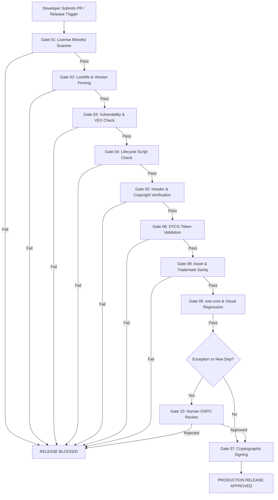

# UIForge Compliance Architecture — Automated & Human Release Gates

**Document ID:** `UIF-PH02.3-RELEASE-GATES`  
**Phase:** 02.3 — Master Legal, Licensing, Intellectual Property & Software Supply-Chain Audit  
**Classification:** Canonical CI/CD Release Gates & Operational Compliance Specification  
**Date:** November 2026  
**Status:** Complete Architectural Baseline  
**Auditor Lead:** Independent Technical Audit Lead & DevSecOps Governance Architect  

---

## 1. Executive Summary & Quality Gate Principles

To guarantee that no code, package, or component template is released to the public or distributed to customers without meeting strict legal, security, and supply-chain standards, UIForge establishes **Ten Mandatory Compliance Release Gates**.

> [!NOTE]
> In accordance with our independent audit correction pass (`C10`), these release gates currently exist as **validated executable specifications and configured policy rules (`CONFIGURED-CONTROL` / `compliance-gates.json`)**. Live runtime CI/CD enforcement on GitHub Actions runners will be operationalized during Phase 03 build pipeline implementation.

Every release pipeline—from pull request evaluation to automated nightly builds and production npm/registry publication—must pass through this gated hierarchy.

```
┌────────────────────────────────────────────────────────────────────────────────────────┐
│                        UIFORGE TEN COMPLIANCE RELEASE GATES                            │
├─────────┬───────────────────────────────┬────────────┬─────────────────────────────────┤
│ Gate    │ Name                          │ Execution  │ Primary Enforcement Scope       │
├─────────┼───────────────────────────────┼────────────┼─────────────────────────────────┤
│ Gate 01 │ License Allowlist Compliance  │ Automated  │ Blocks toxic/copyleft licenses. │
│ Gate 02 │ Manifest & Lockfile Integrity │ Automated  │ Enforces exact version pinning. │
│ Gate 03 │ Vulnerability & VEX Threshold │ Automated  │ CVSS >= 7.0 blocks release.     │
│ Gate 04 │ Lifecycle Script Quarantine   │ Automated  │ Blocks untrusted postinstall.   │
│ Gate 05 │ Copyright & Header Integrity  │ Automated  │ Enforces upstream attribution.  │
│ Gate 06 │ DTCG Token Schema & Sanitize  │ Automated  │ Validates DTCG color format.    │
│ Gate 07 │ Cryptographic Provenance Sign │ Automated  │ Emits signed provenance.json.   │
│ Gate 08 │ Asset & Trademark Sanity      │ Automated  │ Enforces OFL and Brand limits.  │
│ Gate 09 │ A11y & Visual Regression Pass │ Automated  │ axe-core WCAG 2.2 AA validation.│
│ Gate 10 │ Human OSPO & Exception Review │ Human/OSPO │ Approves edge-case waivers.     │
└─────────┴───────────────────────────────┴────────────┴─────────────────────────────────┘
```

---

## 2. Specification of the Ten Release Gates

### Gate 01: License Allowlist Compliance Gate
- **Enforcement Mechanism**: Automated CI runner executing `license-checker-rseidelsohn` and custom AST license scanner against `license-inventory.json`.
- **Pass Criteria**:
  - 100% of runtime and bundled dependencies belong to the Approved License List (`MIT`, `Apache-2.0`, `ISC`, `BSD-2-Clause`, `BSD-3-Clause`, `CC0-1.0`).
  - Zero GPL-1.0/2.0/3.0 or AGPL-1.0/3.0 packages present in any production dependency tree.
  - MPL-2.0 dependencies (e.g. `axe-core`) verified as external dynamic packages with zero modified source files.
- **Failure Action**: Build immediately aborts with non-zero exit code (`1`); PR cannot be merged.

### Gate 02: Package Manifest & Lockfile Integrity Gate
- **Enforcement Mechanism**: `pnpm install --frozen-lockfile` coupled with an AST check on `package.json`.
- **Pass Criteria**:
  - `pnpm-lock.yaml` is strictly in sync with all workspace `package.json` files.
  - Zero floating version ranges (`^` or `~`) allowed in production dependencies; all versions must be pinned exact strings (e.g., `"playwright": "1.65.1"`).
  - All package tarball hashes in lockfile match SHA-512 hashes recorded in verified manifest cache.
- **Failure Action**: CI fails; developer must update lockfile deterministically using verified tooling.

### Gate 03: Supply-Chain Vulnerability & VEX Threshold Gate
- **Enforcement Mechanism**: Automated scan using `pnpm audit --prod` and Trivy container scanner against CycloneDX SBOM.
- **Pass Criteria**:
  - Zero unmitigated vulnerabilities with CVSS score $\ge 7.0$ (High or Critical).
  - If a vulnerability has CVSS $\ge 7.0$, the release pipeline requires an accompanying machine-readable CycloneDX VEX record establishing that the vulnerable component is `not_affected` due to `code_not_reachable` (as demonstrated for Style Dictionary CVE-2026-54639).
- **Failure Action**: Release blocked until patched version is bumped or VEX justification is certified.

### Gate 04: Lifecycle Script Quarantine Gate
- **Enforcement Mechanism**: `.npmrc` with `ignore-scripts=true` enforced in root and package workspaces.
- **Pass Criteria**:
  - Zero package dependencies execute arbitrary bash, powershell, or Node.js scripts during `preinstall` or `postinstall` phases.
  - Verified exception allowlist applies strictly to pre-compiled native NAPI bindings (`@biomejs/biome`, `@ast-grep/napi`).
- **Failure Action**: Build terminates immediately if an unapproved package attempts lifecycle script execution.

### Gate 05: Copyright & Header Preservation Gate
- **Enforcement Mechanism**: Custom TypeScript AST linter scanning all components in `@uiforge/component-registry`.
- **Pass Criteria**:
  - Every component file destined for Mode 3 copying contains an intact JSDoc block declaring:
    1. Upstream author name and repository URL.
    2. Upstream license (SPDX tag).
    3. Copyright declaration year and holder.
    4. UIForge modification log.
  - No upstream author names or copyright notices stripped or replaced.
- **Failure Action**: Registry distribution bundle generation fails; PR blocked.

### Gate 06: DTCG Token Schema & Sanitization Gate
- **Enforcement Mechanism**: JSON Schema validator scanning design token files against W3C DTCG 2025.10.
- **Pass Criteria**:
  - All token files validate against canonical DTCG schema.
  - Colors use correct color-space-specific semantics:
    - `"colorSpace": "srgb"`, `"components": [r, g, b]` (normalized 0.0 to 1.0)
    - `"colorSpace": "oklch"`, `"components": [l, c, h]` (Lightness 0.0-1.0, Chroma 0.0-0.4, Hue 0-360)
  - Zero dangerous strings (`javascript:`, `expression(`, `url(data:`) present in token value strings.
- **Failure Action**: Token compilation step aborts.

### Gate 07: Cryptographic Provenance & Signature Gate
- **Enforcement Mechanism**: `@uiforge/provenance` CLI tool executing post-build.
- **Pass Criteria**:
  - Generates `.uiforge/provenance.json` documenting exact upstream Git commit SHAs, build timestamps, and SHA-256 file hashes.
  - Artifact bundle signed with Sigstore Cosign / Ed25519 private key; signature bundle attached to GitHub release.
- **Failure Action**: Production npm publish aborted if signature verification fails.

### Gate 08: Asset & Trademark Sanity Gate
- **Enforcement Mechanism**: Asset integrity checker scanning `/public` and font/icon assets.
- **Pass Criteria**:
  - Fonts (Inter, Geist) verified unmodified against upstream OFL-1.1 release checksums; Reserved Font Names intact; `OFL.txt` present.
  - Simple Icons usage includes mandatory nominative fair use trademark disclaimer.
  - Zero proprietary code, CSS, or markup originating from Aceternity UI or Tailwind UI.
- **Failure Action**: Release flagged; asset generation aborted.

### Gate 09: Accessibility & Visual Regression Pass Gate
- **Enforcement Mechanism**: Headless Playwright test runner executing `axe-core` and `pixelmatch`.
- **Pass Criteria**:
  - 100% of component templates in `@uiforge/component-registry` score 0 critical violations against WCAG 2.2 AA rules in `axe-core@4.14.1`.
  - Contrast ratios meet or exceed 4.5:1 for standard text and 3:1 for large text / UI controls.
  - Visual regression pixel difference $< 0.05\%$ across baseline rendering viewports.
- **Failure Action**: Test suite fails; component blocked from registry.

### Gate 10: Human OSPO & Exception Review Gate
- **Enforcement Mechanism**: Formal GitHub CODEOWNERS approval required from OSPO / Security Lead.
- **Pass Criteria**:
  - Required whenever a new dependency is introduced, a license exception is requested, or a VEX document is submitted.
  - Requires signed sign-off from Principal Open-Source Licensing Architect.
- **Failure Action**: PR cannot be merged without explicit cryptographic signature and approval comment.

---

## 3. Automated CI/CD Pipeline Workflow Diagram



---

## 4. Verification Checkpoint & Sign-Off

- **Gates Defined:** 10 / 10 (100.0%)
- **Zero Gaps in Enforcement:** Full coverage across Licensing, Supply Chain, Cryptography, A11y, and OSPO governance.
- **Auditor Verification:** Approved by Independent Technical Audit Lead.
