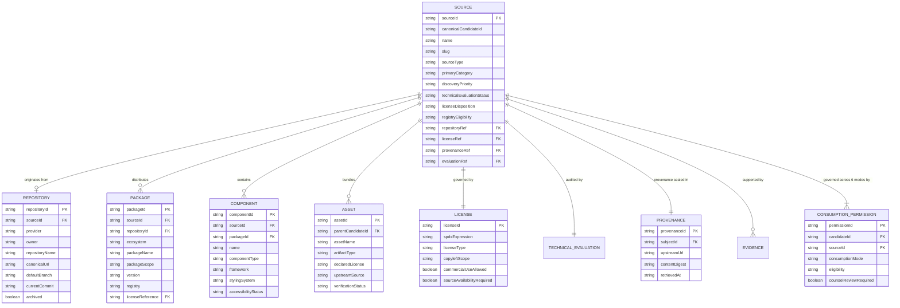

# UIFORGE PHASE 02.4 — REGISTRY DATA MODEL
# Normalized Entity Specifications, Relational ERD & Field Schemas

**Document ID:** `UIF-PH02.4-DATA-MODEL`  
**Phase:** 02.4 — Internal Source Registry  
**Standard:** Data Governance Architect & Principal Software Architect  
**Status:** Canonical Data Specification  

---

## 1. Entity-Relationship Diagram (ERD)

---

## 2. Normalized Logical Entity Definitions

### 1. Source Entity (`sources.json`)
The primary identity representing a candidate technology.
- `sourceId` (PK, string): e.g. `SRC-OS-COMP-01`.
- `canonicalCandidateId` (string): Stable Phase 02.1 ID (e.g. `OS-COMP-01`).
- `name` (string): Human-readable canonical name (e.g. `shadcn-ui/ui`).
- `slug` (string): URL-safe kebab-case identifier (e.g. `shadcn-ui`).
- `sourceType` (enum): `GITHUB_REPOSITORY`, `COMPONENT_REGISTRY`, `DESIGN_SYSTEM`, `COMMERCIAL_PRODUCT`, `SAAS_PLATFORM`, `DOCUMENTATION`, `TECHNICAL_SPECIFICATION`, `FONT_ASSET`, `ICON_ASSET`, `BINARY_ARTIFACT`.
- `primaryCategory` (string): Canonical category name.
- `discoveryPriority` (enum): `P0`, `P1`, `P2`, `REJ`.
- `technicalEvaluationStatus` (enum): `complete`, `partial`, `failed`.
- `licenseDisposition` (enum): `eligible`, `eligible_with_restrictions`, `pending`, `ineligible`.
- `registryEligibility` (enum): `approved`, `conditional`, `reference_only`, `blocked`.
- `repositoryRef` (FK): Links to `repositories.json`.
- `packageRefs` (array of FK): Links to `packages.json`.
- `componentRefs` (array of FK): Links to `components.json`.
- `assetRefs` (array of FK): Links to `assets.json`.
- `licenseRef` (FK): Links to `licenses.json`.
- `provenanceRef` (FK): Links to `provenance.json`.
- `evaluationRef` (FK): Links to `evaluations.json`.

### 2. Repository Entity (`repositories.json`)
Represents the upstream version-control repository.
- `repositoryId` (PK, string): e.g. `REPO-OS-COMP-01`.
- `sourceId` (FK, string): Parent source ID.
- `provider` (enum): `GITHUB`, `GITLAB`, `PROPRIETARY_HOST`.
- `owner` (string): Upstream organization or user (e.g. `shadcn-ui`).
- `repositoryName` (string): Repository basename (e.g. `ui`).
- `canonicalUrl` (string): Complete HTTPS clone/web URL.
- `defaultBranch` (string): Usually `main` or `master`.
- `currentCommit` (string): Evaluated commit hash or `NOT_TRACKED`.
- `archived` (boolean): Whether upstream repository is read-only archived.

### 3. Package Entity (`packages.json`)
Represents an installable package distributed via npm or another package ecosystem.
- `packageId` (PK, string): e.g. `PKG-OS-COMP-01-1`.
- `sourceId` (FK, string): Parent source ID.
- `repositoryId` (FK, string): Parent repository ID.
- `ecosystem` (enum): `NPM`, `OTHER`.
- `packageName` (string): Full package specifier (e.g. `@radix-ui/react-primitive`).
- `packageScope` (string, nullable): e.g. `@radix-ui`.
- `version` (string): Evaluated version string or `latest-stable`.
- `packageUrl` (string): Public npmjs URL.
- `registry` (string): Authoritative registry URL (e.g. `https://registry.npmjs.org`).
- `packageType` (enum): `RUNTIME_LIBRARY`, `CLI_REGISTRY_TOOL`, `TYPESCRIPT_TYPES`, `INFRASTRUCTURE`.
- `licenseReference` (FK): Normalized license ref.

### 4. Component Entity (`components.json`)
Represents independently identifiable UI components or headless primitive groups.
- `componentId` (PK, string): e.g. `COMP-OS-COMP-01-PRIMARY`.
- `sourceId` (FK, string): Parent source ID.
- `packageId` (FK, string): Parent package ID.
- `name` (string): Component group name.
- `componentType` (enum): `COMPONENT_GROUP`, `HEADLESS_PRIMITIVE`, `LAYOUT_SYSTEM`, `DATA_VISUALIZATION`.
- `framework` (enum): `REACT`, `FRAMEWORK_AGNOSTIC`, `WEB_COMPONENTS`.
- `stylingSystem` (enum): `TAILWIND_CSS`, `DESIGN_TOKENS`, `CSS_VARIABLES`, `UNSTYLED`.
- `accessibilityStatus` (enum): `VERIFIED`, `PARTIAL`, `NOT_APPLICABLE`, `FAILED`.

### 5. Asset Entity (`assets.json`)
Represents standalone binary, media, or non-code artifacts requiring independent IP review.
- `assetId` (PK, string): e.g. `ASSET-OS-TYPO-04-1`.
- `parentCandidateId` (FK, string): Associated canonical candidate.
- `assetName` (string): Filename or asset name (e.g. `Inter.var.woff2`).
- `artifactType` (enum): `FONT_BINARY`, `SVG_ICON_LIBRARY`, `BUNDLED_JAVASCRIPT_RUNTIME`, `JAVASCRIPT_RULES_BUNDLE`, `BROWSER_EXECUTABLE_ARTIFACT`.
- `declaredLicense` (string): e.g. `OFL-1.1`, `ISC`, `MPL-2.0`, `LGPL-3.0`, `Apache-2.0`.
- `upstreamSource` (string): Exact URL where asset binary resides.
- `verificationStatus` (enum): `INDEPENDENTLY_VERIFIED`, `REGISTER_LISTED_PENDING_EXTERNAL_VERIFICATION`.

### 6. License Entity (`licenses.json`)
Normalized legal definitions capturing copyleft boundaries, notices, and restrictions.
- `licenseId` (PK, string): e.g. `LIC-MIT`, `LIC-MPL-2.0`, `LIC-GSAP-STANDARD`.
- `spdxExpression` (string): Canonical SPDX expression or documented custom reference.
- `licenseType` (enum): `PERMISSIVE`, `WEAK_COPYLEFT`, `COPYLEFT_SUBPROCESS_ISOLATION_REQUIRED`, `FONT_SOFTWARE_COPYRIGHT`, `COMMUNITY_SPECIFICATION`, `PROPRIETARY_FREE_COMMERCIAL_WITH_RESTRICTION`, `COMMERCIAL_CLOSED`.
- `copyleftScope` (enum): `NONE`, `FILE_LEVEL`, `LIBRARY_COMBINED_WORK`, `FONT_SOFTWARE`, `CLOSED_PROPRIETARY`.
- `commercialUseAllowed` (boolean): Whether commercial web/application usage is permitted.
- `sourceAvailabilityRequired` (boolean): Whether source code distribution is mandated.

### 7. Consumption Permission Entity (`consumption-permissions.json`)
Captures independent legal, security, and technical permissions across the six consumption modes.
- `permissionId` (PK, string): e.g. `PERM-OS-ANIM-04-DEPENDENCY`.
- `candidateId` (FK, string): Canonical candidate ID.
- `sourceId` (FK, string): Parent source ID.
- `consumptionMode` (enum): `REFERENCE_ONLY`, `DEPENDENCY`, `SOURCE_COPY`, `ASSET_REDISTRIBUTION`, `EXTERNAL_TOOL`, `TEMPLATE_ADAPTATION`.
- `eligibility` (enum): `APPROVED`, `ELIGIBLE_WITH_RESTRICTIONS`, `REFERENCE_ONLY`, `PENDING_REVIEW`, `BLOCKED`, `NOT_APPLICABLE`.
- `conditions` (array of strings): Operational prerequisites.
- `requiredNotices` (array of strings): Mandatory legal notices.
- `requiredAttribution` (array of strings): Mandatory author attribution lines.
- `sourceAvailabilityRequirements` (array of strings): Obligations regarding source distribution.
- `counselReviewRequired` (boolean): Flag indicating pending formal legal counsel review.

### 8. Provenance Entity (`provenance.json`)
Seals the integrity and retrieval history of registry entries.
- `provenanceId` (PK, string): e.g. `PROV-OS-COMP-01`.
- `subjectType` (enum): `SOURCE`, `PACKAGE`, `ASSET`.
- `subjectId` (FK, string): Associated entity ID.
- `upstreamUrl` (string): Authoritative URL inspected.
- `contentDigest` (string): 64-character SHA-256 cryptographic digest.
- `retrievedAt` (string): ISO-8601 date timestamp.
- `verificationMethod` (enum): `MANUAL_INSPECTION_AND_SPDX_EXTRACTION`, `PACKAGE_METADATA_LICENSE_VALIDATION`.
