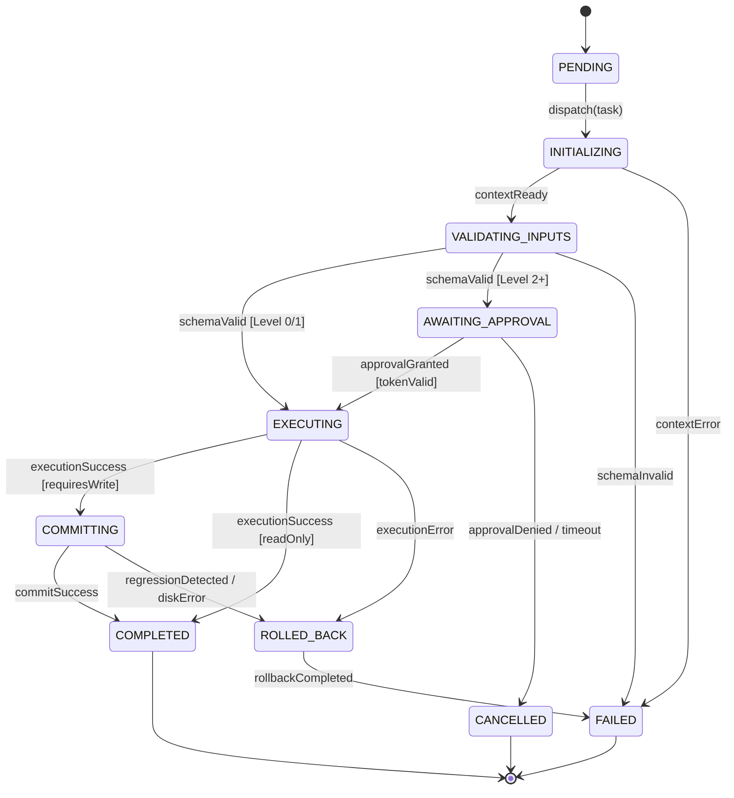
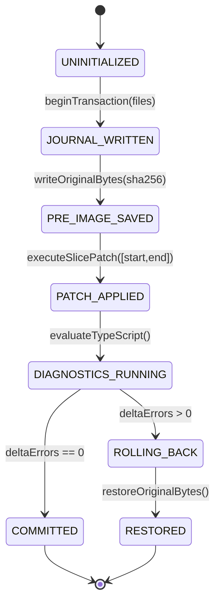
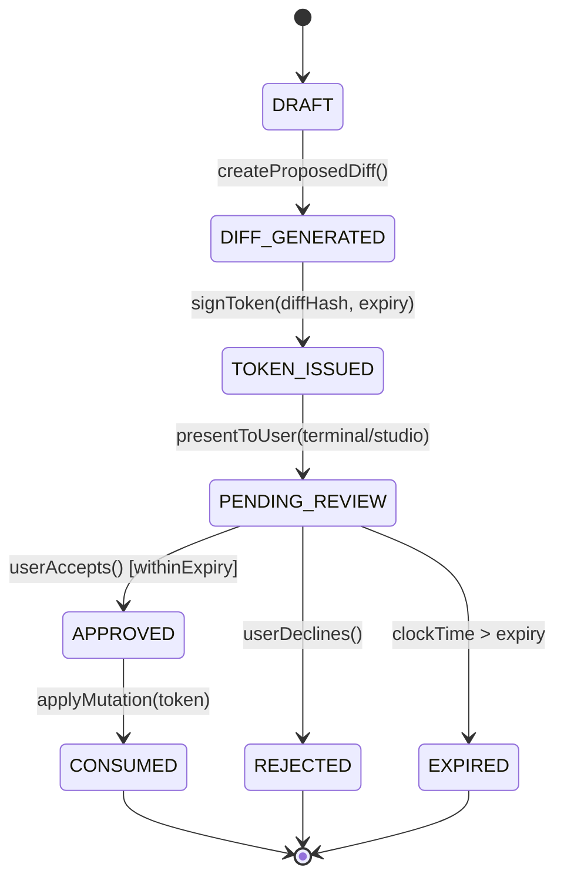

# UIFORGE — PHASE 03: FORMAL STATE MACHINES & LIFECYCLE SPECIFICATION
## Task Execution Lifecycle, WAL Transaction States & Authorization Guard Transitions

**Document ID:** `UIF-PH03-STATE-MACHINES`  
**Phase:** 03 — Product Specification & Architecture Freeze  
**Status:** Certified / Complete  
**Date:** November 22, 2026  
**Standard:** Principal Software Architect & AI Systems Architect  

---

## 1. Executive State Architecture

UIForge guarantees deterministic behavior across distributed CLI commands, long-running browser evaluations, and asynchronous AI agent MCP tool calls by enforcing formal, finite state machines.

Three primary state machines govern system execution:
1. **Task Execution State Machine:** Orchestrates high-level workflow steps and agent requests.
2. **WAL Transaction State Machine:** Manages pre-image journaling, coordinate slice patching, and atomic rollback.
3. **Authorization & Approval State Machine:** Controls human authorization token lifecycles and permission gating.

---

## 2. Task Execution State Machine

The Task State Machine coordinates all operational steps dispatched via CLI or MCP ingress:

### State Definitions & Guards:
- **`PENDING`:** Task descriptor created; queued in memory.
- **`INITIALIZING`:** Loading project context, active tokens, and configuration. Guard: project root must be readable.
- **`VALIDATING_INPUTS`:** Input parameters parsed and checked against Zod contracts. Guard: inputs must strictly match schema.
- **`AWAITING_APPROVAL`:** Mutation task halted. Unified diff and authorization challenge issued. Guard: requires human approval token signature.
- **`EXECUTING`:** Task active in target engine (AST scan, Playwright headless render, token compilation).
- **`COMMITTING`:** File mutations written to disk and verified against TypeScript Compiler API diagnostics.
- **`ROLLED_BACK`:** Automated restoration executed; filesystem reverted to pre-image bytes.
- **`COMPLETED`:** Terminal success state. Output records generated.
- **`FAILED`:** Terminal failure state. Error taxonomy code logged.
- **`CANCELLED`:** Terminal abort state. Triggered by user `Ctrl+C` (`SIGINT`) or approval denial.

---

## 3. Write-Ahead Logging (WAL) Transaction State Machine

The WAL State Machine governs filesystem safety during code modifications:

### Transition Invariants:
1. **Atomicity:** No file bytes are touched until the pre-image log (`.uiforge/wal/journal-<id>.log`) is completely flushed to disk.
2. **Diagnostic Evaluation:** The TypeScript Compiler API diagnostic comparator runs *before* marking the transaction committed.
3. **Crash Recovery:** If a crash occurs in `PATCH_APPLIED` or `DIAGNOSTICS_RUNNING`, the next UIForge process detects the uncommitted journal on startup and forces transition to `RESTORED`.

---

## 4. Authorization & Approval State Machine

The Approval State Machine governs human authorization tokens:

### Security Constraints:
- **Diff-Binding:** Authorization tokens embed the SHA-256 hash of the exact unified diff. If an agent or attacker alters the patch by even one character, the token signature fails and the write is rejected.
- **Single-Use:** Once an approved token is verified during mutation execution, it transitions to `CONSUMED` and cannot be replayed.
- **Time-to-Live (TTL):** Approval tokens carry a default 15-minute expiration window to prevent stale authorization attacks.
