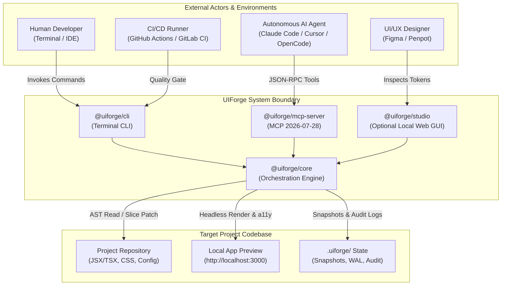
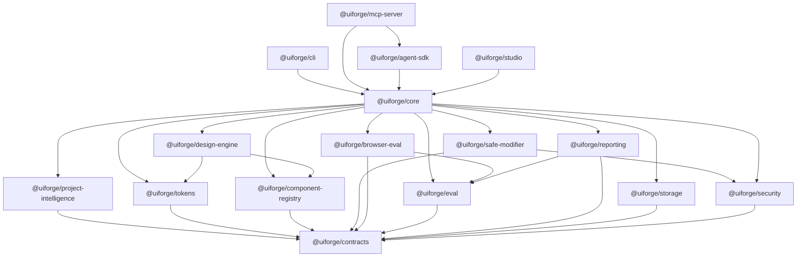
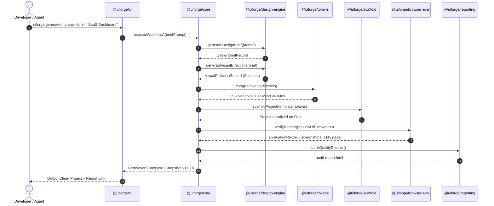
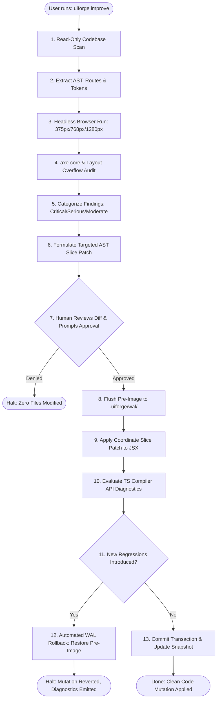
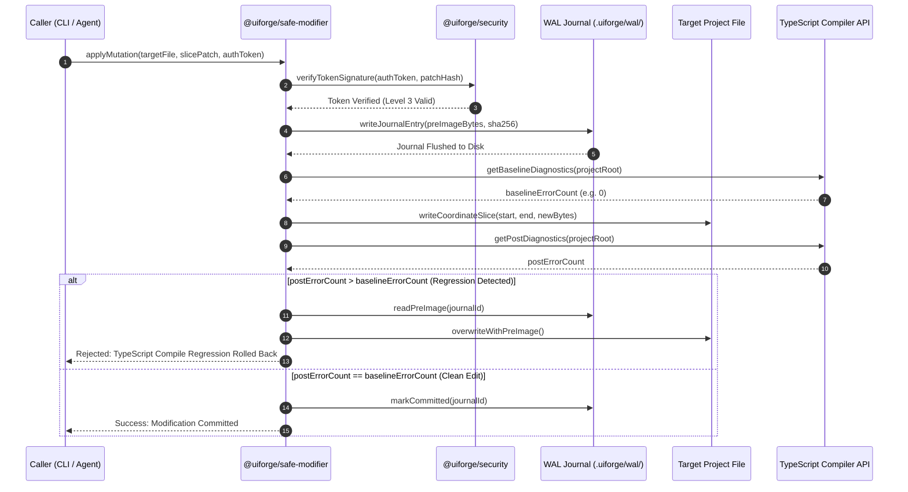
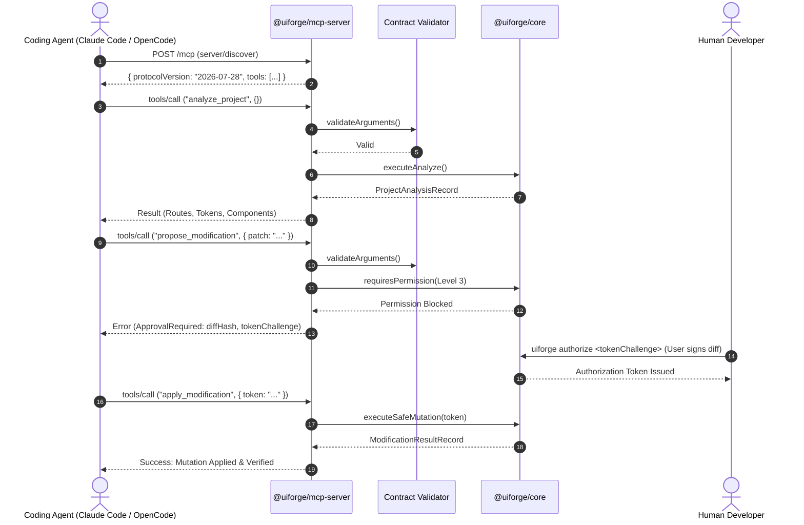
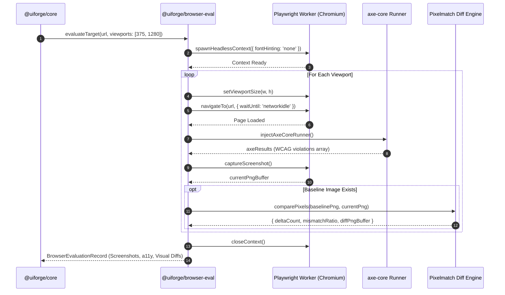
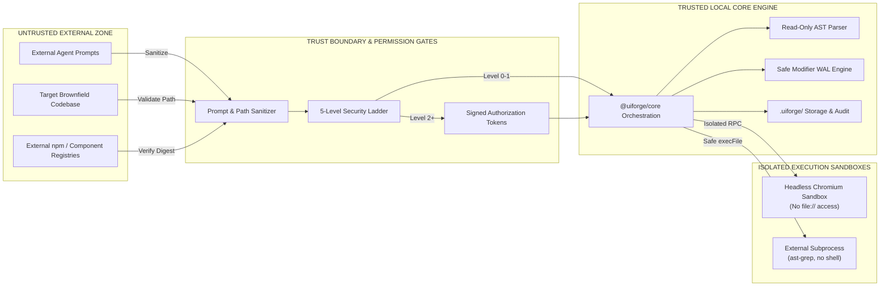
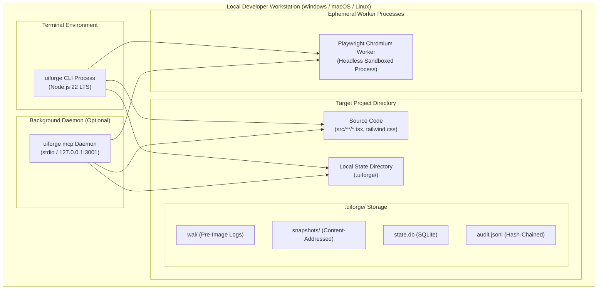

# UIFORGE — PHASE 03: ARCHITECTURE DIAGRAMS CATALOGUE
## Ten Canonical Architectural, Workflow, Sequence & Security Data-Flow Diagrams

**Document ID:** `UIF-PH03-ARCHITECTURE-DIAGRAMS`  
**Phase:** 03 — Product Specification & Architecture Freeze  
**Status:** Certified / Complete  
**Date:** November 22, 2026  
**Standard:** Principal Software Architect & Application Security Architect  

---

## 1. Executive Diagrammatic Overview

This document provides the complete suite of ten canonical architecture diagrams for UIForge. All diagrams are formulated in pure Mermaid syntax, matching the written specifications in `MASTER-SYSTEM-ARCHITECTURE.md` and `SECURITY-ARCHITECTURE.md` with zero discrepancy.

---

## 2. Diagram 1: System Context Diagram

---

## 3. Diagram 2: Container & Component Architecture Diagram

```mermaid
graph TB
    subgraph IngressLayer["1. Ingress & Interface Layer"]
        CLI["@uiforge/cli"]
        MCP["@uiforge/mcp-server"]
        AgentSDK["@uiforge/agent-sdk"]
        Studio["@uiforge/studio"]
    end

    subgraph CoreLayer["2. Core Orchestration Layer"]
        Orchestrator["@uiforge/core<br>(Workflow Coordinator & State Machine)"]
    end

    subgraph DomainEngines["3. Domain Intelligence Engines"]
        Intel["@uiforge/project-intelligence<br>(AST Scanner, Routes, Babel)"]
        Design["@uiforge/design-engine<br>(Briefs, Directions, APG)"]
        Tokens["@uiforge/tokens<br>(W3C DTCG, Style Dictionary v5.8)"]
        Reg["@uiforge/component-registry<br>(shadcn model, Phase 02.4 Pool)"]
        SafeMod["@uiforge/safe-modifier<br>(Slice Patcher, WAL, TS Comparator)"]
        Browser["@uiforge/browser-eval<br>(Playwright, Pixelmatch, axe-core)"]
        Eval["@uiforge/eval<br>(Finding Categorizer, Policies)"]
        Report["@uiforge/reporting<br>(HTML & Markdown Dossiers)"]
    end

    subgraph InfrastructureLayer["4. Infrastructure & Ground Contracts"]
        Security["@uiforge/security<br>(5-Level Ladder, Token Signer)"]
        Storage["@uiforge/storage<br>(Local Filesystem, SQLite)"]
        Contracts["@uiforge/contracts<br>(Zod Schemas & TypeScript Types)"]
    end

    CLI --> Orchestrator
    MCP --> AgentSDK --> Orchestrator
    Studio --> Orchestrator

    Orchestrator --> Intel
    Orchestrator --> Design
    Orchestrator --> Tokens
    Orchestrator --> Reg
    Orchestrator --> SafeMod
    Orchestrator --> Browser
    Orchestrator --> Eval
    Orchestrator --> Report

    Intel --> Security
    SafeMod --> Security
    SafeMod --> Storage
    Browser --> Storage
    Report --> Storage

    Security --> Contracts
    Storage --> Contracts
    DomainEngines --> Contracts
```

---

## 4. Diagram 3: Package Dependency DAG

---

## 5. Diagram 4: Workflow A Sequence Diagram (New Frontend Creation)

---

## 6. Diagram 5: Workflow B Diagram (Brownfield UI Improvement)

---

## 7. Diagram 6: Safe Modification Sequence Diagram (WAL Engine)

---

## 8. Diagram 7: Agent Integration Sequence Diagram (MCP Protocol)

---

## 9. Diagram 8: Browser Evaluation Sequence Diagram

---

## 10. Diagram 9: Trust Boundaries & Security Data-Flow Diagram

---

## 11. Diagram 10: Local-First Deployment Diagram

